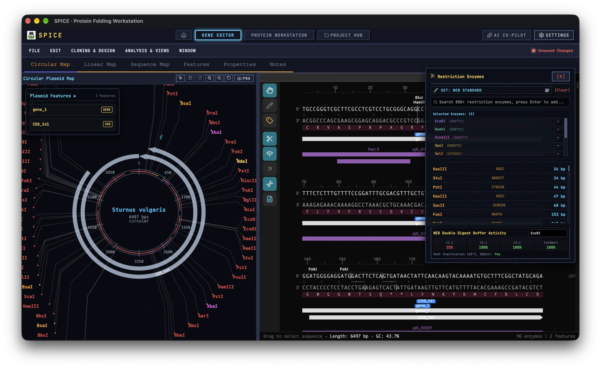

# Gene Editor

The Gene Editor is SPICE's molecular-biology workbench. It opens, edits, annotates, simulates, and designs DNA constructs: plasmid maps, restriction digests, PCR, cloning, CRISPR guides, codon optimisation, sequence QC, and ELN records. This manual walks through every menu and panel.

The editor is deliberately dense. You do not need all of it at once. Start with **File**, the six view tabs, and **Edit → Sequence Search**, then add the design and analysis panels you actually use.

## 1. Workspace layout

The workspace is a dark, full-height split view.

**Top: menu bar.** `File`, `Edit`, `Cloning & Design`, `Analysis & Views`, `Window`. Hover opens a menu on desktop; click pins it. Click outside to close. A highlighted row means that panel is already open; selecting it again closes the panel.

**Top right: dirty indicator.** A red LED with `Unsaved Changes` or a green LED with `Project Saved`.

**Project banner.** When you are editing a document embedded in a `.spiceproj`, a strip appears below the menu bar: package icon, project name › document name, a sync LED, `Save to Project (Ctrl+S)`, and `Back to Project Hub`.

**View tabs.** `Circular Map`, `Linear Map`, `Sequence Map`, `Features`, `Properties`, `Notes`. `Sequence Map` hides the left pane so the sequence gets the full width; the other tabs put the named view on the left and keep the sequence on the right.

**Main split.** Left pane defaults to 640 px. Drag the vertical divider to resize; with the divider focused, Left/Right arrows nudge by 16 px; double-click resets to 640 px.

**Sequence status bar.** With a selection it reports `Selected: start..end = N bp [x% GC] | Tm = N°C`. Without one it shows `Drag to select sequence · Length: N bp · GC: x%`. The right side reports the number of enzymes and features.

**Floating panels.** Every design and analysis tool opens as a floating window with a header. Drag the header to move it, click inside to raise it, click the red `[X]` to close. Panels cannot be resized or minimised; several can be open at once and they may overlap. If a panel is dragged off-screen, drag it back or reload.

## 2. File menu

### 2.1 Open a sequence

`File → Open Sequence File...` accepts `.spiceg`, `.dna`, `.gb`, `.gbk`, `.gbff`, `.genbank`, `.embl`, `.em`, `.fasta`, `.fa`, `.fna`, `.faa`, `.fastq`, `.fq`, `.seq`, `.txt`.

- `.spiceg` restores the full SPICE document: sequence, features, selected enzymes, selection notes, notes, ELN pages, host.
- `.dna` is SnapGene binary; sequence and features are loaded, and the map switches to the topology recorded in the file.
- GenBank, EMBL, FASTA, and FASTQ are parsed; features are imported when present, otherwise the filename becomes the plasmid name.
- Unknown text is scanned for `ATCGN`.

One file at a time. To combine constructs, use the cloning tools.

### 2.2 Drag and drop

Drag a file onto the **DNA sequence box in the `Properties` tab**. A dashed overlay reads `Drop to load plasmid/sequence (.spiceg/.dna/GenBank/FASTA)`. Dropping elsewhere does nothing.

### 2.3 Online imports

**NCBI.** `File → Import from NCBI...`. Enter a gene symbol such as `BRCA1` or an accession such as `NM_007294.4`; choose a species (ignored when you enter an accession). The import brings sequence and GenBank features.

**Ensembl.** `File → Import from Ensembl...`. Enter a gene name or Ensembl ID; the backend resolves it.

**UniProt.** `File → Import from UniProt...`. Enter an accession such as `P0DTC2`. The import uses the UniProt GFF, loads sequence and features, and switches to the linear map. Records without a usable GFF fail with a parse error.

Imports need internet access. Each import creates a history entry, so you can undo back to the previous construct.

### 2.4 SPD Gene Library

`File → SPD Gene Library` opens the shared-gene panel. It requires an SPD API token from **Settings → Public Integrations**.

- **Publish:** fill `Record name`, an optional `Symbol`, and `Gene type` (`protein_coding`, `non_coding`, `regulatory`, `other`), then click `Publish to SPD Gene`. The panel reports the published ID and offers `Details`.
- **Search:** search by name, symbol, or organism; each result has `Details` and `Load`. Loading applies the sequence, name, topology, and DNA-region features.

Publishing sends your sequence to the SPD service. Do not publish unpublished constructs.

### 2.5 Project collections

`File → Project Collections...` opens `Collections Workspace`, a local library of sequences that is independent of the current document.

- `Import Sequence File` accepts `.gb`, `.gbk`, `.fasta`, `.fa`, `.txt`.
- `Import ZIP Pack` / `Export ZIP pack` move a whole collection.
- Double-click a sequence, or click its load icon, to replace the editor content.
- Multi-select enables `Batch DpnI digestion` (cut-site counts and positions) and `Batch primer generation` (fixed 0–100 window, 60 °C target). The batch report can be copied as a tab-separated table.
- Collections live in local storage, not inside `.spiceg`. Exporting a ZIP is the portable copy.

### 2.6 Save and export

`File → Save Project` or `Ctrl/Cmd+S` writes `<plasmid name>.spiceg`. The first save opens a native dialog; later saves overwrite silently. In project mode the save goes into the `.spiceproj`.

`File → Export Current Sequence...` offers `SPICE Gene (.spiceg)`, `GenBank (.gb)`, `FASTA (.fasta)`, `EMBL (.embl)`, plus `Save project file` and `Finish & Close`.

There is no GFF/BED export in this dialog; GFF3/GTF/BED is import-only. SBOL export is in `Analysis & Views → Synthetic Biology CAD`.

### 2.7 Sanger traces

`File → Import Sanger Trace (.ab1/.scf)` loads a chromatogram into the Sanger viewer. Use this rather than the general file picker; the general importer will not parse traces.

## 3. Map views

### 3.1 Map toolbar

Both maps share a header titled `Circular Plasmid Map` or `Linear Plasmid Map` and icon buttons: `Select / click feature`, `Pan view`, `Rotate ring` (circular only), `Zoom in`, `Zoom out`, `Reset View`, and `PNG`. The PNG button exports the current view.

Mouse wheel zooms; pinch zooms on touch. `Reset View` restores zoom 1, rotation 0, and no pan.

### 3.2 Circular map

Drag with `Select` around the ring to select a base range; the selection is synchronised with the sequence viewer. `Pan` moves the ring; `Rotate` turns it visually without changing sequence coordinates.

A floating `Plasmid Features` card lists features. Click one to select its span and show `Range`, `Size`, and `Strand`. The card has no close button; it disappears when the map is not circular or has no features.

Circular enzyme labels are not clickable. To linearise at a cut site, use the linear map.

### 3.3 Linear map

`Select` and `Pan` work as above. Clicking an enzyme label opens a bubble: `Restriction Site: <name> (<pos> bp)` with `Cut plasmid here` and `Cancel`. `Cut plasmid here` rotates the whole sequence so the cut becomes base 1 and clears the selection. This is how you linearise a circular construct at a chosen site.

### 3.4 Selection toolkit

Selecting bases in the sequence or on a map shows a `Selection Toolkit` bar above the canvas with the range, size, GC, and Tm, plus:

- `Copy` copies the sequence, overlapping feature JSON, and a PNG rendering. Pasting into another SPICE sequence reconstructs the features.
- `Copy Image` exports a high-resolution PNG of the selected row.
- `RevComp` reverse-complements the selected segment in place.
- `Delete` removes the selection.
- `Cancel` clears it.

A floating `Selection Properties` card shows `Range`, `Selection Size`, `GC Content`, and `Annealing Temp (Tm)` for selections of 4–50 nt. It also has `Add Note` and `Copy`. Clicking a feature track opens a feature tooltip with range, size, GC, and estimated molecular weight for CDS features.

## 4. Sequence viewer

### 4.1 Toolbar tracks

The vertical toolbar left of the canvas has: `Browse Mode`, `Edit Mode`, `Annotate Mode`, `Show cut sites`, `Show features`, `PCR Primers & Hybridization`, `Show translations`, and `Add Note to Selection`.

The minimap above the canvas shows feature bars, the blue selection, and the viewport; click it to jump.

The sequence is drawn in 10-base blocks with numbering, enzyme labels, feature tracks, and optional translation rows.

### 4.2 Editing

Choose `Edit Mode` and click in the sequence.

- `A`, `T`, `C`, `G` insert a base at the cursor; with a range selected, the whole selection is replaced by that base.
- `Backspace` deletes the selection or the base to the left; `Delete` deletes the selection or the base at the cursor.
- Arrow keys move the cursor; `Shift`+arrows extend by one base or one row.
- `Ctrl/Cmd+C` copies, `Ctrl/Cmd+V` pastes (feature JSON is restored and shifted), `Ctrl/Cmd+S` saves.
- Only A/T/C/G are accepted as typed input; `N` can be pasted.

Click a base before typing. The empty-selection state is a cursor before base 1, so typing immediately after entering Edit Mode inserts at the very start of the sequence.

### 4.3 Annotating

`Annotate Mode`: drag a range; on release the Feature Editor opens prefilled with that range, and the tool returns to Browse Mode.

### 4.4 DNA keyboard

A virtual `DNA KEYBOARD:` with A/T/C/G, backspace, `DEL`, and `✖` appears automatically in Edit Mode on touch devices, or on desktop when **Settings → Gene Editor → Force Virtual Keyboard** is on. Closing it returns to Browse Mode.

### 4.5 Search

`Edit → Sequence Search` or `Ctrl/Cmd+F` opens `Sequence Search`. The query accepts degenerate bases (`N`, `R`, `Y`, and so on) and must be at least 3 nt. Results show `Found N matches` with `→ pos N` or `← pos N`; click a hit to select it. Reverse-complement hits are reported.

### 4.6 Display settings

`Window → Customize Settings` controls topology, feature and translation tracks, single-strand display, the background colour, and the base colour scheme. The colour schemes are `Standard Monochrome`, `AIO Standard`, `SnapGene Classic`, `Benchling Pastel`, `Sanger Channel Colors`, `Purine/Pyrimidine`, and `GC Highlight`.

`Window → Switch to: Double Strand` / `Compact Single Strand` toggles display density.

The working track toggles are the toolbar icons. `Show cut sites`, `Show ORFs`, and `Primers on map` in this panel are stored but not connected to the renderer; do not rely on them.

## 5. Features

The `Features` tab is headed `Annotations (N)` with `Add Feature...` and `Auto-Annotate`. It has a name search, a type filter (`All types` or one type), and sorting by `Start`, `Name`, `Size`, `Type`, or `Color`. Columns are `Name`, `Start`, `Size`, `Type`, with edit and delete buttons. Hovering highlights the feature; clicking selects its span.

### 5.1 Add or edit a feature

The `Feature Editor` modal has `Name`, `Start`, `End` (1-based, inclusive), `Type`, `Color`, and a `Forward strand` checkbox. The `+` next to `Type` adds a custom type. A blank name or `start > end` is rejected. Saving creates a history snapshot.

### 5.2 Auto-annotate

`Edit → Auto-Annotate`, the Features tab button, or `Customize Settings → Run auto-annotate` scans the sequence against a curated common-feature library plus the optional NCBI UniVec_Core library. The matcher can be `Seed k-mer (recommended)`, `Smith-Waterman (most sensitive)` (desktop only), or `Exact substring`. Duplicate features are skipped, so reruns are safe. New features are added with a `Auto-annotate features` history entry.

The library is curated, not exhaustive. Absence of a feature is not evidence that the element is absent.

## 6. Properties

The `Properties` tab holds document metadata and the raw DNA editor.

Fields: `Created`, `Modified`, `Sequence topology & type` (`Natural DNA`, `Synthetic DNA`, `Genomic DNA`, `Plasmid`), `Sequence Class` (`PLN`, `BCT`, `VRL`, `SYN`), `Laboratory Host`, `Description`, `NCBI Accession` (with an open-in-browser button), `Code Number`, `Author (from ORCID)`, `Comments`, `References`.

The DNA area shows `Plasmid/vector name`, a large sequence box (`Input DNA Sequence...`), and live `Length`, `Topology`, and `GC content` (warning colour outside 40–60%). This box is also the drag-and-drop target.

`Author` is read-only and comes from a verified ORCID profile in Settings. It is used by ELN signing.

## 7. Notes and ELN

The `Notes` tab is `ELN & Plasmid Notes`. It has `[Save Page]`, `[Page Manager (N)]`, a page strip (`Current Page: 1. <title>`, author, date), and a Markdown editor with buttons to insert the DNA selection, the translated protein selection, or a local image.

### 7.1 Selection notes

Select a region and use the note icon in the sequence toolbar, or the `Add a note for the current selection` block. Enter text and click `Add`. The `Selection notes table` lists each note with its range; click to jump, `[Delete]` to remove.

### 7.2 ELN signing

`ELN Digital Signing [F-25]` records the page.

1. Fill `Record title (ELN Title)`.
2. Choose `Experiment type (Category)`: `Molecular cloning`, `Polymerase chain reaction (PCR)`, `Cell transformation`, `Gel verification`, or `General experiment`.
3. Add `Reference tags (comma-separated)`.
4. Resolve the `ORCID iD` if the status is `resolve profile before signing`.
5. Enter a `Witness / Reviewer`.
6. Enter a `Signing reason`.
7. Click `Sign, archive and lock this page (.md)`.

Signing locks the page, seals the audit trail, sequence, and feature metadata with a SHA-256 digest, downloads `SPICE_ELN_<title>_<timestamp>.md`, and saves the project. A signed page becomes read-only and cannot be undone.

The signing notice references 21 CFR Part 11. Treat a signed page as a final record: correct mistakes on a new page, do not expect to edit the signed one.

### 7.3 Page manager

`ELN Page Manager` lists all pages with title, category, date, and lock state, and supports `+ New Page`, `[Delete]`, and `Finish & Close`.

Project-mode tip: keep the `.spiceproj` on backed-up storage. A signed page protects integrity, not availability.

## 8. Restriction enzymes

`Cloning & Design → Restriction Enzymes` opens `Restriction Enzymes`.

### 8.1 Selecting enzymes

Search `800+ restriction enzymes` and press Enter to add the exact match or click a suggestion. `Selected Enzymes: (N)` lists each with motif and a `-` button. `[Clear]` empties the set. The default set is EcoRI, BamHI, HindIII, XhoI, NdeI, SacI, SalI, KpnI. The selection persists in local storage.

`Select/Manage Enzyme Sets` opens `Select & Manage Enzyme Groups` with `System Presets`: `NEB Standard`, `Thermo Fisher`, `Golden Gate (Type IIS)`, `Rare Cutters (8bp+)`, `BioBrick Standard`, `MoClo Assembly`, `Blunt End Cutters`, `Methylation-Insensitive`, `Standard Lab Cloning`. You can also save a `User Custom Set`. Custom sets are local only.

### 8.2 Reading the cut sites

The cut-site list shows enzyme, motif, and position. Sites blocked by methylation are red and marked `[Blocked]`. The editor checks Dam (`GATC`), Dcm (`CCWGG`), and EcoKI (`AAC(N6)GTGC` / `GCAC(N6)GTT`) overlaps, because a blocked site will not cut in a typical E. coli prep.

`NEB Double Digest Buffer Activity` shows activity in `r1.1`, `r2.1`, `r3.1`, and `CutSmart`, coloured green/yellow/red, plus heat inactivation. Use it to choose a compatible double digest. The heat-inactivation field is unreliable in the current build; verify against the supplier's table for enzymes you plan to heat-kill.

### 8.3 A digest workflow

1. Choose a preset or add enzymes.
2. Read the cut-site list; note blocked and single-cut enzymes.
3. For a diagnostic digest, prefer two enzymes with well-separated expected fragments.
4. Check buffer compatibility for a double digest.
5. Open `Agarose Gel Simulation` and enter the expected fragment sizes in the `Digest` lane (the gel is not auto-filled from the digest).
6. To linearise the construct at one site, switch to `Linear Map`, click the enzyme label, and choose `Cut plasmid here`.
7. Save or export before running the physical digest.

## 9. Primers

### 9.1 PCR Primer Table

`Cloning & Design → PCR Primer Table` reports the first 20 nt and the reverse complement of the last 20 nt of the current sequence, with length, `Q` score, Tm, GC, GC clamp, hairpin, and self-dimer checks. It is a read-only quality table for the sequence ends, not a parameterised primer designer. For sequences under 40 bp it reports `(Sequence too short to design primers)`.

### 9.2 Primer LIMS

`Cloning & Design → Primer Inventory LIMS` manages a local primer inventory.

- `1. Register New Primer`: name, sequence, `Freezer slot (Location)` (default `Box A - A3`), then `Add primer to inventory`. Tm is computed automatically.
- `Search inventory primers with adaptive alignment` filters by name, sequence, or location.
- `Align plasmid` checks 15-mer matches against the current sequence and reports the count; rows whose full sequence occurs in the plasmid are green.
- The table shows `Name`, `Tm`, `Location`, with `[X]` to delete.
- `One-click bulk primer synthesis order export [F-24]` downloads a CSV for `Sangon`, `Tsingke`, or `IDT (USA)`. Scale (50 nmol) and purification (DSL) are fixed; edit the CSV if you need different chemistry.
- `Physical plate / freezer 2D storage view [F-26]` shows a 96-well or 10×10 map. Click an empty well to copy its coordinate into the location field; click a filled well to see details.

The inventory is local storage, not a shared database. Export the order sheet before clearing a browser profile.

## 10. PCR simulation and virtual gel

### 10.1 PCR Simulator

`Cloning & Design → PCR Simulator` has three modes.

**Standard.** Enter `Fwd (5'->3')` and `Rev (5'->3')`, then `Run PCR`. The result reports `Product Length`, `Tm`, `GC%`, and warnings. `Apply Product` replaces the editor sequence with the product; `Send to Electrophoresis` adds a lane to the virtual gel.

**Overlap Ext.** Runs overlap-extension PCR. The current build splits the current sequence in half with a 20 bp overlap; you cannot supply separate fragments or choose the overlap. For real multi-fragment assembly, use the cloning wizard or Golden Gate panel.

**Mutagenesis.** Enter `Position` and `Base`, then `Site-directed mutagenesis`; `Apply Mutation` writes the result and pushes history. Out-of-range positions error.

### 10.2 Agarose Gel Simulation

`Cloning & Design → Agarose Gel Simulation` renders a virtual gel with `Agarose%` (0.3–3, default 1.2), `Time(min)` (5–120), `Voltage(V)` (50–300), and a `Marker` (`DL2000`, `DL5000`, `DL10000`, `1kb Plus`). Lanes can be added, named, and given comma-separated band sizes. `Export Gel PNG` writes `<plasmid>_gel_<agarose>pct.png` at the export multiplier configured in Settings.

The initial `Digest` lane is empty. Enter the expected fragment sizes yourself, or send PCR products from the PCR Simulator. Migration depends on agarose percentage and run time; this is a teaching and planning view, not a calibrated prediction.

## 11. Cloning and design

### 11.1 Cloning Simulation Wizard

`Cloning & Design → Cloning Simulation Wizard...` supports `Restriction Cloning`, `Gibson Assembly`, `Golden Gate Assembly`, `In-Fusion Cloning`, `NEBuilder HiFi`, `Gateway Cloning`, `TOPO (Directional)`, `TOPO (Non-directional)`, `TA Cloning`, and `GC Cloning`.

1. Choose the method.
2. Select the insert source: `Preset` (`mTagBFP2`, `miniSOG`) or `Custom` (name + sequence).
3. Set method-specific options:
   - Restriction: `5' restriction enzyme (left)` and `3' restriction enzyme (right)`, plus vector/insert end phosphorylation.
   - Gibson/In-Fusion/NEBuilder: `Overlap length (bp)` (20–40 recommended).
   - Golden Gate: Type IIS enzyme (default BsaI).
   - TOPO: `Directional TOPO (CACC 5' overhang)`.
4. Resolve every item under `3. Validation status` until it reads `All condition checks passed`.
5. Click `Simulate ligation reaction`.
6. Review the result: method, product name, total length, parent vector, insert, enzymes, sticky-end junctions or blunt-end ligation, and warnings.
7. Click `Confirm import into design map` to replace the workspace with the recombinant construct. Or `Back to redesign`.

The import adds a CDS feature for the insert at approximate coordinates and records a cloning history entry. Verify the junction in the sequence view before ordering.

### 11.2 Advanced Golden Gate

`Cloning & Design → Advanced Cloning & Markers` → `GoldenGate Assembly` tab. Choose BsaI, BsmBI, or BbsI, enter one fragment per line as `Name,Seq` (or just the sequence), and run `Run Multi-fragment Golden Gate Assembly`. Success shows the assembly order and cohesive overhangs; `[Load Assembled Plasmid into Editor]` applies it. Failure lists the errors.

This is the tool for multi-fragment assembly. Use it rather than chaining single-insert wizard runs when fragment order matters.

### 11.3 Recombinase cloning

`Recombinase Cloning` supports `Cre-loxP (34 bp loxP)` and `FLP-FRT (34 bp FRT)`. Paste a donor insert containing the site, optionally load one of the demo scenes (`1. Integration reaction`, the loop-out excision scene, `3. Fragment inversion`), then run the simulation.

The quick-load scenes replace the entire workspace sequence with a synthetic construct. Save first.

### 11.4 DNA end modification

`Cloning & Design → DNA End Modification` edits the `5' Left End` and `3' Right End`. Each end can be `Blunt End`, `5' Overhang`, or `3' Overhang` with an overhang sequence, plus `5' Phosphorylation`. Actions are `Klenow Fill-in`, `T4 Chew-back`, `Add 5' Phosphate (PNK)`, and `Remove 5' Phosphate (CIP)`. Each action applies immediately and pushes an undo snapshot.

Use this to make vector and insert ends compatible before ligation when you are building a construct by hand.

### 11.5 Expression cassette builder

`Cloning & Design → Expression cassette builder` assembles a cassette from ordered parts. Each part has a name, a `Part role` (`Promoter`, `Enhancer`, `5' UTR`, `Translation context`, `RBS`, `Signal peptide`, `Targeting peptide`, `Linker`, `Fusion tag`, `CDS`, `3' UTR`, `Terminator`, `Poly(A) signal`, `Other`), an orientation arrow, move buttons, and a sequence. `Assemble cassette` validates `ACGTN`, joins the parts in order, and writes the sequence with annotations.

### 11.6 Vector template assembly

`Cloning & Design → Vector template assembly` combines a vector name, template sequence, insertion site (`Default (sequence end)` or a derived cut position), and an embedded cassette builder into one assembly step. `Assemble and validate` reports length, feature count, and either `Validation passed` or a list of issues.

The same panel publishes the current plasmid as an SPD `Vector Template` and lists published templates for loading. Publishing requires an SPD token.

### 11.7 Other design utilities

**Anneal Oligos.** Enter forward and reverse oligos; `Anneal` reports duplex length, Tm, overhangs, and an ASCII duplex. Read-only.

**Silent Mutagenesis.** `Add site` / `Remove site`, enter a restriction site, and `Run`. The result lists synonymous codon changes (`pos N: codonBefore -> codonAfter`) and `Apply mutations` writes them. The reading frame starts at position 1, so set the sequence start to the CDS start first. If no synonymous change exists, it refuses.

**Reverse Translate.** Paste a protein, choose the `Kazusa host` (E. coli, yeast, human), choose both/cDNA/mRNA, optionally include `stop`, then `Generate and validate`. Outputs validation status, codon count, cDNA, mRNA, and a codon trace. Copy to clipboard.

**Primer Modifier.** Adds a restriction site and protection bases to a primer's 5' end. Enter the primer, choose an enzyme and `Protection bases` (0–6), optionally 5' phosphorylation, and generate. Output is text; it is not written into the sequence.

**Fusion Frame Check.** Enter the start/end of two features and `Check reading frame`. Reports `In frame` or `Frameshift`, the offset in bp, the junction sequence, and its translation.

**Ribosomal Slippage.** Choose a preset (`SARS-CoV-2 ORF1ab (-1 PRF)`, `HIV-1 Gag-Pol (-1 PRF)`, `E. coli Release Factor 2 (+1 PRF)`) or set the motif and shift manually. Run the simulation to see the slip point, pre/post peptide lengths, the fusion length, and an alignment. `Create feature` annotates the slippery site.

## 12. CRISPR design

`Cloning & Design → CRISPR Design Cabin` designs guides and donors.

1. Choose `Endonuclease System`: `SpCas9 (NGG, 20nt)`, `SpCas9-VQR (NGA, 20nt)`, `SaCas9 (NNGRRT, 21nt)`, or `Cas12a/Cpf1 (TTTN, 23nt)`.
2. Click `Scan gRNAs`.
3. Review candidates: target sequence, strand, efficiency, specificity, score.
4. Select a row and inspect the PAM, cut index, GC content, poly-T terminator, and hairpin status. A poly-T run can terminate transcription of a U6-driven guide; a self-complementary guide is a warning sign.

Subtabs:

- **HDR Donor Design.** Enter the mutation/insert and the homology arm length. The panel returns the full donor, left and right arms, and a `PAM Silent Evasion` report. If silent evasion is impossible, Cas9 may re-cut the edited locus; redesign the guide or the donor.
- **Prime Editing (pegRNA).** Set PBS length, RTT length, edit offset, and the edit sequence. The panel returns the full pegRNA with PBS and RTT; copy it.
- **Base Editing.** Lists C→T (CBE) and A→G (ABE) candidates in the SpCas9 positions 4–8 window.

Results are copy-only; nothing is written into the plasmid. Order the guide and donor externally.

CRISPR predictions are heuristics. Confirm guide uniqueness against the relevant genome and check the donor by Sanger sequencing after editing.

## 13. Analysis and views

### 13.1 Protein Multi-View

`Analysis & Views → Protein Multi-View` translates the forward frame and reports properties, secondary structure, domains, a codon trace map, and advanced predictions. This panel is a quick look; for folding, MD, pockets, and mutation work use the [Protein Workstation](protein-workstation.md).

Some property labels in the current build are misassigned in the locale file; read values by position. Predictions are heuristic and not a substitute for experimental characterisation.

### 13.2 RNA folding

`Analysis & Views → RNA Folding Structure` folds the entire current sequence and reports a dot-bracket structure, `ΔG`, and length. Folding starts automatically. There are no parameters and no export. For a specific transcript region, copy that region into a new document first.

### 13.3 Sanger tools

**Sanger Trace Viewer.** Import `.ab1`, `.abif`, or `.scf`, and compare against the editor sequence. Shows identity and mismatches, the chromatogram, Phred bars, and Q30 highlighting.

**Sanger Clone Validator.** Paste a read, set `Min Identity Threshold (%)`, optionally allow synonymous mutations, and run. Reports `PASS`, `WARNING`, or `FAIL`, identity and coverage, variant effect predictions, and a quality profile.

Use the validator to check a clone before committing to a large prep. A perfect match over the aligned region is the usual acceptance criterion.

### 13.4 Advanced genomics

`Analysis & Views → Advanced Genomics Tools` is reactive; there is no Run button.

1. **Import GFF3/GTF/BED** appends annotated features to the current document.
2. **Salis RBS translation initiation strength**: enter the CDS start position; read TIR, binding energy, spacer penalty, and total free energy.
3. **Sigma70 promoters and TFBS**: top promoter regions and predicted factor-binding motifs.
4. **Subcellular localisation / signal peptide / TM prediction**.
5. **GC skew, CpG islands, and tandem repeats**.

These are descriptive scans. They use simplified models; confirm promoter, RBS, and localisation predictions experimentally.

### 13.5 Synthetic Biology CAD

`Analysis & Views → Synthetic Biology CAD` collects standards and compliance checks:

- `Export SBOL e-Species Map (RDF/XML)` writes `<name>_sbol2.xml`.
- BioBrick RFC 10 compatibility review.
- MoClo overhang check and assembly-level determination.
- Transformation efficiency estimate (chemical or electroporation, supercoiled or ligation product).
- Genetic circuit motif detection.
- Copy-number classification and biosecurity review, including CARD AMR screening.
- SynBioHub registry search and import. Imported parts are appended to the end of the plasmid, not inserted at a chosen site.

The AMR and biosecurity checks are screening aids, not regulatory clearance. Review any resistance marker and host range before use.

### 13.6 BLAST and evolution

`Analysis & Views → Sequence BLAST & Evolution` has four tabs.

- **Local BLAST** searches the current sequence and/or your collections. It is local, not NCBI BLAST.
- **Phylogenetic Tree** shows a neighbour-joining-style tree and a Newick string.
- **Sequence Info Logo** shows a Shannon-entropy logo.
- **2D Dot Plot** compares the current sequence with a collection using a sliding window and match threshold.

In the current build the tree and logo are demonstration views with fixed data; do not use them to infer relationships among your own sequences. Local BLAST and the dot plot do use your sequences.

### 13.7 Alignment and GC

**Import Alignment File** (`Analysis & Views → Import Alignment File`) accepts `.clustal`, `.aln`, `.fa`, `.fasta`, `.nexus`, `.nex`, `.phylip`, `.msf`, `.sto`, `.stockholm`. The file is parsed and re-aligned by the built-in aligner, and the `Sequence Alignment` panel shows width, identity, rows, and a consensus line. The re-alignment can move gaps; do not assume the imported alignment is preserved exactly.

**GC Sliding Window** computes average, minimum, and maximum GC in a fixed 50 bp window with a 10 bp step. Click `Recalculate` after changing the sequence.

## 14. QC and optimisation panels

### 14.1 NGS and genomics engine

`Cloning & Design → NGS & Genomics Engine` has four tabs:

- **FASTQ QC**: paste FASTQ text; reads, length, GC, and duplicate ratio are computed.
- **Adapter Trimming**: remove adapters from the pasted FASTQ and see the count. The trimmed FASTQ is not displayed; use a dedicated tool if you need the output file.
- **Prokaryotic Gene Finder**: ORFs of at least 90 nt with start/stop, RBS match, and a confidence score.
- **CRISPR Finder**: direct-repeat arrays with repeat count, consensus, spacers, and conservation.

### 14.2 Synthetic Gene Designer QC

`Cloning & Design → Synthetic Gene Designer QC` checks a synthetic gene before ordering:

- **Splice/PolyA**: cryptic splice sites and polyA signals, with one-click synonymous removal.
- **Kozak Opt**: context strength and one-click optimisation.
- **PTC/Nonsense**: premature stops and NMD risk.
- **Codon Pair CPB**: codon-pair bias and optimisation.
- **DUST**: low-complexity regions and lowercase masking.

These buttons write the sequence immediately and do not push an undo snapshot. Export or save before applying if you may need to revert.

### 14.3 Codon optimisation

`Cloning & Design → Codon Optimization` shows the host from Settings and the CAI, and offers `Synonymous Codon Optimization (CAI -> 1.0)`. It substitutes the single most frequent codon per residue.

This is a first pass, not a full gene-design algorithm: it does not preserve restriction sites, GC targets, repeats, or RNA structure, and it is not undoable. Follow it with Synthetic Gene Designer QC, re-check your cloning sites, and inspect the 5' region.

### 14.4 Co-design

`Cloning & Design → Co-Design Panel` scores variant candidates on protein stability and codon adaptation. Enter variants as `ID, mutation label, protein energy delta` lines, run the Pareto optimisation, and review the scatter and table. `[Apply]` loads a variant without pushing undo. Export is manual; copy the table.

### 14.5 Reaction calculators

`Cloning & Design → Reaction Calculators` has `Dilution`, `Ligation`, `MasterMix`, `Concentration`, `Gradient PCR`, `Gel Size`, `ELISA Curve`, and `Enzyme Kinetics`. Fill in the inputs and read the result. There is no export; transcribe values into your notebook.

The calculators are arithmetic aids. Check units and significant figures, and follow your lab's SOP where one exists.

## 15. History, undo, and autosave

**Undo/redo.** `Ctrl/Cmd+Z` and `Ctrl/Cmd+Shift+Z`, or `Edit → Undo` / `Redo`. Up to 100 snapshots are kept. `Window → Edit History Tree` lists snapshots by label and operation type; click one to restore its sequence and features. `Window → Activity Log` shows the last 100 actions.

Not every action pushes history. Feature edits, imports, topology flips, cloning imports, PCR apply, end modification, cassette assembly, silent mutagenesis, and SPD loads do. Codon optimisation, Co-Design apply, Synthetic Gene Designer QC fixes, protein back-mutation, and most analysis-panel edits do not. Save or export before those.

**Autosave.** `Settings → Gene Editor → Real-time Project Auto-Save` saves in the background on every edit: to the project file if one is known, otherwise to a local cache. On opening the editor, a cache is loaded automatically with `Cache automatically recovered`. Because this can replace the default workspace, save real work to a named file promptly.

**Dirty state.** The indicator turns red on any edit to sequence, features, notes, enzymes, or notebook pages. Save before switching documents or closing the app.

## 16. Keyboard shortcuts

| Shortcut | Action |
|---|---|
| `Alt+M` | Toggle circular/linear topology |
| `Alt+C` | Circular Map |
| `Alt+L` | Linear Map |
| `Alt+S` | Sequence Map |
| `Alt+F` | Features |
| `Alt+P` | Properties |
| `Alt+N` | Notes |
| `Ctrl/Cmd+Z` | Undo |
| `Ctrl/Cmd+Shift+Z` | Redo |
| `Ctrl/Cmd+S` | Save |
| `Ctrl/Cmd+R` | Reverse complement |
| `Ctrl/Cmd+F` | Sequence search |
| `Ctrl/Cmd+E` | Restriction enzymes |
| `Ctrl/Cmd+O` | Codon optimiser |
| `Ctrl/Cmd+G` | CRISPR designer |
| `Ctrl/Cmd+V` | Cloning validator |
| `Ctrl/Cmd+H` | Virtual gel |
| `Ctrl/Cmd+J` | Activity log |
| `Ctrl/Cmd+P` | Primer LIMS |
| `Escape` | Clear selection |

Shortcuts are editable in **Settings → Keymap Settings**. They are suppressed while typing in an input or editor.

In the sequence canvas: arrows move, `Shift`+arrows extend, `Backspace`/`Delete` delete, `A/T/C/G` insert or replace, `Ctrl/Cmd+C` copies, `Ctrl/Cmd+V` pastes.

## 17. A complete worked example

Build and verify a GFP expression construct.

1. `File → Open Sequence File...` and open the vector GenBank file.
2. `Properties` tab: set the name, host (`E. coli DH5alpha`), and description.
3. `Edit → Auto-Annotate`; then check `Features` and correct names and types.
4. `Cloning & Design → Restriction Enzymes`; choose the two enzymes for a directional clone; check for blocked sites and buffer compatibility.
5. Obtain the GFP insert sequence; if needed, use `Codon Optimization` for the host, then `Synthetic Gene Designer QC`.
6. `Cloning & Design → Cloning Simulation Wizard...`; choose `Restriction Cloning`; paste the insert; set the enzymes and phosphorylation.
7. Resolve validation until `All condition checks passed`; simulate; confirm the junctions; `Confirm import into design map`.
8. Inspect the recombinant sequence: promoter, RBS, CDS frame, terminator, and the two junctions.
9. `PCR Primer Table` for colony-PCR primers; `PCR Simulator` to check the expected product.
10. `Agarose Gel Simulation`: add a lane with the expected digest and colony-PCR sizes.
11. `Sequence → Save Project` (`Ctrl/Cmd+S`).
12. In project mode, open `Notes`, write the design page, fill the ELN fields, and sign the page.
13. Export the GenBank file for ordering or for your plasmid database.

## 18. Current limitations worth knowing

- The virtual gel is not filled from the selected digest; enter band sizes manually or send PCR products.
- Circular-map enzyme labels are not clickable; linearise only from the Linear Map.
- `Rotate ring` changes the view, not the sequence coordinates.
- The Primer Table always reports the sequence ends; it is not a parameterised designer.
- Overlap-extension PCR uses fixed halves and a 20 bp overlap.
- Alignment import re-aligns the file.
- The phylogenetic tree and sequence logo use fixed demonstration data.
- BLAST is local, not NCBI.
- Codon optimisation is a single-best-codon substitution.
- Some sequence-changing actions are not undoable; save first.
- A few labels in the protein and NGS panels are misplaced in the current locale.
- Floating panels cannot be resized.
- Autosave recovery can load a cached document over a fresh workspace.

For the shared concepts of projects, documents, and reproducibility bundles, see [Project Hub](project-hub.md). For protein work, see [Protein Workstation](protein-workstation.md). For lab bench analysis, see [Bench tools](tools/README.md).
