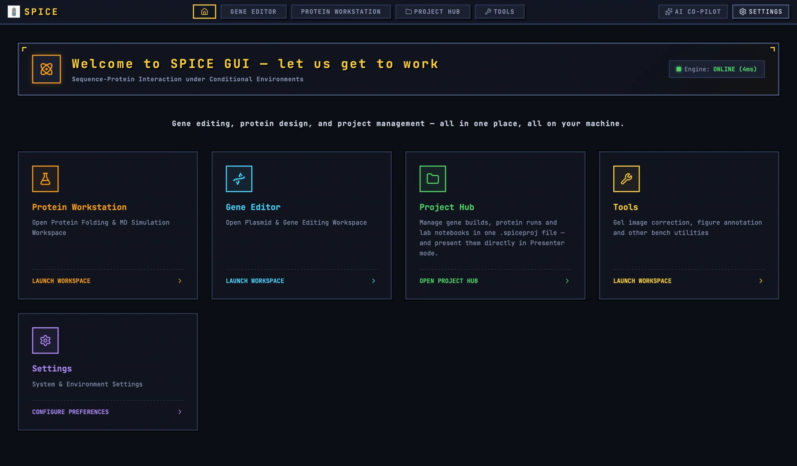

# Getting Started

SPICE GUI is a local-first desktop workbench for gene editing, protein work, and bench analysis. This page gets you from a fresh install to a first useful result.

## 1. Install

Download the package for your platform from the [releases page](https://github.com/SPICE-Protein/SPICE_GUI/releases):

- Windows: `.exe` (NSIS) or `.msi`.
- macOS: `.dmg` for Apple Silicon.
- Linux: `.deb` or `.rpm`.
- Android: universal `.apk`.

Desktop builds are recommended for analysis and figure preparation. The Android build is available for tablet and phone use, but some model and file workflows are easier on a desktop.

## 2. First launch

The welcome page has five cards: **Protein Workstation**, **Gene Editor**, **Project Hub**, **Tools**, and **Settings**. The top bar is always available:

- **Home** returns to the welcome page.
- **Gene Editor**, **Protein Workstation**, **Project Hub**, and **Tools** switch workspaces.
- **AI Co-Pilot** opens the optional assistant.
- **Settings** opens language, theme, models, identity, databases, and keymap.

The engine status chip reports **ONLINE (Nms)** or **CONNECTING**. A failed ping leaves it at CONNECTING rather than showing an explicit offline state; if folding or MD fails, check the activity log and Settings.

The interface defaults to Chinese. To switch to English:

1. Open **Settings**.
2. Choose **General Settings**.
3. Set **Interface Language:** to English.
4. The change applies immediately and is saved locally.

The workbench requires landscape orientation. On a tablet or phone in portrait, a full-screen prompt asks you to rotate the device.

## 3. Understand the two storage modes

SPICE GUI has two ways to keep work:

**Standalone.** Open a tool from the Tools hub and use its own **Save project**/JSON export. This is convenient for a quick analysis, but the project is not connected to a study.

**Project.** Create or open a `.spiceproj` in the Project Hub and open documents from there. The project embeds gene, protein, and tool documents, journal pages, and attachments. Use this mode for anything that needs to be archived or shared.

A project is a single file. Copying it to lab storage is the primary backup. Local snapshots and the Known Projects registry are convenience features, not portable records.

## 4. Configure the models

Two models are configured in **Settings → General Settings**.

### 4.1 GelGenie

GelGenie is the released image model for gel and western-blot segmentation. It is Apache-2.0, about 57 MB, and runs locally.

1. Open **GelGenie detection model**.
2. Leave the default URL unless your lab mirrors it.
3. Enter a proxy if needed.
4. Click **Download GelGenie model**.
5. Wait for **GelGenie model is ready**.
6. Check the path and size.

The default URL is checksum-verified. A custom URL is downloaded without the default checksum check. The model is used by **AI detect (GelGenie)** in the gel and western-blot tools.

### 4.2 SPICE protein model

The SPICE model is a separate ONNX checkpoint used by the Protein Workstation. It is still under development and training; fold, mutation, and MD results are exploratory and not publication-ready.

1. Open **ONNX Neural Network Model**.
2. Enter the absolute checkpoint path and click **Apply**, or use **Model Weights URL** and **Download**.
3. Check **Model Load Status** and **Output Heads**.

The path override is current-process only. If you restart the app, set it again or place the checkpoint in a default candidate location. Without a model, the Fold tab reports an ONNX error.

## 5. Your first 15 minutes

This sequence exercises the main paths without needing a lab sample.

### 5.1 Create a project

1. Open **Project Hub**.
2. Click **New Project**.
3. Enter a name and click **New Project**.
4. Save the `.spiceproj` somewhere you can find it.

### 5.2 Try a gene map

1. Open **GENE EDITOR**.
2. Use **File → Open Sequence File...** to load a GenBank or FASTA file. To drag and drop, drop the file on the DNA sequence box in the **Properties** tab.
3. Look at the circular map, feature list, and restriction-enzyme panel.
4. Open **CLONING & DESIGN** and inspect the available cloning methods.
5. Do not save over a real construct until you understand the workspace tabs and undo behavior.

### 5.3 Try a gel or blot

1. Open **TOOLS → Gel figure tool** or **Western blot densitometry**.
2. Import a real image.
3. Click **Auto draft** in the gel tool, or **Auto detect** in the blot tool.
4. Inspect the lanes and bands; correct anything wrong.
5. If the GelGenie model is downloaded, click **AI detect (GelGenie)** and compare.
6. Export a PNG or CSV, then save the project document.

### 5.4 Capture the work into the project

1. Return to **PROJECT HUB**.
2. Use **+ Add from Gene Workspace** or the tool capture button.
3. Open the captured document and confirm the data is there.
4. Write a journal page describing what you did.
5. Save the project.

## 6. Find the right guide

| You want to… | Read |
|---|---|
| Learn every Gene Editor panel and analysis tool | [Gene Editor](gene-editor.md) |
| Fold, verify, scan, or mutate a protein | [Protein Workstation](protein-workstation.md) |
| Quantify a gel, blot, qPCR plate, or colony plate | [Bench tools](tools/README.md) |
| Assemble a publication figure | [Figure Studio](tools/figure.md) |
| Archive documents and write an ELN | [Project Hub](project-hub.md) |
| Configure models, language, SPD, ORCID, or keys | [Settings](settings.md) |
| Use the AI assistant safely | [AI Co-Pilot](ai-copilot.md) |
| Fix a problem | [Troubleshooting](troubleshooting.md) |

## 7. File formats at a glance

| Extension | What it is |
|---|---|
| `.spiceproj` | Project container: metadata, embedded documents, journal pages, attachments. |
| `.spiceg` | Gene document: sequence, features, primers, notes, notebook. |
| `.spicep` | Protein package: sequence, environment, coordinates, simulation history, metrics. |
| `.json` | Standalone tool project or import/export payload. |
| `.csv`, `.tsv` | Results, sample sheets, plate maps, marker tables. |
| `.svg`, `.png`, `.tiff`, `.pdf`, `.pptx` | Figure and presentation exports. |
| `.zip` | Reproducibility bundle or batch output. |

## 8. Offline and privacy

The Gene Editor, Tools, Project Hub, local files, and GelGenie inference work offline. Internet access is needed only for optional features:

- SPD publishing and lookups.
- Database syncs (REBASE, CARD, IGSC).
- RCSB/NCBI/UniProt queries.
- A remote AI endpoint.
- Downloading the SPICE or GelGenie model.

Images and sequences stay on the machine unless you explicitly publish or use a remote AI endpoint. See [Data and safety](data-and-safety.md) for the full picture.

## 9. Where to get help

- [Troubleshooting](troubleshooting.md) covers models, detection, exports, and project files.
- The [releases page](https://github.com/SPICE-Protein/SPICE_GUI/releases) has the current installers and release notes.
- The [project README](../README.md) describes the architecture and development setup.
