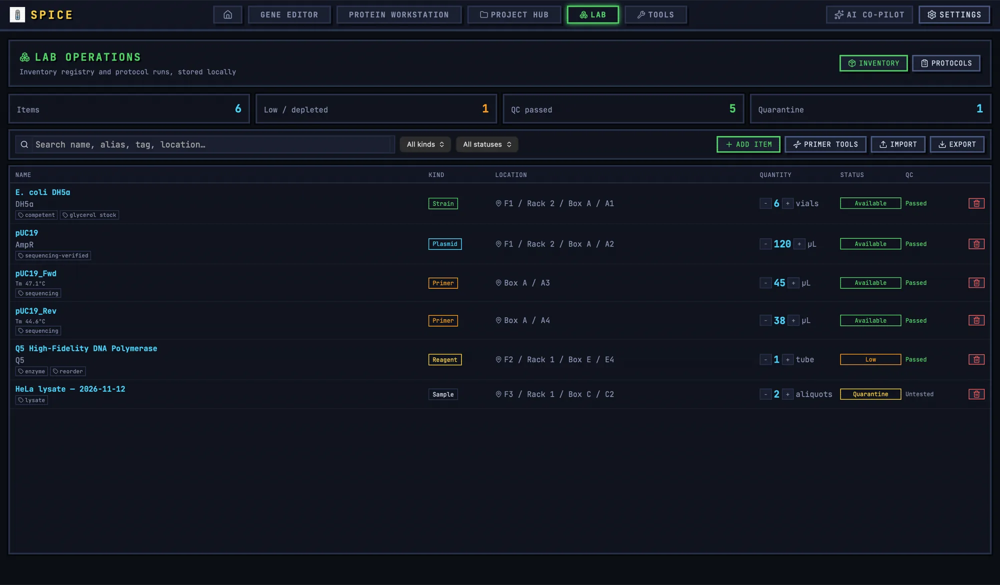
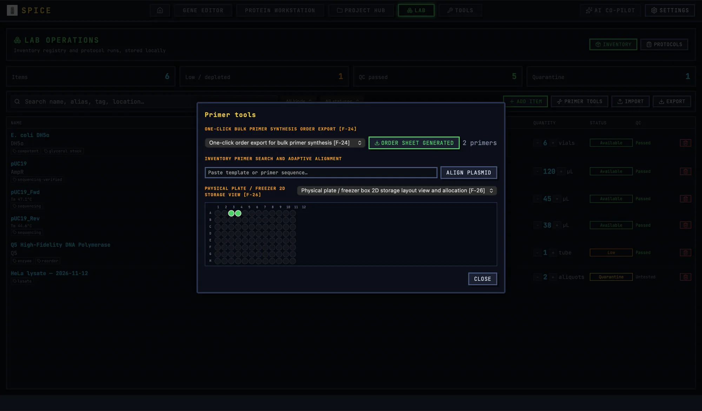
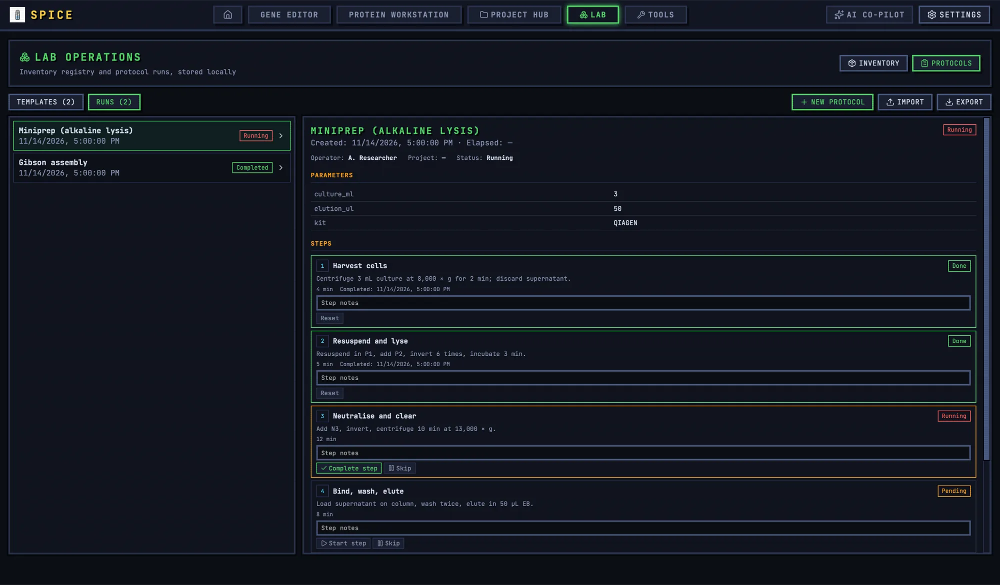

# Lab Operations

**Applies to:** SPICE GUI v0.5.0

The **Lab** workspace records what is physically in the lab and what was done with it. It has two tabs: **Inventory** for strains, plasmids, primers, reagents, and samples, and **Protocols** for reusable protocol templates and the runs executed from them. Both are local-first and export as portable JSON.

## 1. Inventory

### 1.1 Add an item

Click **Add item**, give the item a name, and fill in whatever you know. Name is the only required field; everything else can be added later.

| Field | Purpose |
|---|---|
| **Kind** | Strain, plasmid, primer, reagent, or sample. |
| **Status** | Available, low, depleted, quarantine, or archived. |
| **QC** | Untested, passed, or failed. |
| **Quantity and unit** | Remaining amount, for example `4` `vials`. |
| **Concentration and unit** | Optional stock concentration. |
| **Location** | Freezer, rack, box, and position, so the item can be found at the bench. |
| **Organism, genotype, description** | Strain and plasmid context. |
| **Sequence / notes** | Sequence, lot notes, or handling instructions. |
| **Tags** | Free-form labels such as `glycerol stock` or `sequencing-verified`. |
| **Derived from** | One or more parent items, used to build lineage. |
| **Project and linked document** | Associates the item with a `.spiceproj` and one of its documents. |

Editing an item opens the same form. The **Edit** action is on the row; delete is the bin icon and asks for confirmation.

### 1.2 Find and filter

The search box matches name, alias, tags, and location. The two selectors filter by kind and by status. The four counters above the list show total items, low or depleted items, QC-passed items, and quarantined items.

### 1.3 Quantity changes

The `+` and `−` buttons next to a row adjust the quantity by one. When quantity reaches zero, set the status to **Depleted** yourself; the app does not change status automatically.

### 1.4 Lineage

An item whose **Derived from** field lists parents shows a lane count in the list. Open the item to see the lineage chain. Lineage is advisory metadata; removing a parent does not remove children.

### 1.5 Primer tools

Primers are ordinary inventory items with **Kind = Primer**; the list shows the calculated Tm for any primer that has a sequence. The **Primer tools** button opens the primer-specific utilities that used to live in the Gene Editor.

- **Order sheet.** Choose Sangon, Tsingke, or IDT and download a CSV containing every primer in the inventory. Scale is fixed at 50 nmol and purification at DSL; edit the CSV if you need different chemistry.
- **Match.** Paste a template or a designed primer sequence. The matcher uses 15-mer overlap against every primer with a sequence and lists the matching primers with Tm and location.
- **Freezer map.** Shows a 96-well or 10×10 grid built from the **Position** field of primer items. Filled wells are green; hover to see the primer name. Duplicate positions are reported above the grid.

Primers created in older builds are imported automatically the first time the Lab page opens. The old data is converted to primer items tagged `lims-migrated`, and the original browser key is left in place as a recovery copy.

### 1.6 Import and export

**Export** writes the whole inventory as JSON. **Import** accepts a JSON file produced by another SPICE GUI install and merges it by item ID: items with the same ID are replaced, new IDs are appended. Import never deletes items that are missing from the file.

## 2. Protocol templates

A template is a reusable protocol definition: parameters, ordered steps, and optional timing and temperature for each step.

### 2.1 Create a template

Open **Lab → Protocols → Templates** and click **New protocol**. Set a name and category, then build the parameter and step lists.

Parameters appear in the run start dialog. Each parameter has a key, a display label, a type (text, number, select, or boolean), and a default value. Use parameters for anything that changes between runs, such as `template_dna_ng`, `annealing_temp_C`, or `enzyme`.

Steps appear in the run sheet in order. Each step takes a title, instructions, an optional duration in minutes, and an optional temperature in °C. Instructions are free text and can include calculations or safety notes.

### 2.2 Library import and export

Templates and runs live in one library file. **Export** writes the library; **Import** replaces templates and runs with matching IDs and appends the rest. Export before a major import if you want a rollback point.

## 3. Protocol runs

### 3.1 Start a run

Click **Start run** on a template card, or start one from a project journal page (see section 4). Choose the parameter values, an operator, and optionally a project and journal page. The run copies the template, so later edits to the template do not change an existing run.

### 3.2 Execute steps

Open **Lab → Protocols → Runs** and select the run. Each step has **Start**, **Complete**, **Skip**, and **Reset**. Step status moves from pending to running to done or skipped, and start and completion timestamps are recorded.

Record observations in the step notes, and write the overall outcome, measurements, or deviations in **Results**. **Save results** stores the text against the run.

### 3.3 Finish or abort

**Complete run** stamps the completion time and keeps the run as a finished record. **Abort run** marks it aborted; steps that were not executed keep their status. Neither action deletes data, and a run can still be edited afterwards for notes.

### 3.4 Run sheet

**Run sheet** renders the parameter table, the numbered steps with checkboxes, and the results as Markdown. Copy it to the clipboard or download it as a file. When the run is linked to a journal page, **Insert into journal** appends the run sheet to that page's Markdown.

## 4. Linking runs to the Project Hub

A journal page can own one protocol run. Open the page at **Project Hub**, then click **Start protocol run** in the page header. Pick a template, fill the parameters and operator, and start.

The page header then shows the run name and status instead of the button. Click it to jump to the run in **Lab → Protocols → Runs**. A run started this way is linked to the project and page, so **Insert into journal** works from the Lab side as well.

Start the run from the journal page rather than from Lab when the run belongs to a project: the Lab dialog can attach a project and page, but the journal-page shortcut pre-fills both and stores the link on the page.

## 5. Storage and backup

Inventory and protocol data are kept in the app's local storage and are separate from `.spiceproj` files. They survive closing the app but not clearing application data, so export both libraries regularly.

| Item | Export format | Where it is stored |
|---|---|---|
| Inventory | JSON (`SPICE_INVENTORY`) | Local storage under `spice_inventory_items`. |
| Protocol templates and runs | JSON (`SPICE_PROTOCOL_LIBRARY`) | Local storage under `spice_protocol_library`. |

To move a lab record set to another computer, export both libraries there and import them in the same order. Do not edit the JSON by hand unless you intend to repair a specific record; the import validator rejects files with an unexpected `format` or `version`.
