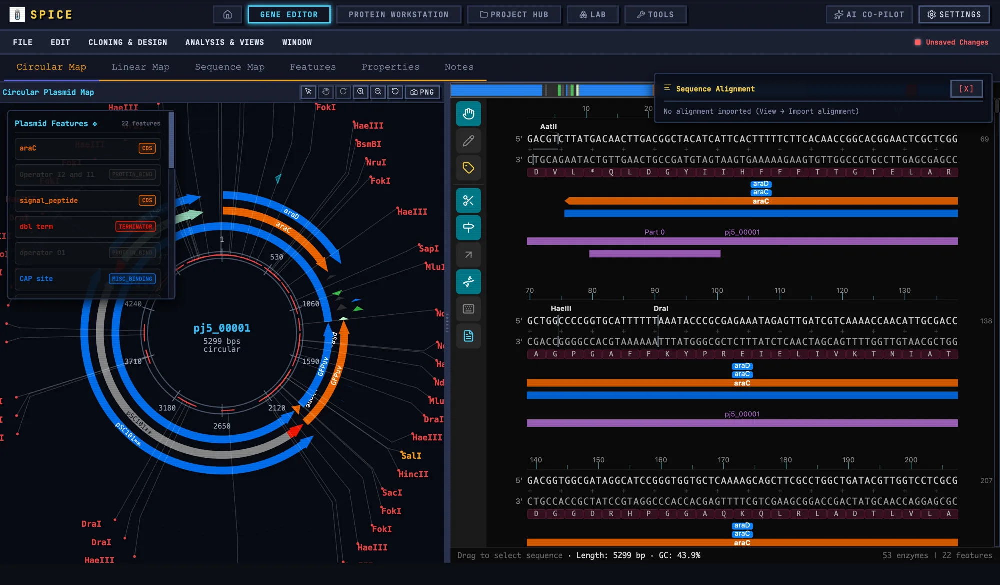

# Sequence Alignment

The Sequence Alignment panel is a read-only viewer for multiple sequence alignments. It shows the alignment width, an overall identity figure, each aligned row and a consensus row. Alignments enter the panel through **Analysis & Views → Import Alignment File**; parsing and alignment run on the local machine, with no network request.

**Menu:** **Analysis & Views → Sequence Alignment** · **Type:** floating panel

## What it does

Opening the panel shows the most recent imported alignment, or the message “No alignment imported” when nothing has been loaded. The panel itself has no algorithm chooser, scoring controls or editing tools: it parses a file, recomputes an alignment in TypeScript and displays the result.

Import uses a progressive aligner. The first record becomes the reference, and each remaining sequence is aligned to the growing master with a semi-global pairwise dynamic-programming alignment using match +2, mismatch −1, gap open −5 and gap extend −1. The import path does not call the Rust MAFFT command; it is entirely the built-in TypeScript implementation.

## How to use

1. Open the panel from **Analysis & Views → Sequence Alignment**.
2. Choose **Analysis & Views → Import Alignment File**.
3. Select a Clustal, FASTA, NEXUS, PHYLIP, MSF or Stockholm file; the file picker accepts `.clustal`, `.aln`, `.fa`, `.fasta`, `.nexus`, `.nex`, `.phylip`, `.msf`, `.sto` and `.stockholm`.
4. The import runs, the panel opens automatically and the alignment appears.
5. Read the rows; scroll horizontally if the alignment is wider than the panel.
6. Close the panel with `[X]` or toggle the menu item again.

## Inputs and results

| Field | Meaning |
|---|---|
| Alignment file | Local text file containing two or more sequences; the format is detected from the header. |
| Width | Number of columns in the recomputed alignment. |
| Identity | Percentage of columns in which every row matches the first row. |
| Name | Record identifier, truncated to 12 characters in the display. |
| Aligned row | Gapped sequence after recomputation. |
| Consensus | Majority character in each column; a gap can become the consensus. |
| “No alignment imported” | Empty state shown until a file is imported. |

## Limits and caveats

- The file is not displayed verbatim. Sequences are re-aligned, so the original column layout and gap placement are not preserved; gap characters in the first record are retained in the master row, while gap characters in other records are treated as ordinary characters.
- There is no mode or scoring control. The alignment is always semi-global with the fixed scores listed above.
- Identity is a whole-alignment column score against the first row, not a pairwise identity or a percentage of the consensus.
- Import parsers are deliberately small: PHYLIP is read as sequential PHYLIP with names clipped to ten characters, NEXUS is read from the `MATRIX` block only, and an unrecognised format falls back to FASTA parsing. Malformed records are skipped rather than reported individually.
- The panel validates neither DNA nor protein alphabets and performs no reverse-complement handling.
- There is no export or save control. The alignment lives only in the panel and is not written into the editor document or the project file.
- The empty-state hint says “View → Import alignment”; in the current menu the command is **Analysis & Views → Import Alignment File**.
- No network request is made at any point.

## Related

- [Gene Editor](../../gene-editor.md)
- [Sequence BLAST & Evolution](blast-evolution.md)
