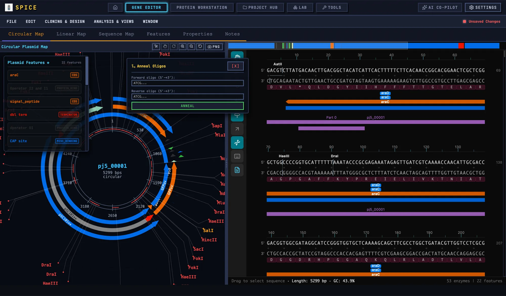

# Anneal Oligos

The Anneal Oligos panel aligns a forward and a reverse oligonucleotide and draws the duplex they could form, including any single-stranded overhangs. It reports the duplex length, melting temperature, and the overhang at each end. It is a design aid: the result is displayed in the panel and is not inserted into the open document.

**Menu:** **Cloning & Design → Anneal Oligos** · **Type:** floating panel

## What it does

Both oligos are entered 5'→3'. The reverse oligo is treated as the bottom strand, so the panel reverse-complements it internally and then slides it against the forward oligo, keeping the offset with the most complementary base pairs. Characters other than A, C, G, T, and N are removed before alignment. The panel draws the aligned duplex as two lines with `-` marking gaps, then lists the duplex length, Tm, and left and right overhangs. Nothing is written to the document and no history entry is created.

## How to use

1. Open **Cloning & Design → Anneal Oligos**.
2. Enter the forward oligo in **Forward oligo (5'->3')**; this is the top strand.
3. Enter the reverse oligo in **Reverse oligo (5'->3')** as it would be synthesised; do not reverse-complement it yourself.
4. Click **Anneal**.
5. Read the duplex length, Tm, overhangs, and the two-line alignment sketch.
6. Edit either oligo and click **Anneal** again to recompute; the previous result is replaced.
7. Close the panel with **[X]** when finished; the entered oligos and last result stay in the panel state until you change them.

Both inputs must contain at least 4 bases. If either is shorter, the run is refused with a message and no result is shown.

## Inputs and results

| Field | Meaning |
|---|---|
| Forward oligo (5'->3') | Top strand, written 5'→3'; at least 4 bases after non-DNA characters are removed. |
| Reverse oligo (5'->3') | Bottom strand, written 5'→3'; at least 4 bases; reverse-complemented internally for alignment. |
| Duplex length | Number of base pairs in the best-scoring alignment, in bp. |
| Tm | Melting temperature of the duplex region in °C, rounded to one decimal place. |
| Left overhang | Unpaired bases reported at the left end, printed as the overhang sequence followed by `bp`. |
| Right overhang | Unpaired bases reported at the right end, in the same format. |
| Warnings | Shown when an oligo is under 4 bases or when fewer than 4 bases can pair. |
| Alignment sketch | Two-line top/bottom representation of the duplex; `-` marks gaps. |

An overhang of zero bases leaves the value blank before the unit. The Tm is calculated from the GC content and length of the paired region, and the panel rounds it before display.

## Limits and caveats

The panel finds one ungapped alignment that maximises complementary pairs; it does not model internal loops, bulges, or a thermodynamic nearest-neighbour Tm. Mismatched bases inside the overlap stay in the alignment but are not counted as pairs, and `N` is accepted in the input but never pairs. There is no salt, primer-concentration, or magnesium correction, so treat the Tm as a rough estimate rather than an annealing protocol.

There is no **Apply** or **Insert** control. To use the product, copy the relevant sequence from the alignment sketch or the original oligo fields into the Gene Editor yourself. Overhang readouts show the bases followed by the unit, not a separate count.

## Related

- [Gene Editor](../../gene-editor.md)
