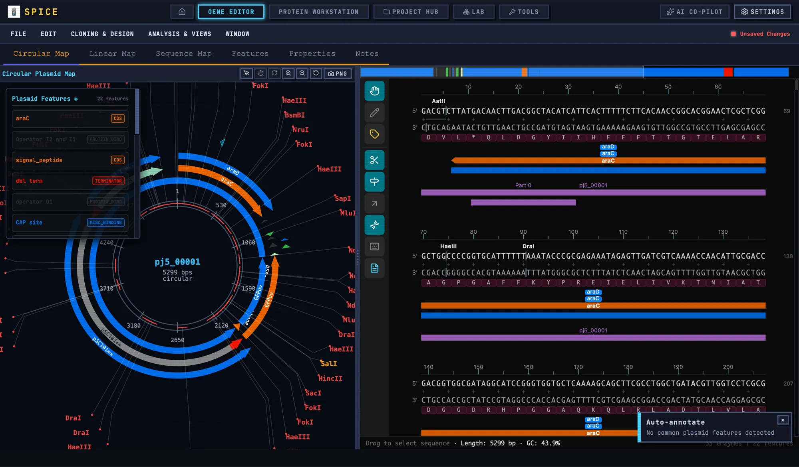

# Auto-Annotate

Auto-Annotate scans the open DNA sequence on both strands for common plasmid elements and appends every match to the document as an editable feature. It searches a small built-in library, optionally extended with a synced UniVec_Core set, and reports the outcome in a toast rather than in a panel.

**Menu:** **Edit → Auto-Annotate** · **Type:** neither a floating panel nor a modal — an immediate command that runs against the current document and reports through a toast

## What it does

The command compares the current sequence against a library of named elements. The built-in library holds T7, SP6, and lac promoters, the T7 terminator, the pMB1 origin, AmpR, KanR, and CmR, the His, FLAG, HA, Myc, and GST tags, and a multiple cloning site. If **Use UniVec_Core** is enabled, the synced UniVec_Core vector and part entries are appended to the same library. The library toggle and the matcher live in **Window → Customize Settings** under **Auto-annotate · feature DB (REBASE-style sync)**, and both choices are remembered locally.

Three matchers are available. **K-mer**, the default, seeds on the first 22 bases of each element, tolerates a small number of mismatches while extending, accepts an extension of at least 24 bp and at least 60% of the element, then merges same-name hits on the same strand within 6 bp. **Exact** requires a full-length forward or reverse-complement substring match and skips elements shorter than 8 bp. **Smith-Waterman** sends the sequence and library to the Rust backend for local alignment; it exists only in the desktop build, and the browser build silently uses k-mer when it is selected.

Matches are converted from the library's 0-based inclusive coordinates to 1-based inclusive feature coordinates, coloured by inferred type, and appended to the existing feature list. No existing feature is modified or removed. A candidate with the same name, start, and end as an existing feature is skipped, so running the command twice adds nothing the second time. When new features are added the command pushes one `Auto-annotate features` history entry and the project becomes dirty; the sequence itself is unchanged.

## How to use

1. Open the sequence you want to annotate in the Gene Editor.
2. Optionally open **Window → Customize Settings**, choose a **Matcher**, and enable or disable **Use UniVec_Core public DB (NCBI)**. Use **Resync** there to refresh the UniVec entries.
3. Choose **Edit → Auto-Annotate**. The same command is also offered as **Auto-Annotate** in the **Features** tab header and as **Run auto-annotate** in the settings panel.
4. Wait for the toast. A successful run reports `Auto-Annotation Complete` with the number of added features; no match reports `No common plasmid features detected`; a repeat run reports that every match already exists.
5. Open the **Features** tab to review, edit, or delete the added entries. Clicking a row selects its span in the sequence view.
6. Undo the whole run with **Edit → Undo** or the keyboard shortcut; one history entry restores the previous feature list.

## Inputs and results

| Field | Meaning |
|---|---|
| Sequence | The open document sequence, searched on the forward and reverse-complement strands. |
| Built-in library | The curated promoter, origin, resistance, tag, and cloning-site elements listed above. |
| Use UniVec_Core public DB (NCBI) | When enabled, adds the synced UniVec_Core entries to the same library. Enabled by default; the synced list may be empty if the sync has not succeeded. |
| Matcher | `K-mer`, `Exact`, or `Smith-Waterman`; Smith-Waterman is desktop-only and falls back to k-mer in the browser. |
| Added features | One feature per merged hit, with name, type, 1-based inclusive start and end, strand, and colour. |
| Toast | Run outcome: features added, nothing detected, or no new features because the matches already exist. |
| Activity log | One line `[AutoAnnotate/<matcher>] Added N features (library: M entries)` on a run that adds features. |

Features are appended, never replaced. Their coordinates are inclusive, so a 20 bp element starting at position 0 in the matcher becomes start 1 and end 20 in the document. A feature that hits several nearby positions under the same name and strand is merged into one span.

## Limits and caveats

This is library matching, not gene prediction. It finds only elements present in the built-in library or in the synced UniVec_Core set; an unlisted promoter, resistance gene, or origin is not detected, and no ORF calling is performed. The built-in set is deliberately short, so a plasmid with no T7, SP6, lac, pMB1, AmpR, KanR, CmR, tag, or MCS sequence legitimately returns no features, as in the screenshot.

K-mer matching can return partial or divergent hits and can miss elements whose first 22 bases differ. Exact matching misses any element with a single substitution or indel. Smith-Waterman is desktop-only and may find local alignments that the other matchers miss, but it depends on the bundled backend. The duplicate check is name plus exact span only; re-running with a different matcher can therefore add a second overlapping copy of the same element.

Matching is linear over the stored string. On a circular map, an element that crosses the numbering origin is not detected. Annotation never deletes or re-types existing features, and it does not upload the sequence anywhere; the only network activity is the optional UniVec sync, which is started separately at application startup or from the settings panel.

## Related

- [Gene Editor](../../gene-editor.md)
- [Sequence Search](search.md)
- [Customize Settings](settings.md)
