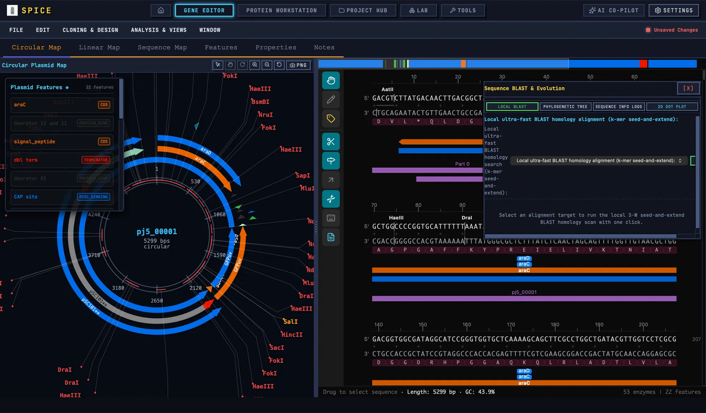

# Sequence BLAST & Evolution

The Sequence BLAST & Evolution panel groups four local analyses of the sequence loaded in the Gene Editor: a seed-and-extend homology search, a neighbour-joining tree, a Shannon-entropy sequence logo and a 2D dot plot. The BLAST tab compares the editor sequence with sequences already held in the project; it does not submit the sequence to NCBI or any other remote BLAST service.

**Menu:** **Analysis & Views → Sequence BLAST & Evolution** · **Type:** floating panel

## What it does

The panel is a draggable floating window with four tabs. **Local BLAST** searches the current editor sequence against a local target set with an 11-base k-mer seed-and-extend algorithm. The packaged desktop app runs the search in Rust through the `run_local_blast` command; when the Tauri bridge is unavailable, the same algorithm runs in TypeScript. Neither path opens a network connection.

**Phylogenetic Tree** runs a neighbour-joining reconstruction from a fixed four-taxon distance matrix and prints the result as a Newick string. **Sequence Info Logo** draws a Shannon-entropy logo from a built-in five-sequence M13 primer alignment. **2D Dot Plot** compares the current sequence with itself or with one saved sequence using a sliding window.

## How to use

1. Open the panel from **Analysis & Views → Sequence BLAST & Evolution**.
2. On **Local BLAST**, choose the target set: all collection entries, the current plasmid (Self), or one named collection entry.
3. Press **BLAST**. Hits are listed below, highest score first; a toast reports the hit count.
4. Open **Phylogenetic Tree** to view the tree and its Newick string for the loaded collection names.
5. Open **Sequence Info Logo** to view the entropy logo and its per-position stack.
6. On **2D Dot Plot**, choose the target and set the sliding window and match threshold; the plot recalculates automatically.

## Inputs and results

| Field | Meaning |
|---|---|
| Target set | Local sequences searched: all collection entries, the current plasmid, or one collection entry. |
| BLAST | Runs the local seed-and-extend search. The query is always the current editor sequence. |
| Subject name | The collection entry that produced the hit. |
| Identity | Percentage of identical bases in the reported run. |
| Position | Query coordinates and subject coordinates of the hit, inclusive and zero-based. |
| Score | Two points per matching base; an exact run contains no mismatches, so the score is twice the run length. |
| Alignment | Query line, match bars and subject line for the reported run. |
| Sliding window | Dot-plot window length, 5–50 (default 15). |
| Match threshold | Minimum matches inside a window for a dot, 3–50 (default 12). |
| Newick | Tree output in standard Newick notation. |

## Limits and caveats

- The search is local only. There is no remote database, no e-value, no reverse-complement pass and no gapped alignment.
- Scoring is fixed: k = 11, minimum run length 15, match +2 and mismatch −1. Seeds are extended only across identical bases, so every reported hit is an ungapped exact run, identity reads 100% and the score is twice the run length.
- Seeds occurring more than eight times in a subject are skipped as low complexity, so repetitive sequences can return no hits. At most 100 hits are returned.
- The tree tab does not derive distances from the loaded sequences; it uses a fixed four-taxon matrix and labels the leaves with collection names. It is intended for up to four entries and needs at least one collection to build a tree.
- The sequence logo always uses the built-in M13 alignment, not the current document.
- The dot plot samples at most about 200 positions per axis and stops after 1,500 points, so it is a coarse overview rather than a base-exact matrix.
- Results are display-only; this panel has no export control.

## Related

- [Gene Editor](../../gene-editor.md)
- [Sequence Alignment](alignment.md)
