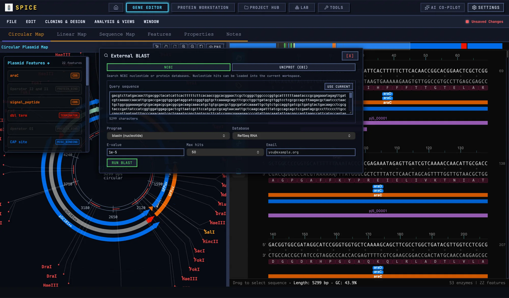

# External BLAST

Runs a remote BLAST search from the Gene Editor and lists the hits with their best alignment. Two providers are offered: NCBI's public BLAST URL API and, for protein searches against UniProtKB, EBI's Job Dispatcher. Nothing is computed locally; the query sequence is sent to the selected service.

**Menu:** **File → External BLAST…** · **Type:** floating panel

## What it does

The panel submits an asynchronous job, polls it until it finishes, and fetches the result as JSON. The **NCBI** tab supports `blastn` against nucleotide databases and `blastp` against protein databases. The **UniProt (EBI)** tab always runs `blastp` through EBI's NCBI BLAST service against a UniProtKB database and requires a contact email address. The query box is prefilled with the current workspace sequence when the panel opens. Results stay in the panel until you explicitly load or send a hit.

## How to use

1. Open **File → External BLAST…**.
2. Choose **NCBI** or **UniProt (EBI)**. The tab determines the program and database lists; changing the NCBI program resets the database to RefSeq RNA for `blastn` or Swiss-Prot for `blastp`.
3. Supply a query sequence: it is prefilled, or click **Use current** to recopy the workspace, or **Translate current** (protein programs only) to translate the current DNA sequence and strip stop codons.
4. Adjust **E-value**, **Max hits**, and, for EBI, the **Email** address.
5. Click **Run BLAST** and follow the status line through submission, queuing, and result retrieval; **Stop** aborts the local wait.
6. Expand a hit to see its alignment, then use **Load as gene** for a nucleotide `blastn` hit or **Send to Protein Workstation** for a protein hit.

## Inputs and results

| Field | Meaning |
|---|---|
| Query sequence | Nucleotide or protein text sent as the query; the code upper-cases it and strips every character except letters, `*`, and `-`. |
| Program | `blastn (nucleotide)` or `blastp (protein)`; the EBI tab is fixed to `blastp`. |
| Database | Four NCBI nucleotide sets, four NCBI protein sets, or three UniProtKB sets on EBI; the current choice is sent with the job. |
| E-value | Expectation threshold, entered as text and parsed as a number greater than zero; defaults to `1e-5`. |
| Max hits | One of 10, 25, 50, or 100, sent as the hit-list or alignment limit. |
| Email | Saved in local storage; required by EBI for job tracking and optional for NCBI, where it is passed for job notices. |
| Hit and Organism | Accession with title, and source organism, for each returned hit. |
| Length | Subject sequence length reported by the provider. |
| E-value and Identity | Values from the first high-scoring segment pair; NCBI's residue identity is converted to a percentage, while EBI already reports percent identity. |
| Coverage | Alignment length divided by query length, capped at 100%. |
| Hit detail | Bit score, hit range, coverage, and the first HSP drawn as query, midline, and subject blocks of 60 residues, plus the load or send action. |

## Limits and caveats

- Both providers are public internet services: the query sequence, program, database, E-value, hit limit, and email address leave the machine. NCBI is contacted at `blast.ncbi.nlm.nih.gov`; EBI at `www.ebi.ac.uk/Tools/services/rest/ncbiblast`. The packaged desktop app sends these requests through its Rust HTTP command, while a browser preview uses `fetch`.
- Jobs time out after 10 minutes. NCBI polling uses the service's recommended initial wait and then 3-second intervals; EBI polls every 2 seconds. A missing or expired NCBI RID is reported as an error rather than retried.
- **Stop** aborts the local request and polling only. No cancellation call is sent to the provider, so a submitted remote job can still finish on its servers.
- Only the first HSP of each hit is shown and used for the E-value, identity, and coverage columns; additional HSPs are discarded by the panel.
- An empty query, a non-positive E-value, or a missing EBI email is rejected before submission. The email warning is visible on the EBI tab whenever the field is empty.
- With no hits, the result pane shows **No hits above the E-value threshold.** and an information toast repeats the message.
- Loading a nucleotide hit delegates to the NCBI importer, which fetches the record over the network and replaces the current document; sending a protein hit fetches its FASTA sequence and navigates to the Protein Workstation.
- The services are shared and queued, so run time depends on load and sequence length; the panel reports elapsed seconds but not queue position.

## Related

- [Gene Editor](../../gene-editor.md)
- [UniProt Import](uniprot.md)
