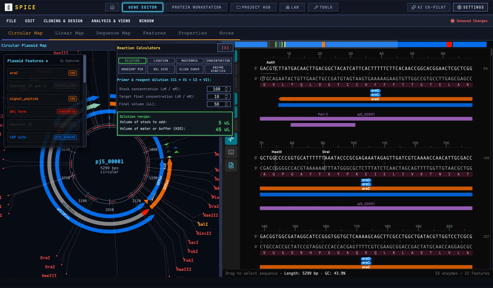

# Reaction Calculators

The Reaction Calculators panel gathers eight bench calculations in one floating window: dilution, ligation mass, PCR master mix, DNA concentration conversion, gradient PCR, gel band sizing, ELISA curve fitting, and enzyme kinetics. Every result is recomputed as you type, and nothing is written to the sequence or the edit history.

**Menu:** **Cloning & Design → Reaction Calculators** · **Type:** floating panel

## What it does

The panel has eight tabs in two rows. **Dilution** solves C1 × V1 = C2 × V2 for a working aliquot and reports the volume of stock and the volume of water or buffer. **Ligation** reports the insert mass needed for a chosen insert:vector molar ratio. **Mastermix** builds a component table for Q5, Phusion, or Taq at a chosen reaction count and volume, with a 10% pipetting excess included in the master-mix column. **Concentration** converts between ng/µL and nM using an average molecular weight for single- or double-stranded DNA.

**Gradient PCR** spreads 12 columns across 50–66 °C and rates each column against an annealing target of the lower primer Tm minus 5 °C. **Gel size** fits log10(bp) against migration distance from three standard bands and estimates an unknown band. **ELISA curve** fits a four-parameter logistic curve through a log-logit transform, reports the asymptotes, Hill slope, and EC50, and back-calculates an unknown concentration in pg/mL. **Enzyme kinetics** fits Vmax and Km with a Lineweaver–Burk double-reciprocal transform.

All tabs recalculate live. There is no Apply button and no exported file: the numbers are intended for copying into a protocol or notebook.

## How to use

1. Open **Cloning & Design → Reaction Calculators**.
2. Choose one of the eight tabs.
3. Enter the values for that tab; the result updates immediately.
4. Read the result block beneath the inputs, or the recipe table for master mix and gradient PCR.
5. Copy the required volumes or parameters manually; the panel does not export them.
6. Close the panel with **[X]**; reopening starts from the default field values.

## Inputs and results

| Field | Meaning |
|---|---|
| Dilution: stock concentration | C1, the concentration of the stock in µM or mM. |
| Dilution: target concentration and final volume | C2 and V2, the concentration and total volume wanted. |
| Dilution recipe | Volume of stock = C2 × V2 ÷ C1; volume of water or buffer = V2 − stock volume; both in µL. |
| Ligation: vector and insert size | Vector and insert lengths in bp. |
| Ligation: vector mass and molar ratio | Starting vector mass in ng and the insert:vector ratio (1:1, 3:1, 5:1, or 10:1). |
| Ligation result | Insert mass = vector mass × (insert size ÷ vector size) × molar ratio, in ng. |
| Mastermix: reactions and volume | Number of wells and reaction volume in µL. |
| Mastermix: polymerase | Q5, Phusion, or Taq; selects the component recipe. |
| Mastermix table | Per-well volume for each component and the total for all wells with 10% excess. |
| Concentration: direction | ng/µL → nM or nM → ng/µL. |
| Concentration: value, chain type, length | Input value, dsDNA or ssDNA, and length in bp. |
| Concentration result | Average molecular weight and the converted nM or ng/µL value. |
| Gradient: primer 1 and primer 2 Tm | The two primer melting temperatures in °C. |
| Gradient table | 12 columns from 50 to 66 °C, each rated Poor, Suboptimal, Good, or Optimal. |
| Gel: bands 1–3 and unknown distance | Migration distance in mm and size in bp for each standard, plus the unknown distance. |
| Gel result | R² of the semi-log fit and the estimated unknown size in bp. |
| ELISA: standards 1–3 and unknown OD | Concentration and optical density pairs, plus the optical density of the unknown. |
| ELISA result | Fitted parameters a, b, c (EC50), and d, R², and the fitted concentration in pg/mL. |
| Kinetics: points 1–3 | Substrate concentration in mM and velocity in µM/min. |
| Kinetics result | Vmax in µM/min, Km in mM, and R². |

## Limits and caveats

The equations are idealised and none of the outputs is experimentally validated. Dilution refuses non-positive values or a target concentration above the stock, returning zero stock volume and treating the whole final volume as water. Ligation does not check overhangs, ends, or compatibility.

The master-mix recipes are standard starting proportions for three polymerases, not a validated protocol; every volume is rounded to two decimal places, and no other polymerase or additive is modelled. The concentration converter uses an average molecular weight (617.96 g/mol per bp for dsDNA, 307 g/mol per base for ssDNA) rather than a sequence-specific mass.

The gradient tool always uses 12 columns over 50–66 °C and a simple lower-Tm-minus-5 rule with coarse ratings; it ignores salt, additives, and primer concentration. Gel sizing is a three-point semi-log fit, so inaccurate distances or a non-linear ladder distort the estimate even when R² looks good. The ELISA fit is a log-logit approximation rather than a full non-linear least-squares fit; it is most reliable when the standards bracket the unknown, it clamps out-of-range optical densities, and it assumes standard concentrations are in pg/mL. Kinetics uses a double-reciprocal transform, which over-weights low-velocity points, and requires all entered concentrations and velocities to be greater than zero. No tab checks units or converts between them.

## Related

- [Gene Editor](../../gene-editor.md)
- [CRISPR Design Cabin](crispr.md)
