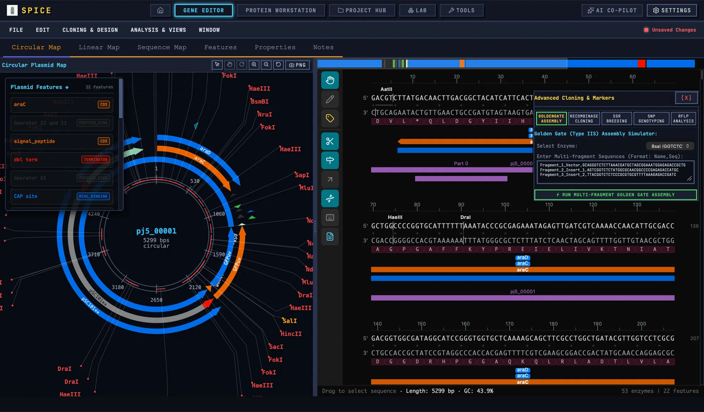

# Advanced Cloning & Markers

The Advanced Cloning & Markers panel collects five sequence-level design routines in one floating window. Golden Gate assembly and site-specific recombinase cloning transform the current sequence; the SSR, SNP and RFLP tabs read the current sequence and report marker designs or digest patterns. All five tabs act on the DNA sequence in the Gene Editor, so the panel must be opened while a document is loaded.

**Menu:** **Cloning & Design → Advanced Cloning & Markers** · **Type:** floating panel

## What it does

The tab strip switches between five independent routines.

- **Golden Gate Assembly** parses one fragment sequence per line, extracts the four-base cohesive ends and insert for the chosen Type IIS enzyme, then asks the backend to find a circular order in which each fragment's right overhang matches the next fragment's left overhang. BsaI (GGTCTC), BsmBI (CGTCTC) and BbsI (GAAGAC) are supported; BbsI uses an eight-base recognition-plus-spacer offset, the other two seven.
- **Recombinase Cloning** searches the vector for the 34 bp loxP site (Cre-lox) or FRT site (FLP-FRT). Two directly oriented sites excise the segment between them, a single vector site plus a site on the donor insert integrates the insert, and anything else returns no reaction.
- **SSR Breeding** scans the current sequence for tandem repeats of one to six bases and designs flanking forward and reverse primers of 18–22 bases with a melting temperature between 54 and 62 °C. The tab recomputes on every edit and has no run button.
- **SNP Genotyping** designs allele-specific primer sets for a chosen position and two allele bases. The helper returns both a KASP set (FAM and HEX tails plus a common reverse primer) and a TaqMan set (flanking primers plus two allele-specific probes).
- **RFLP Analysis** compares the current sequence with a mutant sequence, cuts both at occurrences of the chosen enzyme site, and reports the fragment sizes for each genotype and whether the cut counts differ.

## How to use

1. Open the panel from the menu. The SSR, SNP and RFLP tabs read the current sequence immediately, so later edits are reflected without pressing a button.
2. On **Golden Gate Assembly**, choose the enzyme and enter at least two fragments as `Name,Sequence`; the name is discarded and the sequence is uppercased and stripped to A/T/G/C/N. Press **Run Multi-fragment Golden Gate Assembly**.
3. Review the reported fragment order and overhang sequence. On success, press **Load Assembled Plasmid into Editor** to replace the workspace sequence with the assembled product.
4. On **Recombinase Cloning**, choose Cre-loxP or FLP-FRT and paste a donor insert. The three preset buttons load synthetic test constructs for integration, excision and inversion; they only populate the editor. Press **Run Site-Specific Gene Recombination Cloning Simulation** to apply the reaction.
5. On **SSR Breeding**, read the generated markers directly; each row gives the repeat pattern, repeat count, product size, and both primer sequences with Tm.
6. On **SNP Genotyping**, enter the position and the two allele bases. On **RFLP Analysis**, enter the enzyme name, its recognition site, and the mutant sequence.

## Inputs and results

| Field | Meaning |
|---|---|
| Enzyme | Type IIS enzyme for Golden Gate: BsaI, BsmBI or BbsI. |
| Fragment list | One `Name,Sequence` per line; names are discarded and sequences reduced to A/T/G/C/N. |
| Order | Fragment indices in the circular order found by the backend. |
| Overhangs | Four-base joins reported in assembly order. |
| Recombinase system | Cre-loxP or FLP-FRT. |
| Insert DNA | Donor sequence scanned for the same recombinase site. |
| Reaction type | Integration, excision, inversion or no reaction. |
| Position | Nucleotide index used for SNP primer design; the helper treats it as a zero-based index. |
| Allele 1 / Allele 2 | Bases substituted at the SNP position. |
| Enzyme / Site | RFLP enzyme label and its recognition sequence. |
| Mutant DNA | Sequence compared with the workspace sequence. |
| SSR row | Repeat unit and count, product size, forward and reverse primers, Tm. |

## Limits and caveats

- The Golden Gate product concatenates only the insert segments between the cohesive ends; recognition sites and overhangs are not included. Applying it replaces the whole document sequence and creates an unsaved change. The browser fallback does not reorder fragments: it assembles in input order and only warns when the last right overhang does not close the circle.
- At least two fragments are required. A fragment shorter than 15 bases, a missing site pair, or duplicated overhangs produces an error. Self-complementary overhangs produce a warning only.
- Recombinase site searches use the forward pattern only, so an inverted second site is not found. The helper has an inversion branch, but the inversion preset ends in No reaction for this reason. Two directly oriented sites excise; one vector site plus one insert site integrates; no usable pair leaves the sequence unchanged and shows a warning.
- The recombinase preset buttons overwrite the workspace sequence with synthetic constructs and do not run the reaction.
- SSR design considers only repeats of one to six bases with at least three units (eight bases for mononucleotide repeats) and requires 25 bases of flank on each side. Primers are selected by the Tm window alone, and no secondary-structure or specificity check is made.
- The SNP and RFLP readouts are wired to result field names that the current helpers do not return: the SNP tab always shows its failure branch with an empty message, and the RFLP tab cannot read its fragment lists. Treat both readouts as non-functional in this version.
- RFLP cuts are placed at the midpoint of each recognition site rather than at the enzyme's true cleavage offset, and methylation, star activity and fragment resolution on a gel are not modelled.

## Related

- [Gene Editor](../../gene-editor.md)
- [Cloning Simulation Wizard](cloning-wizard.md)
