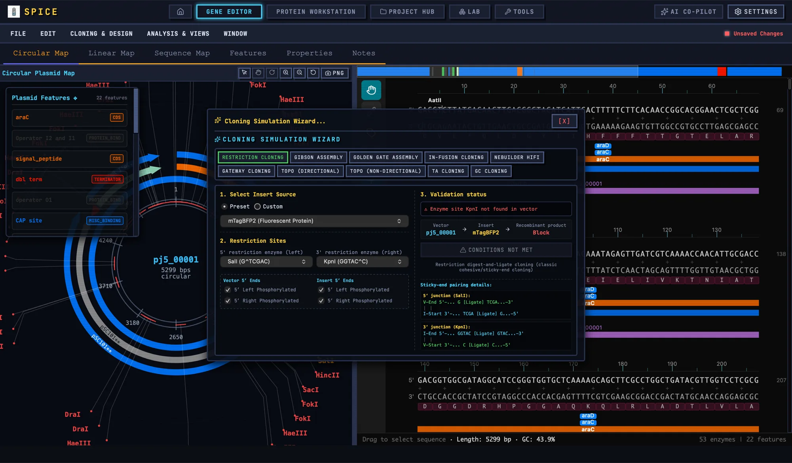

# Cloning Simulation Wizard

`Cloning Simulation Wizard` builds a single-insert recombinant from the sequence that is open in the Gene Editor. The open document supplies the vector; you supply the insert from a preset or by pasting a sequence, then choose one of ten assembly methods. The wizard returns a product sequence that can be imported back into the editor. It writes no file.

**Menu:** **Cloning & Design → Cloning Simulation Wizard...** · **Type:** modal

## What it does

The wizard treats the entire open sequence as the vector and always passes it to the assembly engine as a circular molecule. The insert is always linear. It offers ten method buttons: `Restriction Cloning`, `Gibson Assembly`, `Golden Gate Assembly`, `In-Fusion Cloning`, `NEBuilder HiFi`, `Gateway Cloning`, `TOPO (Directional)`, `TOPO (Non-directional)`, `TA Cloning`, and `GC Cloning`.

The configuration area has two numbered steps. Step 1 selects the insert source. Step 2 changes with the method. A third column shows validation warnings, a vector → insert → product schematic, the action button, the selected method's description, and, for restriction cloning, a sticky-end junction diagram for the left and right cuts.

`Simulate ligation reaction` runs the assembly engine and replaces the configuration with a result screen. The result screen reports the method, generated product name, total length, parent vector and its length, insert and its length, the enzymes used, and any warnings. From there, `Back to redesign` discards the result and returns to the configuration; `Confirm import into design map` writes the product into the editor.

Import replaces the current document sequence with the product, renames it to the generated product name, appends one CDS feature for the insert, records a cloning entry in the undo history, and writes to the activity log. The modal stays open, now with the recombinant sequence as its vector; close it with `[X]`. Nothing is exported or saved to disk by the wizard.

## How to use

1. Open the wizard with the vector sequence already loaded in the Gene Editor.
2. Choose an assembly method from the button row.
3. Choose `Preset` or `Custom` as the insert source. For `Custom`, enter a name and paste the sequence.
4. Fill in the method-specific parameters shown under step 2.
5. Read step 3 (`Validation status`). Warnings do not always block the run; a blocking condition replaces the action button with a disabled `Conditions not met` button.
6. Click `Simulate ligation reaction` and review the product length and warnings.
7. Click `Confirm import into design map` to adopt the product, or `Back to redesign` to change parameters. Verify the insert feature and the junctions in the sequence view before ordering.

## Inputs and results

| Field | Meaning |
|---|---|
| Method buttons | Selects the assembly method. The selected method's description appears below the action button. |
| `Preset` | Two built-in inserts: `mTagBFP2 (Fluorescent Protein)` at 722 bp and `miniSOG (Optogenetic Flavin-binding)` at 351 bp. The preset carries the intended left and right enzyme names. |
| `Custom` | Free-text insert name plus a sequence. Uppercased, and every character other than A, T, C, or G is removed before use. |
| `5' restriction enzyme (left)` / `3' restriction enzyme (right)` | Available to restriction cloning only: SalI, EcoRI, XhoI, BamHI, HindIII, NdeI, SacI, KpnI. |
| Vector and insert end phosphorylation | Four checkboxes: 5' left and 5' right for each molecule. They feed only the T4 ligase warning. |
| `Overlap length (bp)` | Gibson, In-Fusion, and NEBuilder HiFi only; 15–60, default 25. The note recommends 20–40. |
| Golden Gate enzyme | BsaI (default), BbsI, BsmBI, BtgZI, SapI, or AarI. |
| `Directional TOPO (CACC 5' overhang)` | Checkbox shown for Gateway and TOPO (Non-directional); it has no effect on either method (see caveats). |
| `Validation status` | Lists blocking and non-blocking warnings; `All condition checks passed` when empty. |
| Result summary | Method, product name, total length, parent vector, insert fragment, and digestion enzymes when applicable. |
| `Back to redesign` | Discards the result and returns to the configuration. No history entry is made. |
| `Confirm import into design map` | Replaces the editor document with the product, adds one insert feature, and records history and log entries. |

## Limits and caveats

- One insert only. The vector is the whole open sequence and is always treated as circular; there is no separate backbone, no multi-fragment assembly, and no choice of vector topology.
- Restriction cloning needs a complete recognition site for each enzyme in both molecules. It uses the first cut site for each enzyme, takes the insert between the leftmost and rightmost cut positions, does not check insert orientation, and leaves both recognition sites in the product. The enzyme-mismatch warning is non-blocking.
- The `mTagBFP2` preset begins with a SalI-compatible 5' overhang but contains no complete SalI site. With the default SalI/KpnI enzymes, restriction cloning therefore produces a warning result with the parent vector unchanged rather than an insert. Use a custom insert with both complete sites.
- Gibson, In-Fusion, and NEBuilder HiFi assume that the insert begins with the vector's terminal 3' overlap and ends with the vector's terminal 5' overlap, or the reverse complement of the latter. They do not search for internal homology. Missing homology is reported as a warning, not a block. The vector is kept whole and the matched overlap lengths are trimmed from the insert, so the insert is effectively appended at the vector's 3' end.
- Golden Gate requires at least two cut sites for the chosen Type IIS enzyme in both vector and insert. If either molecule has fewer, the engine returns the vector sequence unchanged with warnings. Only the first two cut sites in each molecule are used, and no overhang compatibility beyond the shared enzyme is checked.
- Gateway does not validate att sites before running. It searches for attB1/attB2 and then attP1/attP2; if any is missing it warns and falls back to concatenating vector + attL1 + insert + attL2. There is no BP versus LR choice.
- TOPO (Directional) warns when the insert does not start with `CACC`, but the warning does not block the run. The engine inserts the fragment immediately before the first `GTGG` (directional) or `GTTT` (non-directional) occurrence; if that string is absent it appends the insert at the vector end with a warning.
- TA and GC cloning are plain `vector + insert` concatenations. Neither checks for T/A overhangs or blunt ends; GC shares the TA implementation and TA-style product naming.
- The `Directional TOPO` checkbox appears for Gateway and TOPO (Non-directional) but does not influence either engine path: non-directional TOPO is forced non-directional, and Gateway ignores the flag.
- The phosphorylation checkboxes only trigger the warning when both the vector and the insert are dephosphorylated at both ends. Partial phosphorylation does not change the product.
- The result screen appears even when the engine could not assemble anything. In that case the product is the parent vector, the warnings explain why, and import is still offered.
- Import does not remap the vector's existing features; they keep their old coordinates, and only one CDS feature named after the insert is appended. Its position is estimated from the first occurrence of the left enzyme's recognition sequence (SalI unless another restriction enzyme was last selected), not from the engine's insert coordinates. Check the junction manually.
- Import overwrites the open document without a save prompt. Save or undo first if you need the parent construct.

## Related

- [Gene Editor](../../gene-editor.md)
- [Agarose Gel Simulation](gel.md)
- [Restriction Enzymes](enzymes.md)
- [Advanced Cloning & Markers](cloning-extension.md)
