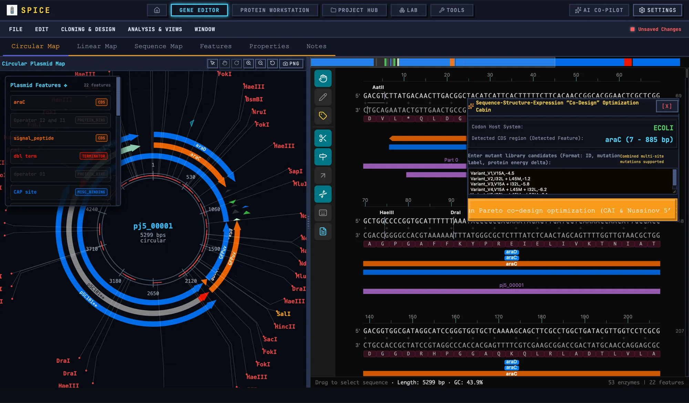

# Co-Design Panel

The Co-Design Panel screens candidate mutation sets for a coding sequence against two competing objectives: predicted protein stability and codon adaptation. It back-translates each candidate with host-preferred codons, computes the Codon Adaptation Index (CAI) and a 5' mRNA folding energy, marks the Pareto-optimal variants, and can write a chosen variant back into the Gene Editor.

**Menu:** **Cloning & Design → Co-Design Panel** · **Type:** floating panel

## What it does

The panel reads the current sequence and the editor's codon host. It locates the first feature whose type is `CDS` and uses that feature's start and end as the coding region; when no CDS feature exists it uses the whole sequence up to the last complete codon and labels the region `Default CDS (Full)`. The host is displayed but not changed here: it is bound to the host chosen in the Codon Optimization panel and is one of `ECOLI`, `YEAST` or `HUMAN`.

Each candidate is one line of `ID, mutation label, protein ΔE`. The label is parsed as one or more substitutions such as `V15A + I32L`. Positions are read as 1-based amino-acid positions within the CDS, converted to zero-based codon indices, and each targeted codon is replaced with the host-preferred codon for the stated target residue. The original residue in the label is parsed but not checked against the sequence.

For every candidate the backend computes CAI over the mutated CDS using host codon weights, a 5' mRNA ΔG from a Nussinov minimum-free-energy fold of the first 80 nucleotides, and a Pareto flag. The dominance test uses only two objectives: lower protein ΔE and higher CAI. The protein ΔE is supplied by you in the candidate list; the panel does not calculate it. The 5' mRNA ΔG appears in the table, but it is not part of the dominance test.

## How to use

1. Open the panel with a coding sequence loaded. Check the host and the detected CDS range before entering candidates.
2. Enter one candidate per line as `ID, label, ΔE`. Blank lines and lines beginning with `#` are ignored, and a line with fewer than three comma-separated parts is skipped.
3. Press **Run Pareto co-design optimization (CAI & Nussinov 5' Fold)**.
4. Read the scatter plot, where the horizontal axis is protein ΔE and the vertical axis is CAI. Green points with a white outline are Pareto-optimal; grey points are dominated.
5. Use **[Apply]** in a table row to replace the workspace DNA with that variant's mutated sequence.

## Inputs and results

| Field | Meaning |
|---|---|
| Codon host | Host whose codon table is used; follows the editor's codon host setting. |
| Detected CDS region | Named CDS feature and its start–end coordinates; falls back to the whole sequence. |
| Candidate input | `ID, mutation label, protein ΔE` per line; combined mutations use `+`. |
| ID | Candidate identifier, used as the point label in the plot. |
| Mutations | Label as typed, echoed in the table. |
| Protein ΔE | Protein stability delta in kcal/mol, taken from the input. |
| CAI | Codon Adaptation Index of the mutated CDS, rounded to three decimals. |
| 5' mRNA ΔG | Nussinov minimum free energy of the first 80 nucleotides, in kcal/mol. |
| Optimal? | `PARETO` or `Dominated`, from the two-objective test. |
| Action | `[Apply]` writes the variant's full DNA back to the editor. |

## Limits and caveats

- CDS detection is by feature type only: the first `CDS` feature wins, and start codon, stop codon and reading frame are not validated.
- Without a CDS feature, the fallback region spans the whole sequence rounded down to complete codons, which may include non-coding DNA.
- Mutation positions are relative to the CDS, not to the plasmid, and the original residue in a label is ignored; only the target residue is used to pick a codon.
- Every targeted codon is replaced with one fixed host-preferred codon, so each candidate explores a single codon choice per mutation rather than alternative synonymous codons.
- The Pareto frontier considers protein ΔE and CAI only. A variant with poor 5' mRNA structure can still be marked Pareto-optimal.
- A candidate with an out-of-range amino-acid position is skipped. An unknown target amino acid aborts the backend call; the panel then falls back to demo values and shows a warning.
- In browser or fallback mode, CAI and 5' mRNA ΔG are pseudo-random estimates and the applied DNA is unchanged, so treat the table as illustrative only.
- Applying a variant replaces the entire document sequence; the region outside the CDS is copied unchanged from the sequence as it was when the run started.

## Related

- [Gene Editor](../../gene-editor.md)
- [Codon Optimization](codon.md)
