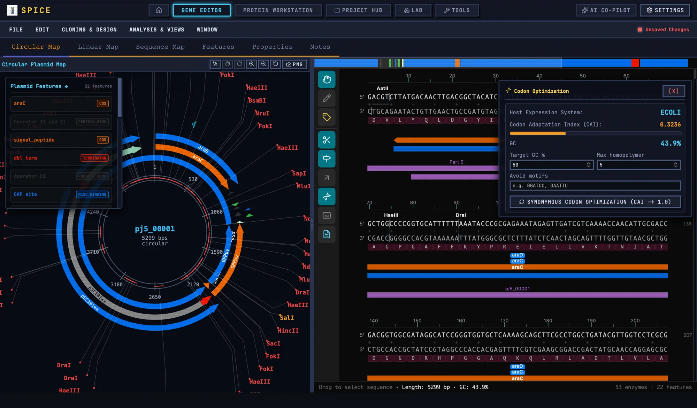

# Codon Optimization

The Codon Optimization panel replaces the open sequence with synonymous codons for a selected expression host and reports the resulting codon adaptation index and GC content. It can also steer the sequence towards a target GC percentage, limit homopolymer runs and remove forbidden motifs. The rewritten sequence is written directly into the document; nothing is copied to the clipboard.

**Menu:** **Cloning & Design → Codon Optimization** · **Type:** floating panel

## What it does

The host is displayed read-only as `ECOLI`, `YEAST` or `HUMAN`. It is not chosen in this panel: the Gene Editor loads it from the Default Back-Translation Host setting, or takes the host recorded in a `.spiceg` document when one is opened.

Two live readouts describe the current document. **Codon Adaptation Index (CAI)** is the geometric mean of each codon's relative adaptiveness in the host's usage table, computed over complete in-frame codons from the first base; 1.0 means every codon is the host's most adaptive synonym, and lower values mean rarer codons. The value is shown to four decimal places and turns green above 0.8; the bar is the same value as a percentage. **GC** is the percentage of G and C over all A, C, G and T bases in the document, shown to one decimal place.

The button **Synonymous Codon Optimization (CAI → 1.0)** starts from the most adaptive codon for every residue in the translated document and then performs a fixed 2,000-step seeded local search. Each step swaps one codon for a synonymous alternative and keeps the change only when the combined score improves and the number of forbidden-motif occurrences does not rise. The score rewards CAI and penalises distance from the target GC, deviation in local GC windows, homopolymer excess and forbidden motifs. The seed is fixed, so the same sequence and options give the same output.

The optimised sequence replaces the document sequence in place. A toast reports the host, new CAI and new GC, and the Activity Log records the host and the CAI before the run. The result line in the panel repeats the new CAI and GC and lists any unresolved constraints. No history entry is created by the run itself.

## How to use

1. Open a coding sequence in the Gene Editor.
2. Check the host readout. To change it, set **Settings → Primer Thermodynamics & PCR Simulation Physical Parameters → Default Back-Translation Host** and reload the Gene Editor, or open a `.spiceg` document that carries the intended host.
3. Open **Cloning & Design → Codon Optimization**.
4. Read the current CAI and GC values before changing anything.
5. Set **Target GC %**, **Max homopolymer** and, if needed, **Avoid motifs**.
6. Click **Synonymous Codon Optimization (CAI → 1.0)**.
7. Read the confirmation toast and the result line, then inspect the sequence view for the rewritten document.
8. Save the document when satisfied.

An empty translation is refused with an **Optimization Failed** toast and no change. The run rewrites the whole document, so keep an external copy if you need to compare before and after.

## Inputs and results

| Field | Meaning |
|---|---|
| Host Expression System | Read-only host, `ECOLI`, `YEAST` or `HUMAN`; sets the codon usage table. |
| Codon Adaptation Index (CAI) | Geometric mean of relative adaptiveness over complete codons of the current document, to four decimals; green above 0.8. |
| GC | Percentage of G and C in the current document, to one decimal place. |
| Target GC % | Desired global GC percentage; default 50, spinner range 20–80. |
| Max homopolymer | Longest permitted run of one base; default 5, spinner range 2–10. |
| Avoid motifs | DNA motifs to remove, separated by commas, semicolons or spaces; non-DNA characters are stripped. |
| Result line | New CAI and GC after a run. |
| Unresolved | Forbidden motifs and over-long homopolymers still present, with 1-based positions. |

## Limits and caveats

The input is the whole document translated from the first base in frame 1, not a selected CDS or feature. Any 5' or 3' untranslated sequence is therefore translated and rewritten as though it were coding, and a terminal stop codon is dropped from the protein before optimisation. Start the document at the coding sequence, or edit the reading frame first.

The host cannot be switched inside the panel. Changing the default in Settings only affects a Gene Editor loaded afterwards, and opening a `.spiceg` document overwrites the host with the value stored in that file.

The run replaces the sequence without adding an undo snapshot, so **Undo** does not step back over the optimisation alone. There is no preview, no accept or reject step and no clipboard copy.

The button label mentions CAI → 1.0 as an aim, not a guarantee. CAI, GC, homopolymer and motif terms compete, the search is capped at 2,000 single-codon swaps, and the accepted sequence may still contain forbidden motifs or over-long runs; those are reported in the result line. Because the seed is fixed, rerunning without changing the inputs produces the same sequence.

Target GC is a global target and also a target for local 30-base windows that the panel does not expose. The spinner ranges are not re-validated before the run: a typed value outside them is passed to the engine, which rejects out-of-range or non-integer settings. Forbidden motifs are uppercased and stripped to A, C, G and T, so a motif containing ambiguity codes is silently shortened; duplicates are ignored.

The translator and optimiser expect standard coding residues. Ambiguous bases or non-standard residues are rejected by the engine rather than skipped, and the panel does not catch that error, so no toast appears and the sequence is left unchanged. Stop codons present in the input are preserved as stop codons.

## Related

- [Gene Editor](../../gene-editor.md)
- [Restriction Enzymes](enzymes.md)
