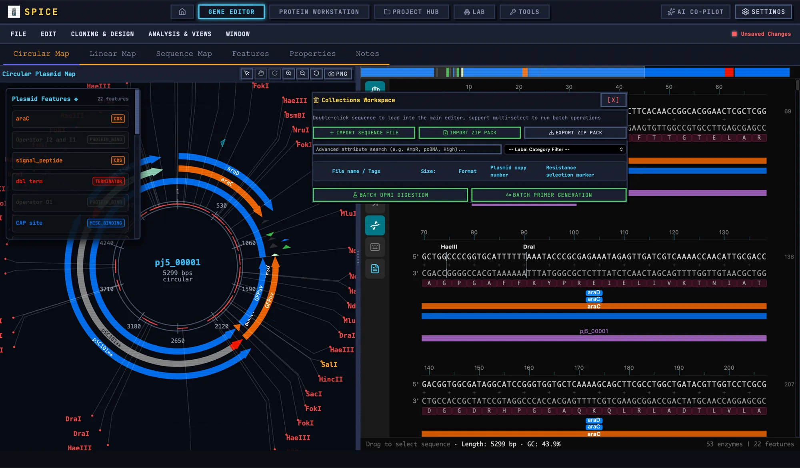

# Project Collections

The Project Collections panel is the Gene Editor's local library of plasmids and sequence files. It imports sequences one file at a time or as a ZIP pack, exports the whole library as a ZIP, filters by name and tag, loads an entry into the editor, and runs DpnI digestion or primer generation across a ticked subset. The window is titled **Collections Workspace**, and despite the menu name the list is not part of the project document: it is stored in the browser's local storage and is available with no project open.

**Menu:** **File → Project Collections...** · **Type:** floating panel

## What it does

- Keeps a persistent list of entries with name, size, format, tags, plasmid copy number and resistance marker.
- Imports individual sequence files and ZIP packs, and exports all entries as a ZIP archive through the native backend.
- Filters the table by free text (name, copy number or resistance) and by an exact tag.
- Loads an entry into the main editor on double-click or with the load icon.
- Runs batch DpnI digestion, reporting cutsite counts and 1-based positions, or batch primer generation over the selected entries.
- Copies either report as tab-separated text for use elsewhere.

No SPD token, account or project is required; reading, importing, loading and batch analysis are local operations.

## How to use

1. Open **File → Project Collections...**.
2. Click **Import Sequence File** and choose a GenBank, FASTA or plain-text file; it is appended with the tags `Imported` and the detected format.
3. Alternatively click **Import ZIP Pack** and choose a `.zip` archive of sequence files.
4. Use the search box and the **-- Label Category Filter --** dropdown to narrow the table.
5. Tick the checkbox in each row you want to process. Clicking anywhere in a row also toggles selection; double-click loads that entry immediately.
6. Click **Batch DpnI digestion** or **Batch primer generation** to run the operation on the ticked rows.
7. Review the report beneath the table: **Copy** places a tab-separated table on the clipboard and **Clear** hides it.
8. Click **Export ZIP pack** to download all entries as `spice_collection_<timestamp>.zip`.
9. Use the trash icon to remove a single entry.

## Inputs and results

| Field | Meaning |
|---|---|
| File name / Tags | Entry name and its tags, shown as small chips. |
| Size | Length in base pairs as recorded when the entry was added. |
| Format | Detected format, uppercased (`GENBANK`, `FASTA`, `PLAIN`, `ZIP`). |
| Plasmid copy number | Metadata shown as stored; imported entries use `Unknown`. |
| Resistance selection marker | Metadata shown as stored; imported entries use `Unknown`. |
| Search box | Case-insensitive match on name, copy number or resistance; tags are not searched. |
| Label Category Filter | Exact tag match; `All` disables the tag filter. |
| Batch DpnI report | One row per selected plasmid: name, cutsite count and cut positions. |
| Batch primer report | One row per selected template: forward and reverse primer with Tm. |

## Limits and caveats

- The list is persisted to `localStorage` under `spice_gene_collections_list`, not to the open project or to SPD. Opening the Gene Editor without saved data seeds four demonstration entries (pUC19, pcDNA3.1, pET28a and eGFP).
- Clearing application storage, or using a different browser profile or machine, loses or hides the list; nothing is synchronised.
- Import Sequence File stores the parsed sequence only. GenBank features, topology and annotations are not carried into the collection entry, and copy number and resistance remain `Unknown`.
- The file picker filters to `.gb`, `.gbk`, `.fasta`, `.fa` and `.txt`, so a SnapGene `.dna` file cannot be chosen through it.
- ZIP import does not parse records: each archive entry is stored as raw text, so its size is the text length and loading it places that text in the editor as the sequence.
- ZIP export writes each entry's stored sequence text under its existing name, or `<name>.gb` when the name has no extension. It is not a GenBank serialisation.
- ZIP import and export call the native Tauri backend. In a browser-only build they report the demo-mode error instead of producing a usable archive.
- Batch DpnI treats every selected entry as circular and tests only DpnI. Batch primer generation uses a 0–100 target range at a 60 °C target Tm, regardless of features or the current selection.
- Loading an entry overwrites the editor sequence and name without adding an undo snapshot.
- Deleting an entry is immediate and has no confirmation or undo.

## Related

- [Gene Editor](../../gene-editor.md)
- [SPD Gene Library](spd.md)
