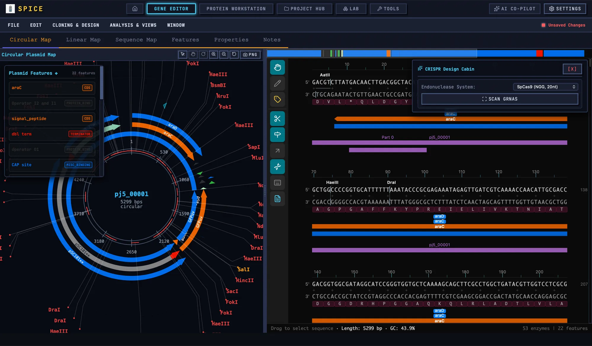

# CRISPR Design Cabin

The CRISPR Design Cabin scans the open sequence for protospacers that match a chosen Cas endonuclease and its PAM, ranks the candidates with heuristic scores, and derives HDR donor, prime-editing pegRNA, and base-editing options from the selected guide. It is a design aid: every score and construct it reports is a computational draft, not an experimentally validated result.

**Menu:** **Cloning & Design → CRISPR Design Cabin** · **Type:** floating panel

## What it does

The panel supports four endonucleases. SpCas9 uses an NGG PAM with a 20 nt guide; SpCas9-VQR uses NGA with 20 nt; SaCas9 uses NNGRRT with 21 nt; Cas12a uses a 5' TTTV PAM (shown as TTTN in the selector) with 23 nt. The open sequence must be at least 30 nt long. Both strands are scanned, and every PAM-adjacent window of the correct guide length becomes a candidate.

Each candidate receives an efficiency score built from simple features associated with Doench-style rules (GC content, a TTTT terminator, the base next to the PAM, and a self-complementarity check), a specificity score derived from matches elsewhere in the current sequence, and a combined score. The table is sorted by the combined score. The panel does not write to the sequence: it reports candidates, coordinates, and derived constructs, and appends scan summaries to the Activity Log.

Selecting a candidate shows its PAM, cut position, GC content, poly-T status, and hairpin status. The **Genome-wide off-targets** block searches one or more FASTA records on both strands for PAM-adjacent sites within a chosen mismatch count, sorts them by a position-weighted heuristic, and caps the list at 50 hits. Sequence can be pasted into the text area or loaded from a `.fa`, `.fasta`, `.fna`, or `.txt` file with **Load FASTA**; the file is read into the text area and nothing leaves the app.

Three tabs derive further designs from the selected guide. **HDR donor** places the insert between two homology arms and attempts silent codon changes around the PAM so the repaired site is not re-cut. **Prime editing** builds a pegRNA from a primer binding site, a reverse transcription template, and a fixed sgRNA scaffold. **Base editing** lists cytosine and adenine candidates inside a fixed editing window.

## How to use

1. Open **Cloning & Design → CRISPR Design Cabin**.
2. Choose an endonuclease in **Endonuclease System**.
3. Click **Scan gRNAs**; the open sequence must be at least 30 nt.
4. Click a row in the **gRNA candidates** table to make it the active guide.
5. Optionally paste genome FASTA or use **Load FASTA**, set **Mismatches**, and click **Search genome**.
6. Open **HDR**, **Prime editing**, or **Base editing** and adjust the fields for that design.
7. Copy any sequence with its copy control; results are not inserted into the document.
8. Close the panel with **[X]**; the chosen Cas, tab, and design fields are restored the next time it opens.

## Inputs and results

| Field | Meaning |
|---|---|
| Endonuclease System | Cas variant and its PAM/guide length: SpCas9 (NGG, 20 nt), SpCas9-VQR (NGA, 20 nt), SaCas9 (NNGRRT, 21 nt), or Cas12a (TTTV, 23 nt). |
| Scan gRNAs | Scans both strands of the open sequence and ranks every PAM-adjacent window. |
| Candidate table | Row ID, guide sequence, strand, efficiency, specificity, and combined score; click a row to select it. |
| PAM and cut position | The selected guide's PAM and predicted double-strand break position, mapped to forward-strand coordinates. |
| GC content, poly-T, hairpin | Percentage GC, presence of a TTTT terminator, and whether a self-complementary stem was detected. |
| Genome-wide off-targets | FASTA text area, **Load FASTA**, a mismatch limit of 0–8, and **Search genome**. |
| Off-target table | Genome record name, forward-strand position, strand, guide plus PAM, mismatch count, and heuristic CFD. |
| HDR Insert sequence | Nucleotides placed between the two homology arms. |
| HDR Homology arm length | Length of each arm taken from the forward strand either side of the cut position. |
| HDR Full donor | Assembled donor, with left and right arms and any silent codon changes reported separately. |
| Prime PBS and RTT length | Lengths of the primer binding site and reverse transcription template; defaults are 13 and 16 nt. |
| Prime offset and edit sequence | Offset from the cut position and the replacement bases written into the RTT. |
| Base editing rows | CBE candidates (a C, or a G on the minus strand) and ABE candidates (an A, or a T on the minus strand), each with its window position and fixed efficiency. |

## Limits and caveats

Scores are ranking heuristics, not predictions of measured activity. Efficiency is a feature-based approximation, not the Doench Rule Set 2 model. Specificity during the initial scan is computed against the open sequence only, and that internal pass always uses 20 nt SpCas9-style NGG windows even when another Cas is selected.

The genome-wide CFD column is a position-weighted heuristic, not the MIT CFD model. The search uses a hard mismatch ceiling, so a site one mismatch above the limit is simply absent. The scan is synchronous: a very large FASTA genome can block the interface while it runs, and the panel returns at most 50 hits, so the summary is not a complete genome-wide census.

HDR evasion only applies when the exact guide-plus-PAM string is found in the donor, and it substitutes the first listed synonymous codon near the PAM; it can fail to find an alternative or fail to destroy the site. Prime editing uses the Wallace rule for PBS Tm and a fixed scaffold, and an edit offset outside the RTT window is placed at the start of the RTT instead. Base editing inspects positions 4–8 of the guide with fixed efficiency values and applies no edit. Review every result before synthesis or transfection.

## Related

- [Gene Editor](../../gene-editor.md)
- [Reaction Calculators](calculators.md)
