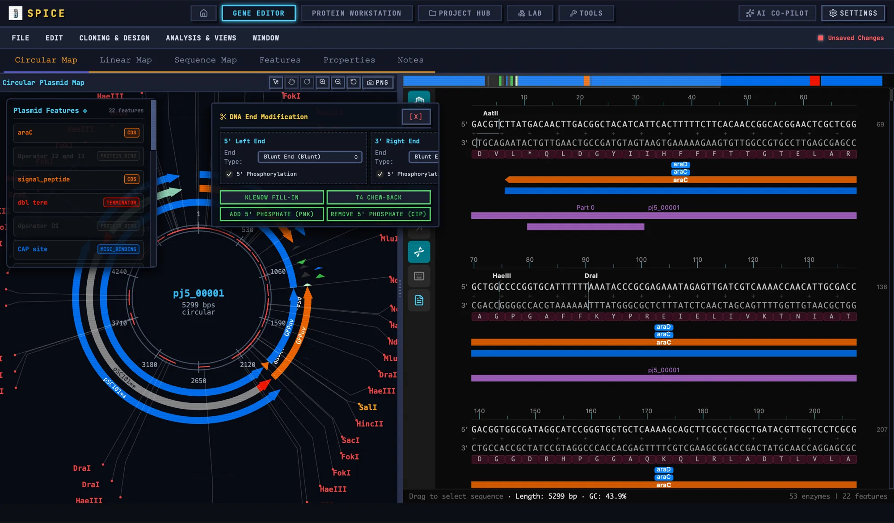

# DNA End Modification

DNA End Modification models the enzymatic treatment of the two ends of a linear DNA fragment: Klenow fill-in of 5' overhangs, T4 chew-back of 3' overhangs, and addition or removal of 5' phosphates. Every action edits the open Gene Editor sequence directly and records a history entry.

**Menu:** **Cloning & Design → DNA End Modification** · **Type:** floating panel

## What it does

The panel holds a definition for each end of the molecule, labelled **5' Left End** and **3' Right End**. Each end has a type (blunt, 5' overhang, or 3' overhang), an optional single-stranded overhang sequence that appears only for a non-blunt type, and a **5' Phosphorylation** tick box that is on by default. The end definitions are supplied to the modification engine together with the current sequence.

**Klenow Fill-in** simulates DNA polymerase I large fragment. It acts only on 5' overhangs: a left-end 5' overhang is changed to blunt with no edit to the sequence text, while a right-end 5' overhang has the reverse complement of its declared overhang appended to the end of the sequence before being marked blunt. Blunt ends and 3' overhangs are left untouched.

**T4 Chew-back** simulates the 3'-to-5' exonuclease activity of T4 DNA polymerase. It acts only on 3' overhangs: a left-end 3' overhang is changed to blunt without editing the sequence, while a right-end 3' overhang removes as many bases from the end of the sequence as the declared overhang is long, then marks the end blunt. Blunt ends and 5' overhangs are untouched.

**Add 5' Phosphate (PNK)** and **Remove 5' Phosphate (CIP)** change only the phosphorylation flags of both ends; the sequence is unchanged. After any of the four actions the resulting sequence replaces the open document, the panel reloads its end definitions from the result, and a history entry, Activity Log line, and success toast are produced.

## How to use

1. Open **Cloning & Design → DNA End Modification**; the panel floats over the Circular Map view and can be dragged by its header.
2. In **5' Left End**, choose the end type. For an overhang, enter its single-stranded sequence in **Overhang Seq**.
3. Repeat for **3' Right End**.
4. Set the per-end **5' Phosphorylation** tick boxes to describe the starting state.
5. Click **Klenow Fill-in** to fill in 5' overhangs, or **T4 Chew-back** to remove 3' overhangs.
6. Alternatively click **Add 5' Phosphate (PNK)** or **Remove 5' Phosphate (CIP)** to set the phosphate state of both ends.
7. Inspect the map or sequence view; the change is already applied. Use the Gene Editor history if you need to undo it.

## Inputs and results

| Field | Meaning |
|---|---|
| 5' Left End / 3' Right End | Independent definitions for the two ends; the sequence itself is treated as a linear string with a first and a last base. |
| End Type | Blunt, 5' overhang, or 3' overhang. Determines whether an overhang sequence is requested and which operations can act on that end. |
| Overhang Seq | Declared single-stranded overhang, entered 5'->3'. Used as the added sequence for right-end fill-in and as the trim length for right-end chew-back. |
| 5' Phosphorylation | Per-end state flag, on by default. It describes the starting end but does not by itself edit the document. |
| Klenow Fill-in | Blunts 5' overhangs. Appends the reverse complement of the declared overhang at the right end; leaves the left-end sequence unchanged. |
| T4 Chew-back | Blunts 3' overhangs. Trims the declared overhang length from the right end; leaves the left-end sequence unchanged. |
| Add 5' Phosphate (PNK) | Sets phosphorylation on at both ends without changing the sequence. |
| Remove 5' Phosphate (CIP) | Sets phosphorylation off at both ends without changing the sequence. |
| Result | The modified sequence replaces the open Gene Editor document and a history entry is added. |

## Limits and caveats

The per-end phosphorylation tick boxes do not drive the PNK and CIP buttons. Those buttons set both ends at once, so unticking one end and pressing PNK still marks that end phosphorylated. The tick boxes only supply starting state to the fill-in and chew-back actions, and their values are overwritten by the result.

Fill-in ignores 3' overhangs and chew-back ignores 5' overhangs, with no warning that an end was skipped. The declared overhang is not validated: it is not checked for length, base composition, or whether it actually matches the end of the sequence. Right-end chew-back trims strictly by the declared length even if those bases do not form the overhang, and a declaration longer than the sequence reduces it to an empty sequence.

Left-end operations never alter the sequence text; they only clear the overhang declaration, because the modelled overhang lies on the bottom strand. The panel also does not check the topology of the open document, so running it on a circular plasmid still edits the first and last bases of the stored sequence as though the molecule were linear. End types and phosphorylation states are panel state only: they are not stored in the sequence and are not exported with the document.

## Related

- [Gene Editor](../../gene-editor.md)
- [Primer Modifier](primer-modifier.md)
