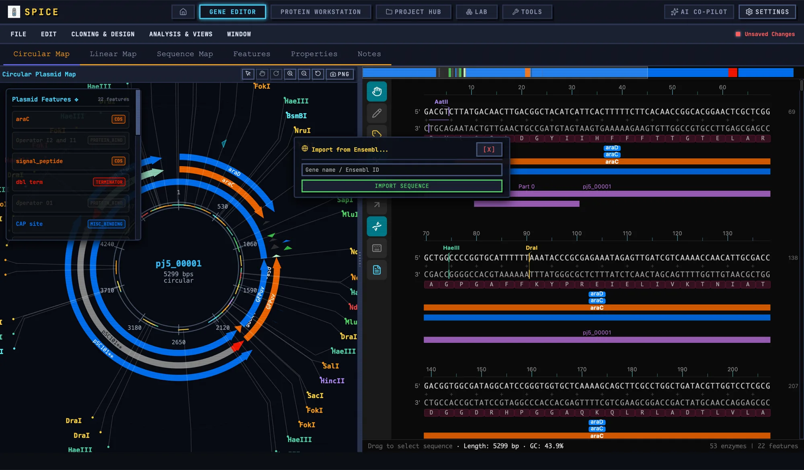

# Ensembl Import

Retrieves a sequence and its gene, exon, and CDS annotations from the Ensembl REST API and loads them into the Gene Editor, so a reference locus can be opened without first downloading and importing a file.

**Menu:** **File → Import from Ensembl...** · **Type:** floating panel

## What it does

The panel resolves your input to an Ensembl identifier, fetches the sequence for that identifier from `https://rest.ensembl.org/sequence/id/<ID>`, and fetches overlapping gene, exon, and CDS records from `https://rest.ensembl.org/overlap/id/<ID>`. Input beginning with `ENS` is treated as an identifier and used directly; anything else is looked up as a gene symbol, first against *Homo sapiens* and then against *Mus musculus* via the `xrefs/symbol` endpoints, with the first returned identifier winning. On success the current sequence and annotations are replaced, the document name becomes `Ensembl:<your query>`, an import step is added to the Edit History Tree, a summary is written to the Activity Log, and a success toast is shown. The panel stays open after an import.

This is a network operation in both builds. The packaged desktop app sends the requests from its Rust backend; a browser preview sends them with `fetch`. In either case the query and the Ensembl identifier leave the machine and are sent to `rest.ensembl.org`. The service is public and unauthenticated.

## How to use

1. Open **File → Import from Ensembl...**.
2. Type a gene symbol such as `BRCA1` or an Ensembl identifier such as `ENSG00000012051` into **Gene name / Ensembl ID**.
3. Press **Enter** or click **Import sequence**.
4. Wait while the button reads **Searching…** and is disabled.
5. On success, check the new document name in the workspace and review the imported annotations on the Features tab; close the panel with **[X]** when finished.

## Inputs and results

| Field | Meaning |
|---|---|
| Gene name / Ensembl ID | The only input. Values beginning with `ENS` skip symbol resolution and are fetched as identifiers; other values are resolved as symbols in human, then mouse. |
| Import sequence | Submits the lookup. It is disabled during the request and displays **Searching…**; **Enter** in the text field does the same. |
| Sequence | The text returned for the resolved identifier, upper-cased and reduced to letters. It replaces the current document sequence. |
| Name | `Ensembl:<query>`, using the text you typed rather than the resolved identifier. |
| Features | Records from the overlap endpoint limited to `gene`, `exon`, and `CDS`, named `<query>_gene`, `exon_<start>`, or `CDS`; strand is taken from the record, and coordinates are incremented by one as they are mapped into the editor. |

## Limits and caveats

- Symbol resolution covers only *Homo sapiens* and *Mus musculus*. There is no species selector, and a symbol that exists only in another organism is reported as not found.
- Query resolution is not a search: only the first identifier returned by the symbol endpoint is used, and a RefSeq or other non-Ensembl accession is treated as a symbol and will normally fail.
- An empty field is rejected before any request with the toast **Ensembl Import**, message **Please enter a gene name or Ensembl ID**.
- Timeouts are 10 seconds per symbol-lookup request, 15 seconds for the sequence request, and 10 seconds for the feature request. A non-success response, an empty sequence, or a missing symbol produces an error toast, writes a failure line to the Activity Log, and leaves the loaded document unchanged.
- If the feature request fails but the sequence request succeeds, the sequence is imported with an empty annotation list; the import is not rolled back.
- The import replaces the current document without a confirmation prompt. Save or export first if the existing sequence matters.
- There is no API key, retry, or rate-limit handling; the public Ensembl service may throttle repeated imports.
- The panel does not close on success, and the sequence is not checked against the length or assembly of any local reference.
- The lookup does not ask which transcript to use. The sequence is whatever Ensembl returns for the resolved identifier, and the panel offers no transcript choice.

## Related

- [Gene Editor](../../gene-editor.md)
- [NCBI Import](ncbi.md)
