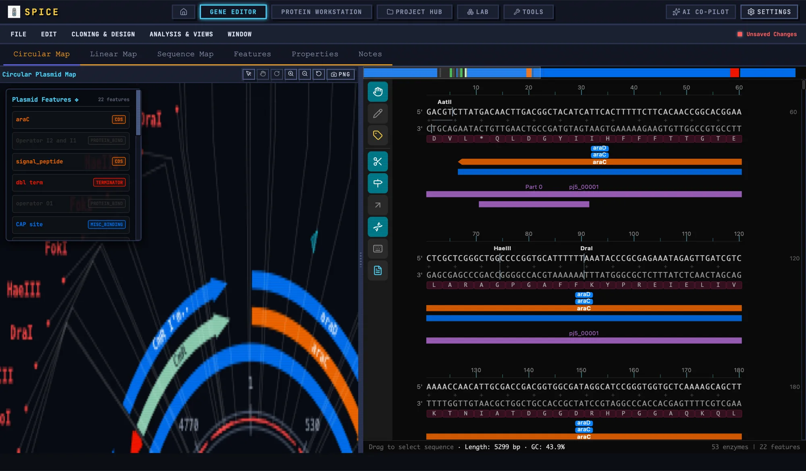

# Restriction Enzymes

The Restriction Enzymes panel chooses which enzymes the Gene Editor scans for and lists every cut site found for those enzymes in the open sequence. Each row gives the enzyme name, recognition motif and 1-based cut position, and marks sites blocked by Dam, Dcm or EcoKI methylation. The panel also reports NEB buffer activity for one enzyme at a time. It is a view over the document: it does not cut, edit or export the sequence.

**Menu:** **Cloning & Design → Restriction Enzymes** · **Type:** floating panel

## What it does

The panel keeps a selection list of enzyme names. The list starts with eight common enzymes and is restored from the last session; it is also stored in `.spiceg` documents. Selected enzymes are added to a built-in curated set of common enzymes whenever the editor computes cut sites, so the cut-site list is not restricted to your selection.

Selection is made by typing in the search field. Matching is a case-insensitive substring test against the loaded enzyme database, and the dropdown shows at most five names. Enter adds an exact case-insensitive match, otherwise the first dropdown result, otherwise an error toast is shown. Clicking a dropdown row toggles that enzyme and clears the query. The **Selected Enzymes** box lists the current names with their motifs and a `-` button on each row; `[Clear]` empties the selection.

The **Select/Manage Enzyme Sets** dialog groups selections. Nine system presets are supplied: NEB Standard, Thermo Fisher, Golden Gate (Type IIS), Rare Cutters (8 bp+), BioBrick Standard, MoClo Assembly, Blunt End Cutters, Methylation-Insensitive and Standard Lab Cloning. Applying a preset replaces the whole selection rather than merging it, and closes the dialog. Custom sets are saved in browser storage under `spice.gene.customEnzymeSetsGrid`, can be renamed or deleted, and are not written to the document.

The site list is computed over the sequence as a circular molecule on both strands, even when the document is linear. Rows are sorted by ascending cut position. A site is labelled `[Blocked]` in red when its recognition sequence overlaps a Dam (`GATC`), Dcm (`CCWGG`) or EcoKI target, with the methylation type in the row tooltip. Blocked sites remain in the list. If no sites are found, the list shows `(No cutsites detected)`.

The lower block, headed **NEB Double Digest Buffer Activity**, resolves one enzyme and shows percentage activity in buffers r1.1, r2.1, r3.1 and CutSmart, coloured green at 100%, amber at 50% or more and red below 50%. Values come from a built-in table that is seeded into `spice_neb_buffers` in browser storage; an enzyme that is not in the table receives generic fallback percentages. The heat-inactivation line is fixed at **Yes** for every enzyme.

## How to use

1. Open **Cloning & Design → Restriction Enzymes**. On a fresh profile the panel is already open when the Gene Editor loads; after that its open state is restored from the saved view configuration, and the menu item toggles it.
2. Type an enzyme name in the search field and press Enter, or click a dropdown row. Repeat for each enzyme you need.
3. Alternatively, open **Select/Manage Enzyme Sets**, pick a system preset or a saved custom set, and let the dialog close on selection.
4. Review **Selected Enzymes**; remove unwanted entries with `-`, or use `[Clear]` to start again.
5. Read the cut-site list below: enzyme, motif and cut position. Hover a blocked row to see which methylation system blocks it.
6. Type an enzyme name in the buffer field to inspect its buffer activities; Enter resolves an exact or first fuzzy match.
7. Close the panel with `[X]` or toggle the menu item.

## Inputs and results

| Field | Meaning |
|---|---|
| Search | Case-insensitive substring filter over the loaded enzyme database; dropdown limited to five names. |
| Selected Enzymes | Enzymes added to the scan, with motif and a remove control; persisted between sessions and in `.spiceg` files. |
| Enzyme set | System preset or custom group that replaces the selection when applied. |
| Cut-site row | Enzyme name, recognition motif, and 1-based position of the top-strand cut in bp. |
| `[Blocked]` | Site overlaps a Dam, Dcm or EcoKI methylation target and is not expected to cut in a methylating host. |
| Buffer field | Enzyme used for the buffer readout; defaults to EcoRI and follows the current detail enzyme. |
| r1.1 / r2.1 / r3.1 / CutSmart | Percentage activity in each NEB buffer; green at 100, amber at 50–99, red below 50. |
| Heat Inactivation (65°C, 20 min) | Fixed `Yes` in the current panel. |

## Limits and caveats

The list is not a digest of your selection. A built-in curated set of common enzymes is always scanned, so sites from enzymes you did not choose still appear; selection adds to that set rather than filtering it. Clearing the selection therefore does not empty the list.

The panel reports cut positions only. It does not show fragment lengths, overhang sequences, fragment ends or a gel, and there is no copy or export control. A digest fragment calculation exists elsewhere in the editor, but this panel does not display its result.

Methylation flags are motif-overlap tests, not a strain-specific methylation model. A site is marked blocked when it overlaps a Dam, Dcm or EcoKI recognition pattern, regardless of the strain in use. Enzymes that require methylation, such as DpnI, are not treated specially in this list.

Presets replace the selection, so applying one discards manual choices. Custom sets are local to the browser profile and are not part of a project or `.spiceg` document. The search dropdown caps results at five, so a short query can hide names that match later in the alphabet; press Enter with the full name to add an exact match.

Buffer percentages are per-enzyme activity values, not a prediction for a specific double digest, and the block does not check whether two chosen enzymes share a suitable buffer. Enzymes outside the built-in table get fallback values rather than an explicit "no data" state, so an unfamiliar enzyme's numbers are not measured data. The heat-inactivation line does not vary by enzyme.

## Related

- [Gene Editor](../../gene-editor.md)
- [Codon Optimization](codon.md)
