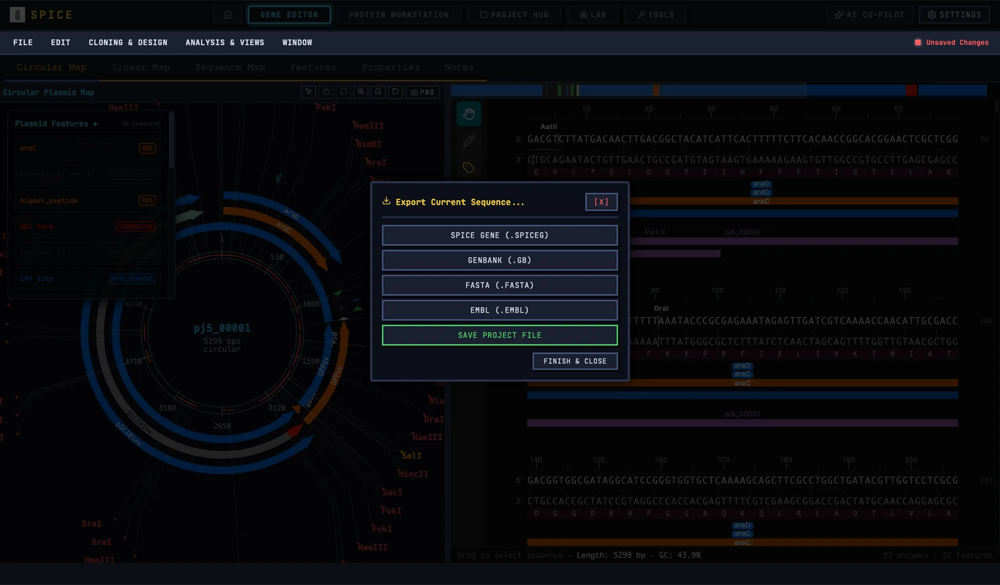

# Export Current Sequence

Writes the sequence currently open in the Gene Editor to a file in one of four sequence formats, or saves the whole document as a project file. The dialog acts on the entire sequence, never on the current selection, and does not change the document.

**Menu:** **File → Export Current Sequence...** · **Type:** modal

## What it does

The file stem is the current plasmid name; the dialog has no name field. Each format button performs its export immediately and leaves the dialog open, so several formats can be written in one visit.

- **SPICE Gene (.spiceg)** writes a JSON document containing the format marker and version, plasmid metadata (name, host preference, creation time), the full sequence, features with 1-based coordinates and strand, selected enzymes, selection notes, Notes markdown, and notebook pages.
- **GenBank (.gb)** writes `LOCUS`, `DEFINITION`, `FEATURES` and `ORIGIN`. Feature locations are 1-based and inclusive, and reverse-strand features are wrapped in `complement(...)`. Circular or linear topology is carried in `LOCUS`.
- **FASTA (.fasta)** writes the sequence name and bases only. Features, topology, notes, enzymes and selection notes are dropped.
- **EMBL (.embl)** writes `ID`, `DE`, `FH`/`FT` and `SQ`, with the same feature coordinates and reverse-strand handling as GenBank.
- **Save project file** writes the same JSON payload through the project save path. It records the path as the current project file and clears the dirty flag. In a project workspace it commits the gene document into the `.spiceproj` instead of writing a separate file.

## How to use

1. Open or import the sequence you want to export in the Gene Editor.
2. Choose **File → Export Current Sequence...**.
3. Click the required format. On desktop a native save dialog opens; in the browser build the file is downloaded.
4. Confirm or change the destination, then wait for the success toast.
5. Repeat for other formats if needed.
6. Click **Finish & Close**, `[X]`, or outside the dialog to dismiss it. No export is performed by these actions.

## Inputs and results

| Field | Meaning |
|---|---|
| SPICE Gene (.spiceg) | Full editable document as JSON, including notes, enzymes and notebook pages. |
| GenBank (.gb) | Sequence and annotations in GenBank flat-file form; topology is preserved. |
| FASTA (.fasta) | Sequence only, with the plasmid name as the header. |
| EMBL (.embl) | Sequence and annotations in EMBL flat-file form; topology is preserved. |
| Save project file | Saves the document as the current project file and clears the dirty flag; outside a project workspace, later saves overwrite the recorded path without a dialog. |
| Finish & Close | Closes the dialog without exporting. |

## Limits and caveats

- Only the whole sequence is exported. There is no selection-only export, no GFF/BED export, and no primer or feature-only export.
- FASTA loses annotations and topology. Use GenBank, EMBL or SPICE Gene when the annotations matter.
- The FASTA button is labelled `.fasta`, but the generated file name uses the `.fa` extension. GenBank uses `.gb`, EMBL uses `.embl`, and SPICE Gene uses `.spiceg`.
- The plasmid name is passed through as the file stem. Characters that are invalid on the target filesystem are not sanitised before the save dialog.
- The SPICE Gene button is a plain export: it does not mark the document saved or update the project file path. Use **Save project file** or `Ctrl/Cmd+S` for the save workflow.
- A failed write produces an error toast and a log entry; the dialog stays open so another format or destination can be tried.
- In the browser build the file is downloaded and no filesystem path is reported in the success toast.

## Related

- [Gene Editor](../../gene-editor.md)
- [Feature Editor](feature-editor.md)
