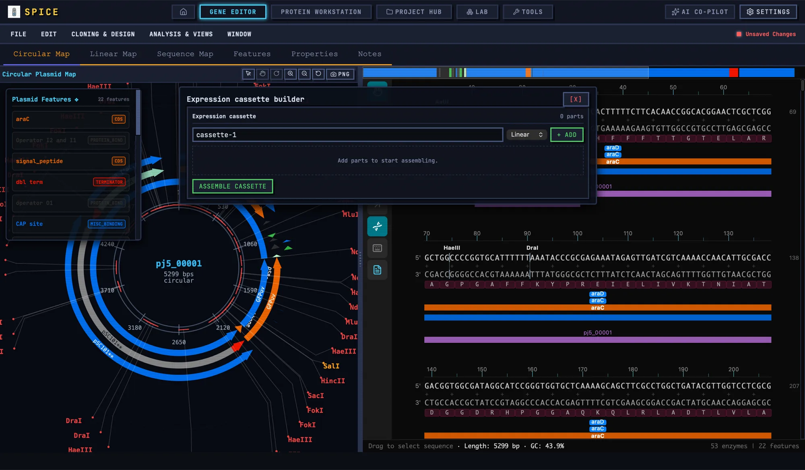

# Expression Cassette Builder

The Expression Cassette Builder assembles a construct from an ordered list of DNA parts. Each part is entered as a name, a role, an orientation, and a raw DNA sequence; assembly concatenates the parts, reverse-complements any part set to the reverse orientation, and writes the resulting sequence and its projected feature annotations to the Gene Editor canvas. The panel is local: it reads and writes the current workbench and makes no network requests.

**Menu:** **Cloning & Design → Expression cassette builder** · **Type:** floating panel

## What it does

- Keeps one cassette with an editable ID, a topology label, and an ordered part list.
- Lets each part carry one of fourteen roles: promoter, enhancer, 5' UTR, translation context, RBS, signal peptide, targeting peptide, linker, fusion tag, CDS, 3' UTR, terminator, Poly(A) signal, or other.
- Concatenates parts in list order on **Assemble cassette**. A part set to `←` is reverse-complemented before concatenation.
- Projects any feature annotations already attached to a part onto the assembled coordinates, reversing their offsets and strand when the part is flipped.
- Hands the assembled sequence and feature list to the Gene Editor, replacing the current sequence and annotations.
- Reports the assembled length in base pairs and the number of projected annotations.

All content is manual. There is no built-in promoter, CDS, terminator, or backbone library, and no sequence import inside this panel; the only DNA that enters a construct is what you type or paste.

## How to use

1. Open **Cloning & Design → Expression cassette builder**. The panel floats over the map and can be dragged by its header.
2. Set the cassette ID in the top text field and choose `Linear` or `Circular` from the topology menu. Topology is a label carried into the result; it does not change how parts are joined.
3. Click **+ Add** once per part. A new row starts as role `CDS`, with the name and ID `part-N` and an empty sequence.
4. Rename the part, choose its role, and set orientation with `→` (forward) or `←` (reverse).
5. Paste the DNA sequence into the sequence box. Input is uppercased and whitespace is removed as you type; the row shows its current length in bp.
6. Reorder rows with `↑` and `↓`, or remove one with `×`. Both actions update the stored part order.
7. Click **Assemble cassette**. The footer reports the assembled length and annotation count.
8. Check the Gene Editor canvas: the assembled sequence is applied immediately and an `Expression assembly applied` entry is added to the history.

## Inputs and results

| Field | Meaning |
|---|---|
| Cassette ID | Identifier stored on the cassette and shown in the header. |
| Topology | `Linear` or `Circular`; recorded on the result, not used during assembly. |
| Part name | Editable label for a part; defaults to its generated ID. |
| Part role | One of the fourteen fixed roles; recorded for the part range and copied to projected features. |
| Orientation | `→` keeps the sequence; `←` reverse-complements it during assembly. |
| DNA sequence | Raw part sequence; only `A`, `C`, `G`, `T`, and `N` are accepted. |
| Length | Current part length in bp, updated as the sequence changes. |
| Assemble cassette | Concatenates the parts and applies the result to the workbench. |
| Result line | Total assembled bp and the number of projected annotations. |

## Limits and caveats

- Assembly is refused if any part contains a character outside `ACGTN`; the error names the offending part. IUPAC ambiguity codes and `U` are rejected.
- Hand-entered parts carry no features, so they project no annotations. The annotation count is non-zero only when the incoming cassette object already has part features, as supplied by another caller or a script.
- Assembly overwrites the entire workbench sequence and feature list rather than inserting into it. Use undo or the history tree if the current document was not saved.
- With no parts, assembly produces an empty sequence and nothing is applied to the canvas.
- Reading frame, required features, forbidden restriction sites, and junction scars are not checked here. Those checks belong to Vector Template Assembly.
- Circular topology does not rotate or wrap the construct; assembly stays a plain concatenation with no origin handling.

## Related

- [Gene Editor](../../gene-editor.md)
- [Vector Template Assembly](vector-template.md)
