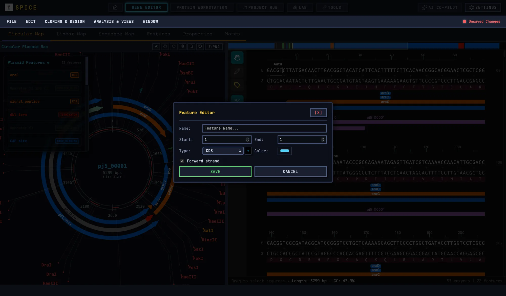

# Feature Editor

Adds a new annotation to the current sequence or edits an existing one. A feature is a named range with a type, colour and strand; it is drawn on the maps and sequence viewer and written into GenBank, EMBL and SPICE Gene exports.

**Menu:** **Edit → Add Feature...** · **Type:** modal

## What it does

The dialog edits a single feature at a time. Opening it from the menu prefills **Start** and **End** from the current selection; with no selection, **End** falls back to **Start**, so the initial range is one base.

- **Name** is free text and is used for the map label, feature list, history entry and export qualifier.
- **Start** and **End** are 1-based and inclusive. `Start = 10` and `End = 10` describe a single base.
- **Type** is chosen from the built-in list `CDS`, `PROMOTER`, `TERMINATOR`, `ORI`, `PRIMER_BIND`, `MISC_FEATURE`, `GENE`, `EXON`, `INTRON`, `RRNA`, `TRNA` and `MRNA`. The `+` button prompts for a custom type, lowercases it and adds it to the list.
- **Color** sets the feature colour in the map and feature list. New features start at `#4cd6ff`.
- **Forward strand** is checked by default. Clearing it marks the feature as reverse-strand; the coordinates stay as entered and no sequence is changed.
- **Save** adds a feature with the next free numeric id, or replaces the edited feature while keeping its id. A history snapshot, a log entry and a success toast are produced, and the modal closes.

Blank names and reversed ranges are rejected. The error toast reads `The name cannot be empty and the start position must be lower than the end position`, and the dialog remains open with the entered values intact.

## How to use

1. Optionally drag a range in the sequence viewer to prefill the coordinates. The **Annotate** tool opens the editor automatically when the drag ends.
2. Choose **Edit → Add Feature...**, or click the pencil on a row in the **Features** tab to edit an existing feature.
3. Enter a name. Adjust **Start** and **End** if the prefilled range is not the one you want.
4. Choose a type and colour. Use `+` to create a custom type if the built-in list is insufficient.
5. Leave **Forward strand** checked for the coding strand, or clear it for a reverse-strand feature.
6. Click **Save**. Use **Cancel**, `[X]` or a click outside the modal to discard the draft.

## Inputs and results

| Field | Meaning |
|---|---|
| Name | Required label for the annotation. An empty string is rejected; a name containing only spaces is accepted. |
| Start | 1-based inclusive start coordinate. Defaults to the current selection start, which is the caret position when no range is selected. |
| End | 1-based inclusive end coordinate. Defaults to the current selection end, or to Start when there is no selection. |
| Type | Built-in category from the list above, or a custom value added with `+`. Custom values are trimmed, lowercased and deduplicated. |
| Color | Colour used for the feature on both maps and for its swatch in the Features tab. |
| Forward strand | Checked writes `forward: true` and draws the feature on the forward strand; cleared writes `forward: false` and draws it as reverse. |
| Save | Validates, writes the feature into the current document, pushes a history snapshot and closes the modal. |
| Cancel | Closes the modal without writing anything. |

## Limits and caveats

- Coordinates are not clamped to the sequence length or checked for integers. Only an empty name and `Start > End` are rejected.
- `Start = End` is allowed and represents one base. `Start > End` is rejected, so a feature spanning the origin of a circular sequence cannot be entered as a single range.
- Clearing a number field can leave the bound value empty or invalid; save is still attempted because the range check is the only coordinate validation.
- The strand checkbox records orientation only. It does not reverse-complement the name, alter the sequence, or swap the coordinates. GenBank and EMBL exports use it to apply `complement(...)`.
- The modal has no notes, qualifiers, accession or product fields, and no delete action. Use the **Features** tab to delete a feature.
- Custom feature types are stored in browser local storage under `spice.gene.customFeatureTypes`, not inside the `.spiceg` document or the project file, so they do not travel with an exported file.
- Closing the modal by any route discards the draft without a confirmation prompt.

## Related

- [Gene Editor](../../gene-editor.md)
- [Export Current Sequence](export.md)
