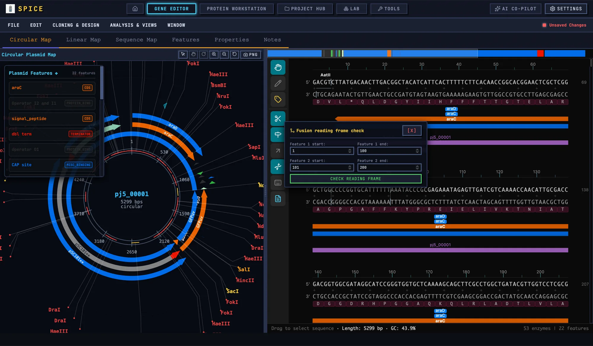

# Fusion Frame Check

The Fusion Frame Check panel compares the coordinates of two feature ranges and reports whether their junction is described as in frame. It returns a frame verdict, the number of bases between the ranges, and a short forward translation of the junction. It checks coordinates only: it does not translate either feature, read its annotation, or modify the sequence.

**Menu:** **Cloning & Design → Fusion Frame Check** · **Type:** floating panel

## What it does

The panel takes four one-based coordinates: the start and end of feature 1 and the start and end of feature 2. On **Check reading frame** it evaluates the junction against frame 0, meaning the first base of the sequence. There is no frame selector, strand control, or CDS-phase input.

- The verdict is derived from the end coordinate of feature 1. The panel reports **In frame** when `(Feature 1 end + 1)` modulo 3 equals 2, and **Frameshift** otherwise.
- **Frame offset** is the number of bases between the end of feature 1 and the start of feature 2, modulo 3. Contiguous ranges give 0.
- The junction window runs from roughly six bases before the end of feature 1 to six bases after the start of feature 2. It is translated from its first base on the forward strand; internal stops appear as `*`, and a stop in the final codon is omitted.
- A green result card marks **In frame**; a red card marks **Frameshift**. The card also shows the offset, the junction DNA, the junction translation, and any warnings.
- Each run writes a `[Fusion] Frame check: …` line to the activity log and shows a success or warning toast.
- Nothing is written to the document, no feature is created or changed, and no undo entry is added.

## How to use

1. Open **Cloning & Design → Fusion Frame Check**. The panel floats over the Gene Editor and can be dragged by its header.
2. Enter the start and end of the first range in **Feature 1 start** and **Feature 1 end**.
3. Enter the start and end of the second range in **Feature 2 start** and **Feature 2 end**.
4. Click **Check reading frame**.
5. Read the verdict and frame offset on the result card.
6. Check the junction sequence and translation, then read any warning line.
7. Edit a coordinate and run again; the card is replaced with the new result.
8. Close the panel with **[X]**. The coordinates and last result remain in panel state until they are changed or the page is reloaded.

The panel does not import the selected annotation, so the coordinates must be typed. It also does not verify that the ranges exist, are ordered, or lie inside the sequence.

## Inputs and results

| Field | Meaning |
|---|---|
| Feature 1 start | One-based start of the first range; accepted but not used in the verdict or offset. |
| Feature 1 end | One-based end of the first range; determines the **In frame** or **Frameshift** verdict. |
| Feature 2 start | One-based start of the second range; used for the frame offset and the mismatch warning. |
| Feature 2 end | One-based end of the second range; accepted but not used in the calculation. |
| Reading frame | **In frame** or **Frameshift**, coloured green or red. |
| Frame offset | Bases between the two ranges, modulo 3, reported in bp as 0, 1, or 2. |
| Junction sequence | DNA window spanning the junction, printed in upper case. |
| Junction translation | Amino-acid translation of that window in the forward orientation; `*` marks a stop. |
| Warnings | Mismatch and gap messages joined with semicolons. A mismatch reports the two computed codon positions; a gap reports a non-zero offset. |

A zero offset does not mean the fusion is in frame. The verdict and the offset are independent, and a three-base or six-base gap also reduces to an offset of zero while adding bases at the junction.

## Limits and caveats

The check is a coordinate rule, not a biological validation. The verdict uses only the end of feature 1 and a fixed frame-0 convention, so the start of feature 1, the end of feature 2, the actual annotations, and the reading frame of either coding sequence are ignored. The label reflects the implementation's boundary rule and should be confirmed by translating the assembled construct.

Ranges are not validated. Reversed, zero, negative, or out-of-sequence coordinates are accepted; the junction window is clipped to the sequence, and a reversed range can produce an empty junction sequence and translation. Reverse-strand features are not handled.

The junction translation always starts at the first base of the window rather than at a codon boundary or the feature's reading frame, so it is a local sketch, not the fusion protein. Internal stops are shown, but a stop in the final codon is dropped.

Frame offset counts bases rather than codons. A 3 bp or 6 bp insertion still gives 0 even though it adds amino acids, so treat the value as a quick consistency indicator rather than a measure of the fusion product. There is no warning when the offset is zero but the two ranges are not contiguous.

## Related

- [Gene Editor](../../gene-editor.md)
- [Ribosomal Slippage](slippage.md)
