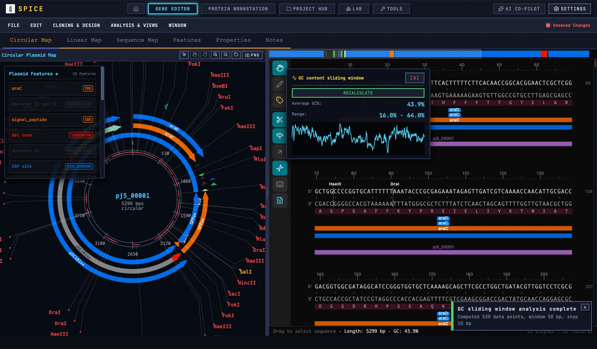

# GC Sliding Window

The GC Sliding Window panel measures GC content in fixed 50 bp windows stepped 10 bp along the open sequence and presents the result as an average, a range, and a sparkline. It is read-only: it reports on the sequence and never edits it.

**Menu:** **Analysis & Views → GC Sliding Window** · **Type:** floating panel

## What it does

Choosing the menu item toggles the panel and, when opening it, runs the analysis immediately. The sequence is uppercased and a window of 50 bases starts at position 0; its GC percentage is the count of G and C divided by the window length, multiplied by 100, and the next window starts 10 bases later. Windows continue to the end of the sequence, and the final window is shortened when fewer than 50 bases remain. Every character in the window, including N and other ambiguity codes, stays in the denominator but is not counted as GC.

The panel prints the mean of all window values as **Average GC%** and the smallest and largest values as **Range**, both to one decimal place. Beneath them an SVG polyline plots the points left to right. The trace has no axes, labels, or readout; its height is scaled between the run's own minimum and maximum, with a dashed horizontal guide at mid-height.

**Recalculate** repeats the run against the current sequence. Each run appends a line to the Activity Log and raises a completion toast naming the number of data points, window size, and step size. The panel is about 320 px wide, can be dragged by its header, and closes with **[X]**.

## How to use

1. Open the sequence in the [Gene Editor](../../gene-editor.md).
2. Choose **Analysis & Views → GC Sliding Window**. The panel opens and the first run starts automatically.
3. Read **Average GC%** and **Range** for the overall picture.
4. Read the trace from left to right; position is linear from the first base to the last, but the vertical scale is relative.
5. Edit the sequence, then press **Recalculate** to refresh the figures.
6. Close the panel with **[X]**. Reopening from the menu runs the analysis again.

## Inputs and results

| Field | Meaning |
|---|---|
| Open sequence | The full editor sequence, read-only input; the current selection is ignored. |
| Window length | Fixed at 50 bp; there is no control for it. |
| Step | Fixed at 10 bp between window starts. |
| Average GC% | Mean GC percentage across every window, one decimal place. |
| Range | Lowest and highest window GC percentage, one decimal place each. |
| GC trace | Sparkline of every window value; no axes, hover values, or coordinates. |
| Recalculate | Re-runs the whole analysis against the current sequence. |

## Limits and caveats

The window and step are hard-coded at 50 and 10 bp, so resolution and smoothing cannot be adjusted and short features may be averaged away. The plot is computed only when the panel opens or **Recalculate** is pressed; editing the sequence while the panel stays open leaves stale numbers on screen.

Opening the panel from the **GC sliding window** checkbox in **Window → Customize Settings** only shows the panel and does not run the analysis, so the result area stays empty until **Recalculate** is pressed.

The last window is truncated at the sequence end, so its percentage rests on fewer than 50 bases and can swing more sharply than earlier points. N and other non-ACGT characters depress the percentage because they occupy space in the denominator without counting as GC.

The vertical axis is fitted to the observed minimum and maximum, not to 0–100%, so the dashed midline is not the 50% mark and amplitudes are not comparable between sequences. The analysis is also linear: a circular plasmid gets no window across its origin, so the junction at base 1 is not represented as a wrapping window.

Results are display-only and are not written to the edit history, the project file, or any export.

## Related

- [Gene Editor](../../gene-editor.md)
- [Fusion Frame Check](fusion-check.md)
