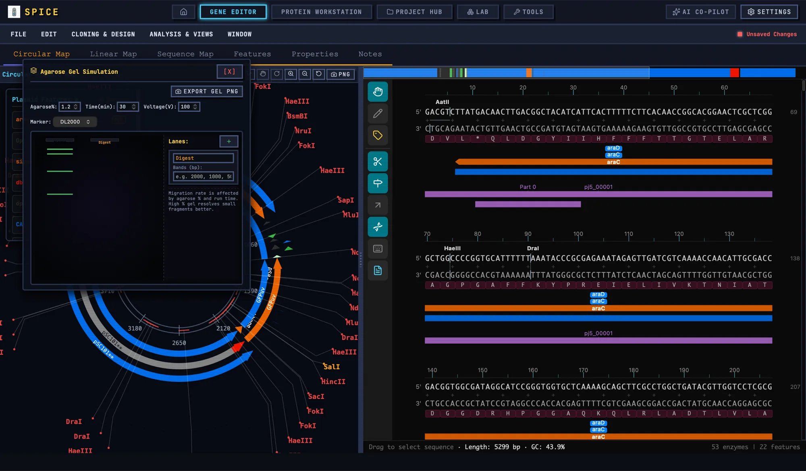

# Agarose Gel Simulation

`Agarose Gel Simulation` draws a schematic electrophoresis gel from band sizes that you type in, or that the PCR Simulator sends over. It is a planning and teaching view: it neither digests the open sequence nor consults the selected enzymes.

**Menu:** **Cloning & Design → Agarose Gel Simulation** · **Type:** floating panel

## What it does

The panel renders a 260 px gel tank with a fixed marker lane on the left and any number of sample lanes to its right. Each lane is 50 px wide and starts 110 px after the previous one; the visible tank is 230 px wide, so the gel scrolls horizontally as lanes are added.

Band position is a log-size model. For a fragment of `bp`, the vertical position is `(A − B × ln(bp)) × (runTime / 30) × 1.6`, where `A = 210 − 15 × log(agarose) / log(1.2)` and `B = 25 + 3 × log(agarose) / log(1.2)`. Larger fragments therefore stay near the top and smaller fragments migrate further down. Run time scales every position linearly; agarose percentage changes both the slope and the offset.

Fragment sizes are clamped to 50–20000 bp before migration, so anything outside that window is drawn at the corresponding edge. Sizes are otherwise plotted exactly as entered, with no adjustment for overhangs, topology, or fragment intensity.

The marker lane uses one of four hard-coded ladders: `DL2000` (2000, 1500, 1000, 750, 500, 250, 100), `DL5000` (5000, 3000, 2000, 1500, 1000, 500, 250, 100), `DL10000` (10000, 7000, 5000, 3000, 2000, 1500, 1000, 500), or `1kb Plus` (12000, 8000, 5000, 3000, 2000, 1500, 1000, 500, 300, 100). Marker bands are positioned by the same function as sample bands; there is no separate calibration curve.

Labels are resolved for collisions by pushing text downward to a minimum spacing of 9 px. The band lines themselves do not move.

The first lane is named `Digest` and cannot be removed. It starts empty in the Gene Editor, and new lanes added with `+` also start empty because the editor passes an empty fragment list. `Send to Electrophoresis` in the PCR Simulator appends a lane named `PCR Prod N` containing the product length and opens this panel.

## How to use

1. Open the panel. The `Digest` lane is empty and the marker defaults to `DL2000`.
2. Set `Agarose%`, `Time(min)`, and `Voltage(V)`.
3. Type the expected fragment sizes into the lane's `Bands (bp)` field as comma-separated integers, or run a PCR simulation and use `Send to Electrophoresis`.
4. Click `+` to add another lane, edit its name above the well, and enter its bands. Multi-lane comparisons are the point of the panel.
5. Compare sample lanes against the marker by eye. The panel does not calculate sizes from migration distances.
6. Click `Export Gel PNG` to save the tank as a PNG through the system save dialogue. The filename is `<plasmid>_gel_<agarose>pct.png`.

## Inputs and results

| Field | Meaning |
|---|---|
| `Agarose%` | Gel concentration, 0.3–3 in 0.1 steps; default 1.2. Changes the slope and offset of the migration model. |
| `Time(min)` | Run time, 5–120 in 5-minute steps; default 30. Multiplies every band position. |
| `Voltage(V)` | 50–300 in 10 V steps; default 100. Printed in the export caption only and does not affect band position. |
| `Marker` | Selects one of the four fixed ladders listed above. |
| `Lanes` `+` | Appends a lane; it is named `Lane N` and starts with the current digest fragments, which are empty in the Gene Editor. |
| Lane name | Free text shown above the well; editing it does not change the bands. |
| `Bands (bp)` | Comma-separated positive integers. Non-numeric parts, zero, and negatives are discarded. |
| `Export Gel PNG` | Saves a PNG of the tank and its caption at the multiplier chosen in Settings (1×, 2×, 4×, or 8×; default 4×). |

## Limits and caveats

- The panel does not perform a restriction digest. It never reads the sequence or the selected enzymes, and it cannot populate a lane from a digest; sizes are manual or come from the PCR Simulator.
- `Voltage(V)` is inert. Only agarose percentage and run time move bands, despite the control and the caption.
- The 50–20000 bp clamp means a 30 bp primer and a 25 kb plasmid both sit on the edge of the gel rather than off it. Migration values are also clamped to 25–240 px, so long runs pile bands against the bottom edge.
- There is no intensity, band-width, supercoiled/nicked/linear distinction, or ladder regression. Marker migration uses the same model as samples, so the comparison is internally consistent but not a calibrated size estimate.
- Collision resolution moves the label only. A crowded lane can show a size label below its band; trust the band line, not the text position.
- The exported image contains only the gel tank and the caption. Lane management controls, the note, and toast messages are not included.
- The first lane is always present and cannot be deleted; only added lanes have a delete button.
- The panel is 380 px wide and cannot be resized. With many lanes, use the horizontal scroll area rather than expecting the window to grow.

## Related

- [Gene Editor](../../gene-editor.md)
- [PCR Simulator](pcr.md)
- [Restriction Enzymes](enzymes.md)
- [Cloning Simulation Wizard](cloning-wizard.md)
