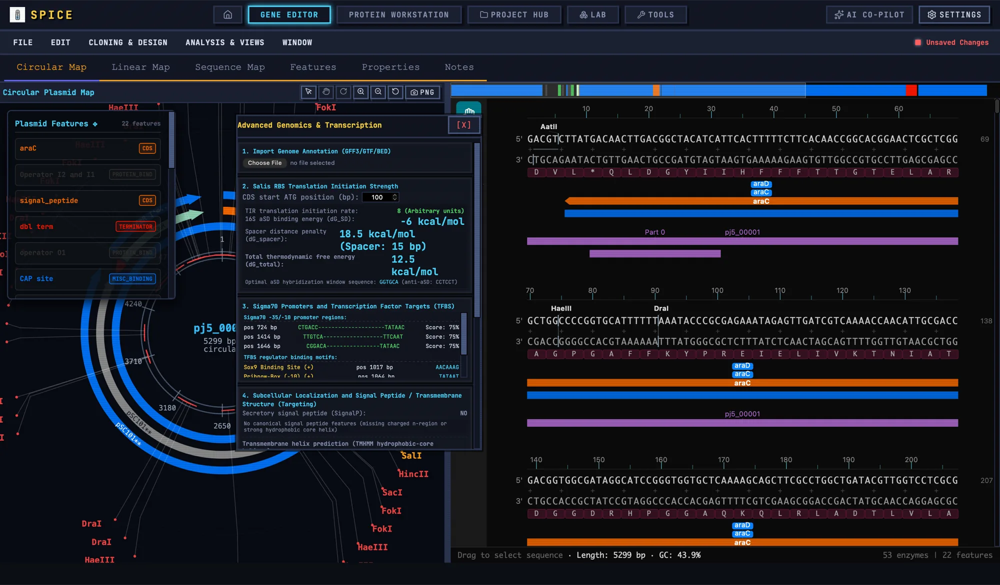

# Advanced Genomics Tools

Advanced Genomics Tools is a read-mostly inspection panel for the open Gene Editor document. Its header reads **Advanced Genomics & Transcription**, and it stacks five numbered sections: annotation import, a thermodynamic estimate of translation initiation at one start codon, Sigma70 promoter and transcription-factor motif scans, N-terminal signal-peptide and transmembrane predictions, and composition scans for GC skew, CpG islands, and tandem repeats. Every result is recomputed from the current sequence and feature list, so there is no run button and no result to refresh.

**Menu:** **Analysis & Views → Advanced Genomics Tools** · **Type:** floating panel

## What it does

All five sections read the open document, and only the first writes back. An imported GFF3, GTF, or BED file is parsed and its rows are appended to the document's feature list, where they appear in the map and in the Features view. The remaining sections are read-only: they price one translation-initiation site, report promoter and motif hits, scan the N-terminus of the translated sequence for targeting signals, and summarise sequence composition.

The analysis sections clean the sequence to A, C, G, and T before scanning, so ambiguous bases and gaps are removed and their reported positions are indices into the cleaned sequence. Imported annotation coordinates are not cleaned; they are applied as they appear in the file.

## How to use

1. Load a sequence in the Gene Editor, then choose **Analysis & Views → Advanced Genomics Tools**. The panel opens at a fixed size over the map.
2. Import annotation with **Choose File**, which accepts `.gff`, `.gff3`, `.gtf`, and `.bed`. Parsed rows are appended to the current feature list and counted in a toast and a log entry. A file with no parseable rows produces a warning and changes nothing.
3. Set **CDS start ATG position (bp)**, default `100`, minimum `25`. The TIR, binding energy, spacer penalty, and total free energy update as you type.
4. Read section 3 for promoter and TFBS hits. Each list is ranked and truncated.
5. Read section 4 for the signal-peptide call and any transmembrane helices.
6. Scroll inside the panel to section 5 for GC skew, CpG islands, and tandem repeats.
7. Drag the header to move the panel and click `[X]` to close it. The panel has no apply or run step.

## Inputs and results

| Field | Meaning |
|---|---|
| Annotation file | A GFF3, GTF, or BED file. Features are appended to the document, not filtered against the current sequence length. |
| CDS start ATG position | 1-based position in the cleaned sequence, default 100. The value is not checked against an actual ATG. |
| TIR translation initiation rate | Arbitrary units from a logistic function of the total free energy, rounded to an integer. |
| 16S aSD binding energy | Best six-base anti-Shine-Dalgarno match in the 25 nt upstream window, scored at −1.5 kcal/mol per Watson–Crick pair. |
| Spacer distance penalty | Zero for a 5–9 nt spacer, with a quadratic penalty below 5 and above 9. |
| Total free energy | Sum of the aSD binding energy and the spacer penalty. |
| Sigma70 promoter regions | TTGACA and TATAAT consensus matches separated by 15–20 bp; score is percentage identity over the 12 compared positions. Top three listed. |
| TFBS regulator motifs | Forward and reverse matches to five built-in consensus patterns; the first five by position are listed. |
| Secretory signal peptide | Yes or no plus the predicted cleavage position, from a tripartite N-terminal heuristic. |
| TM helix | Non-overlapping 20-residue windows whose mean Kyte–Doolittle hydrophobicity exceeds 1.5, with that mean. |
| Average GC skew | Mean (G−C)/(G+C) over 100 bp windows stepped by 20 bp. |
| CpG islands | Merged 200 bp windows with GC content of at least 50% and observed/expected CpG of at least 0.6. Top three listed. |
| Tandem repeats | Patterns of 1–6 bp repeated at least three times with a minimum total length. Top three listed. |

## Limits and caveats

- These are consensus and heuristic scans, not database searches. Nothing is aligned to a reference genome and no annotation is fetched from a server.
- Imported coordinates are applied directly to the open sequence. There is no chromosome or scaffold selection and no bounds check, so rows beyond the sequence end remain in the feature list. Only lowercase `cds` receives the CDS colour; `CDS` from a GFF3 file keeps the default colour.
- The RBS section is a compact approximation, not the Salis RBS calculator. It scores one six-base anti-Shine-Dalgarno match in a 25 nt window, charges a fixed −1.5 kcal/mol per pair, and does not model mRNA structure. An out-of-range ATG position yields a short or empty window and meaningless energies.
- Promoter prediction scans the forward strand only, uses fixed TTGACA and TATAAT boxes, and lists only the three highest scores. TFBS scanning uses five built-in consensus patterns on both strands and lists the first five by position, not by score.
- Signal-peptide and transmembrane predictions translate from the first base of the document in a single frame and never re-frame to an annotated CDS. The signal-peptide scan reads only the first 50 amino acids and is not SignalP.
- Skew, CpG, and repeat parameters are fixed at 100/20 bp, 200/50 bp, and pattern lengths of 1–6 bp. There are no controls for them in the panel.
- CpG islands and tandem repeats show at most three entries, with no show-all control.
- The panel has no export control of its own; its only write is the imported feature set.

## Related

- [Gene Editor](../../gene-editor.md)
- [Synthetic Biology CAD](synbio.md)
