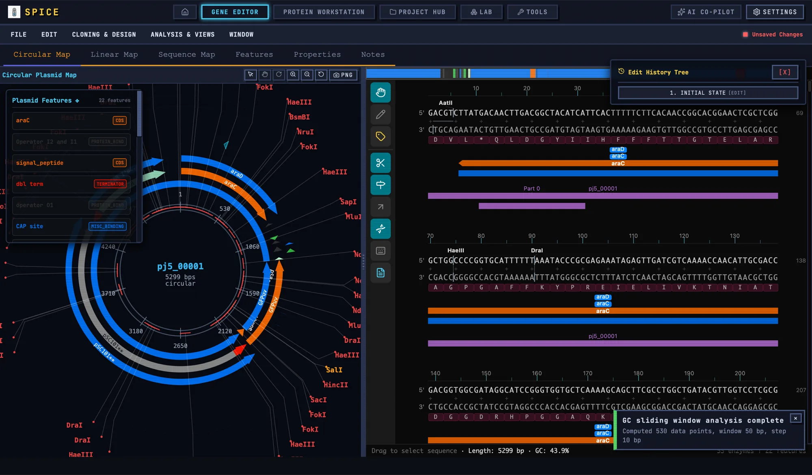

# Edit History Tree

The Edit History Tree panel lists every editor snapshot the current session has recorded and lets you jump back to any of them. Despite the name, the panel renders a flat numbered list rather than a branching tree: each row is one saved sequence and feature set, oldest first.

**Menu:** **Window → Edit History Tree** · **Type:** floating panel

## What it does

The Gene Editor seeds the history with an **Initial state** snapshot after the page loads. Each tracked operation then appends a snapshot containing the sequence, the feature list, a label, and an operation type such as `edit`, `clone`, or `import`. Tracked operations include file and database imports, cloning simulations, feature add, edit and delete, topology changes, silent mutagenesis, end modifications, SPD loads, expression assemblies, and Lua script patches.

The panel shows the snapshots in creation order, numbered from 1, with the label and the operation type in square brackets. The list is scrollable and the newest entry is at the bottom.

Clicking an entry restores that snapshot's sequence and feature annotations into the editor and highlights the row. The Activity Log records the restored step. This is a jump, not a rollback: later snapshots stay in the list and the undo/redo stacks are left untouched, so you can inspect an earlier state and still return to the newest one.

The **Edit → Undo** and **Edit → Redo** commands, and their keyboard shortcuts, walk the same stack one snapshot at a time. Undo is available only when more than the initial snapshot exists; a new tracked edit clears the redo side. The panel is about 320 px wide, limited to 540 px high with a scrolling list, can be dragged by its header, and closes with **[X]**.

## How to use

1. Open a sequence in the [Gene Editor](../../gene-editor.md) and make some edits.
2. Choose **Window → Edit History Tree**.
3. Scroll the numbered list; entry 1 is the initial state and the last entry is the most recent snapshot.
4. Click a row to restore its sequence and features. The row is highlighted and the Activity Log records the step.
5. Use **Edit → Undo** or **Edit → Redo** for stepwise movement when you do not want to jump.
6. Close the panel with **[X]**.

## Inputs and results

| Field | Meaning |
|---|---|
| Snapshot number | 1-based position in the list; 1 is the initial state. |
| Label | Short description of the operation that created the snapshot, such as an import or clone name. |
| Operation type | Tag in square brackets, for example `edit`, `clone`, or `import`. |
| Current row | Highlighted entry matching the last snapshot clicked in the panel. |
| Restored state | The snapshot's sequence and feature list, applied to the editor when a row is clicked. |
| Undo / Redo | Edit-menu commands that move the stack cursor; disabled when there is nothing to move to. |

## Limits and caveats

The panel is a list, not a genealogy: it shows no parent links, timestamps, sizes, or diffs, and the branching tree view defined in the history module is not rendered here.

Restoring a snapshot replaces only the sequence and features. The plasmid name, topology setting, selected enzymes, notes, cloning lineage list, open analysis panels, and other editor state are not restored and keep their current values.

Clicking a row does not truncate the list or change the undo/redo stacks, so an Undo straight afterwards moves from the stack top rather than from the snapshot you clicked.

The stack holds at most 100 snapshots and drops the oldest entry when full. Not every change is recorded: the plain-text fallback import, opening a different document or tab, and some project loads do not append a snapshot, and the list is not cleared when another document is opened, so old rows can refer to a different sequence.

## Related

- [Gene Editor](../../gene-editor.md)
- [Cloning Simulation Wizard](cloning-wizard.md)
