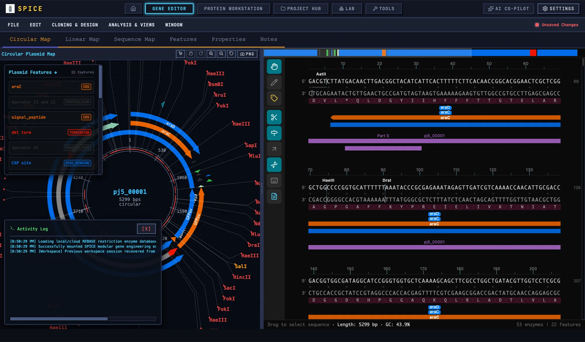

# Activity Log

The Activity Log is a read-only console that lists timestamped messages from the current Gene Editor session. It reports what the editor has just done with the open sequence, such as loading a file, saving a project, running a cloning simulation, or synchronising a database; it is not an application-wide diagnostic log and it does not show native backend output.

**Menu:** **Window → Activity Log** · **Type:** floating panel

## What it does

The editor appends a line whenever one of its operations completes. The line is prefixed with the local wall-clock time in square brackets, followed by a localised message. Many operations also add a short tag of their own, so entries can begin with markers such as `[UNDO]`, `[REDO]`, `[ELN]`, `[SPD]`, `[BLAST]`, or `[Script]` after the timestamp.

Recorded events include project and document creation, loading, saving, and closing; autosave and workspace recovery; file, SnapGene, Sanger, GenBank, FASTA, Ensembl, NCBI, and UniProt imports; exports; cloning and expression assembly; feature, primer, note, and history actions; circularisation, linearisation, and flipping; enzyme and UniVec synchronisation; auto-annotation; alignment; searching; silent mutagenesis; end modification; GC window, fusion, and annealing runs; and panels that hand their own log messages to the editor.

The panel keeps the entries in memory for the life of the page. They are displayed newest first, so the most recent action is always at the top, and the list scrolls within a fixed 360 × 240 px panel. The panel sits at the lower left of the workbench, can be dragged by its header, and closes with **[X]**. The **Mod+J** shortcut toggles it and raises a brief toast saying whether the log is shown or hidden.

## How to use

1. Open a sequence in the [Gene Editor](../../gene-editor.md) and perform an operation, such as importing a file or running a cloning simulation.
2. Choose **Window → Activity Log**, or press **Mod+J**.
3. Read the newest entry at the top of the list; older entries continue downwards.
4. Drag the header to move the panel clear of other floating panels.
5. Press **Mod+J** again, or click **[X]**, to hide the panel. Hiding it does not clear the entries.
6. Reopen the panel later in the same session to see the accumulated history.

## Inputs and results

| Field | Meaning |
|---|---|
| Log entry | One completed editor operation, rendered as a single line. |
| Timestamp | Local time of day in square brackets, with no date. |
| Prefix tag | Optional operation marker added by the source feature, such as `[UNDO]` or `[ELN]`. |
| Message | Localised description of the action, often naming the file, sequence, feature, or result. |
| Ordering | Newest entry first; the list grows downwards into older entries. |
| Empty state | `No log output` until the first logged operation. |

## Limits and caveats

The log is session state, not project data. Entries are held in a reactive array in the page and are never written to the project file, `localStorage`, or an export, so a reload or a new window starts with an empty log. The panel's open or closed state is stored in the editor's view preferences and can therefore reopen on the next launch, but its contents will still be empty.

The array is trimmed to the most recent 100 entries before each new line is appended, so it stays at roughly 100 lines and silently discards the oldest ones. There is no clear button, search, severity filter, copy action, export, or resize handle. All lines use the same cyan style even though the stylesheet defines other severity classes.

Long messages do not wrap. The panel scrolls vertically only, so a message wider than the panel is clipped at the right edge rather than wrapping onto a second line.

The log covers actions performed in the Gene Editor page. Routing changes, MCP or agent activity, and the native backend's standard output are not streamed into it, and some operations report only through a toast without adding a log line. Startup synchronisation can add entries before you interact with the panel, and the same log persists across document and tab switches within the session, so older entries may refer to a different sequence.

## Related

- [Gene Editor](../../gene-editor.md)
- [Settings workspace](../../settings.md)
