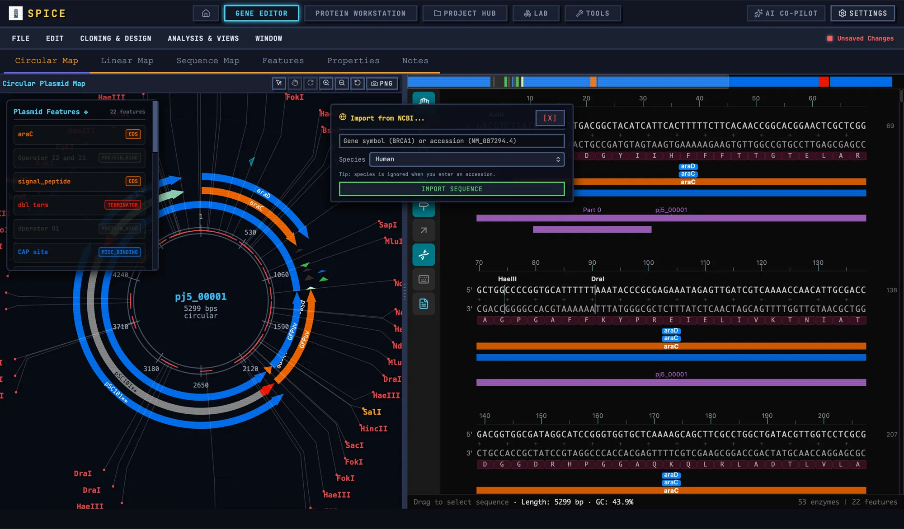

# NCBI Import

Fetches a nucleotide record from NCBI by gene symbol or accession and loads its sequence and annotations into the Gene Editor, so a public GenBank record can be used as the starting document without a manual download.

**Menu:** **File → Import from NCBI...** · **Type:** floating panel

## What it does

The panel accepts a gene symbol or an accession. Input that matches the accession pattern — one to four letters, an optional underscore, at least three digits, and an optional version suffix, such as `NM_007294.4` — is fetched literally and the species selection is ignored. Anything else is resolved with Entrez `esearch` against the `nuccore` database, one hit at a time, using a ladder of queries that prefer curated RefSeq mRNA and exclude `PREDICTED` records. When a species is selected, organism-constrained variants are tried first, followed by organism-free variants and finally the raw term, so an incorrect species guess degrades to a broader search rather than failing outright. The resolved identifier is then fetched with Entrez `efetch` in GenBank flat-file format, and the `ORIGIN` sequence plus recognised feature rows are parsed. On success the current sequence and annotations are replaced, an import step is added to the Edit History Tree, a summary is written to the Activity Log, and a success toast is shown. The panel stays open after an import.

The requests leave the machine: they go to `eutils.ncbi.nlm.nih.gov` from the Rust backend in the packaged desktop app, or directly from the browser preview via `fetch`. The service is public and the requests carry no API key.

## How to use

1. Open **File → Import from NCBI...**.
2. Type a gene symbol such as `BRCA1` or an accession such as `NM_007294.4` into the query field.
3. Choose a **Species** if you are searching by symbol. Leave it at **Any (auto)** for an unconstrained search; the choice is ignored when the input is an accession.
4. Press **Enter** or click **Import sequence**.
5. Wait while the button reads **Searching…** and is disabled.
6. On success, check the document name in the workspace and review the imported features on the Features tab; close the panel with **[X]** when finished.

## Inputs and results

| Field | Meaning |
|---|---|
| Gene symbol or accession | The query sent to NCBI. Accession-shaped text bypasses the symbol search; other text is resolved through `esearch` in `nuccore`. |
| Species | Organism constraint for symbol searches: **Any (auto)**, Human, Mouse, Rat, Zebrafish, Xenopus, Chicken, Fruit fly, Roundworm, Yeast, E. coli, Thale cress, Rice, Tobacco, Tomato, Soybean, Maize, or Agrobacterium. The choice is stored locally in `spice_ncbi_organism` and ignored for accessions. |
| Import sequence | Submits the lookup. It is disabled during the request and displays **Searching…**; **Enter** in the query field does the same. |
| Sequence | The `ORIGIN` block with non-letter characters removed and bases upper-cased. It replaces the current document sequence. |
| Name | The record's `/organism` qualifier, or the first comma-delimited part of its `DEFINITION`, falling back to `NCBI:<query>`. |
| Features | Recognised GenBank feature rows: `CDS`, `gene`, `promoter`, `exon`, `mRNA`, `tRNA`, `rRNA`, `rep_origin`, and `misc_feature`. Each is named `<type>_<start>` and marked reverse-strand when its location begins with `complement`; for joined locations only the first range is used. |

## Limits and caveats

- Only the `nuccore` nucleotide database is queried, so protein accessions and protein-only records are not imported.
- Symbol resolution takes the first hit returned by relevance ranking. A symbol shared by several genes, or a species guess that is not among the listed organisms, can produce a different record or a resolution failure; entering a RefSeq accession directly is the reliable path.
- The accession heuristic is textual. A symbol that happens to match the pattern is fetched literally, while an unusual accession that does not match is sent through the symbol-search ladder.
- Requests time out after 15 seconds each, and a symbol search can issue several sequential `esearch` calls before one succeeds. There is no API key, retry policy, or rate-limit handling, so repeated or bulk imports may be throttled by NCBI.
- An empty field is rejected before any request with the toast **NCBI Import**, message **Please Input Accession Number (e.g. P0DTC2)**.
- A resolution failure, HTTP error, or record with no `ORIGIN` sequence produces an error toast, writes a failure line to the Activity Log, and leaves the loaded document unchanged.
- The import replaces the current document without a confirmation prompt. Save or export first if the existing sequence matters.
- Feature parsing reads a fixed set of keywords and ignores qualifiers, so annotation names and other attributes are not carried over; features with multi-segment locations are represented by their first segment only.
- The panel does not close on success.

## Related

- [Gene Editor](../../gene-editor.md)
- [Ensembl Import](ensembl.md)
