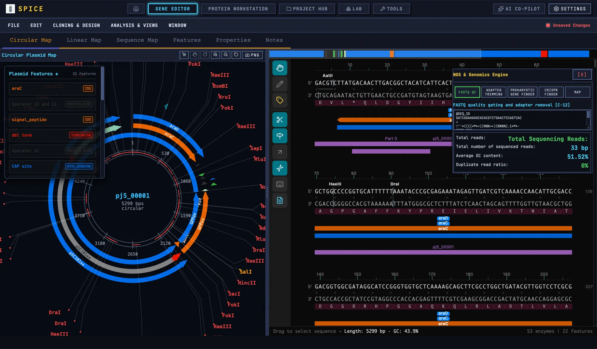

# NGS & Genomics Engine

The NGS & Genomics Engine gathers five short-read and prokaryotic-genomics tools in one panel: FASTQ quality control, adapter trimming, ORF-based gene prediction, CRISPR array detection, and read mapping with single-nucleotide variant calling. The open editor sequence supplies the template or reference for every tab that needs one, and reads are pasted as text, so nothing leaves the app.

**Menu:** **Cloning & Design → NGS & Genomics Engine** · **Type:** floating panel

## What it does

**FASTQ QC** recalculates as soon as the read text changes. It uses the Rust backend when the desktop build is available and the TypeScript implementation otherwise, and reports four rows: total reads (currently rendered as the heading "Total Sequencing Reads:" rather than a count), average read length in bp, average GC content, and duplicate read ratio. The duplicate row turns red above 20 per cent. The underlying report also computes per-position base qualities, a quality distribution, and hits against three common adapters, but the panel does not display them.

**Adapter Trimming** trims the reads held in the FASTQ QC text box. An empty adapter field selects three defaults: Illumina TruSeq R1 (AGATCGGAAGAGCACACGTCTGAACTCCAGTCA), TruSeq R2 (AGATCGGAAGAGCGTCGTGTAGGGAAGAGTG), and Nextera transposase (CTGTCTCTTATACACATCT). Entering a sequence replaces that list with one custom adapter. A full adapter match, or a 3' partial match of 6–15 bp, is cut away, and the read is only shortened when at least 15 bp remain.

**Prokaryotic Gene Finder** finds open reading frames of at least 90 bp on both strands, starting at ATG, GTG, or TTG and ending at the next in-frame TAA, TAG, or TGA. Each hit reports a 1-based range and strand, whether a Shine–Dalgarno-like motif (AGGAGG, GGAGG, or GAGG for a 35 point bonus; GGAG or AGGA for 20) occurs in the 18 bp upstream, and a confidence score of 45 plus the RBS bonus plus a length term capped at 45 (length in bp ÷ 300 × 10), clamped to 99.

**CRISPR Finder** scans the forward strand for direct-repeat arrays. Repeats are 23–40 bp, spacers 21–72 bp, each repeat may differ from the first by at most two bases, and an array needs at least three repeats. Each array reports its 1-based range, repeat count, direct-repeat consensus, spacer count, and a conservation score of 50 plus 10 per repeat, capped at 100.

**Map** performs ungapped end-to-end read mapping against the open sequence and calls single-nucleotide variants from the resulting pileup. Seeding uses 11-mers against the forward and reverse-complement reference, both strands are searched, only the best hit per read is reported, and reads below the minimum identity are discarded. Variants need a depth of at least 3 and an alternative allele frequency of at least 0.2. The tab reports mapped reads, unmapped reads, and variant count, then one row per variant with its position, ref>alt change, depth, and allele frequency.

## How to use

1. Open the template or reference sequence in the [Gene Editor](../../gene-editor.md).
2. Open **Cloning & Design → NGS & Genomics Engine** and drag it by its header if it covers the sequence. Close it with **[X]**.
3. For **FASTQ QC**, paste four-line FASTQ records into the text box; the four rows update on every edit.
4. For **Adapter Trimming**, use the reads already entered on the FASTQ QC tab. Leave the adapter field empty to use the three defaults, or enter a custom adapter, then click **Adapter trimming succeeded!** The toast and Activity Log report how many reads were trimmed; the read text is not rewritten.
5. For **Prokaryotic Gene Finder** or **CRISPR Finder**, simply open the tab. Both scan the current sequence automatically and show a Rust computing indicator while the ORF search runs.
6. For **Map**, paste FASTQ reads into the Map tab's own text box, set **Min identity** (0.5 to 1.0, default 0.9), and click **Map reads & call variants**.
7. Read the mapped, unmapped, and variant counts, then inspect the variant rows. Check the Activity Log for the mapping summary line.

## Inputs and results

| Field | Meaning |
|---|---|
| FASTQ text (FASTQ QC) | Four-line records: `@` header, sequence, `+` line, quality. Malformed records are skipped. |
| Total reads | A label row whose value is currently the heading "Total Sequencing Reads:" rather than a count. |
| Total number of sequenced reads | Despite the label, this row displays the average read length in bp. |
| Average GC content | GC bases divided by all bases across the parsed reads, as a percentage with two decimals. |
| Duplicate read ratio | Reads whose sequence occurs more than once, counted as extra copies ÷ total reads, shown in red above 20 per cent. |
| Adapter sequence | Optional custom adapter; when blank, the TruSeq R1, TruSeq R2, and Nextera sequences are used. |
| Adapter trimming button | Runs trimming on the FASTQ QC text and reports the trimmed-read count in a toast and the Activity Log. |
| Gene ID | Sequential identifier for each predicted ORF. |
| Range | 1-based start and end in the open sequence, with the strand; on the Rust path the end can be one base beyond the true ORF. |
| Start / Stop | Always displayed as ATG and TAA because the backend result carries no codon fields, even when the scan used GTG, TTG, TAG, or TGA. |
| SD sequence | Whether a Shine–Dalgarno-like motif was found in the 18 bp upstream. |
| Overall confidence score | Heuristic score out of 100, not a probability. |
| CRISPR array row | Repeat count, 1-based range, direct-repeat consensus, spacer count, and conservation score. |
| Reference | Length in bp of the current sequence, after trimming outer whitespace. |
| Min identity | Fraction of matching bases required over the whole read; default 0.9. |
| Mapped / Unmapped / Variants | Counts from the last mapping run. |
| Variant row | 1-based position, ref>alt, sequencing depth after ×, and alternative allele frequency as a percentage. |

## Limits and caveats

The FASTQ QC and Map tabs have separate text boxes. Adapter trimming always reads the FASTQ QC box, even when the Map tab is open, and it does not write trimmed reads back into either box or into the document. Only the trimmed-read count and log line survive, so export trimmed reads elsewhere if they are needed downstream.

FASTQ parsing is strict. A record is skipped unless the header begins with `@`, the third line begins with `+`, and the sequence is non-empty. The mapping parser does not check that sequence and quality lengths agree, and duplicate read identifiers collapse to the first sequence during variant calling.

Mapping is ungapped and end-to-end, so a read carrying an insertion or deletion usually fails the identity threshold or maps with misleading mismatches; indels are never called. Reads longer than the reference, or with no shared 11-mer seed, are counted as unmapped. Only one best hit is reported per read, ties at two loci yield MAPQ 0, and MAPQ itself is never displayed. Lowering **Min identity** admits partial matches, and those mismatches then appear as apparent SNVs.

Variant calling uses fixed thresholds of depth 3, allele frequency 0.2, and mapping quality 0, with no base-quality weighting, strand-bias filter, or multiple-testing correction. The strand-bias value is computed but not shown. Low-depth amplicon data can fail the depth threshold entirely, so an empty variant list does not prove that the sample matches the reference.

The gene finder is a heuristic ORF scan, not a trained gene model. It reports every ORF of at least 90 bp, including nested alternatives, rather than a non-redundant gene set, and the RBS check reads the upstream 18 bp on the forward strand even for minus-strand genes. The Rust result also carries an exclusive end that the panel converts as though it were inclusive, so a Rust-path gene can extend one base past its real end; the Rust and TypeScript paths can differ slightly in boundaries. Start and stop codons are always shown as ATG and TAA for the same reason: the codon fields are absent, so the actual GTG, TTG, TAG, or TGA used by the scan is not displayed. The CRISPR finder scans the forward strand only, does not detect PAMs or cas genes, and derives its conservation score arithmetically rather than from a model.

## Related

- [Gene Editor](../../gene-editor.md)
- [Advanced Genomics Tools](genomics.md)
- [Synthetic Gene Designer QC](qc.md)
