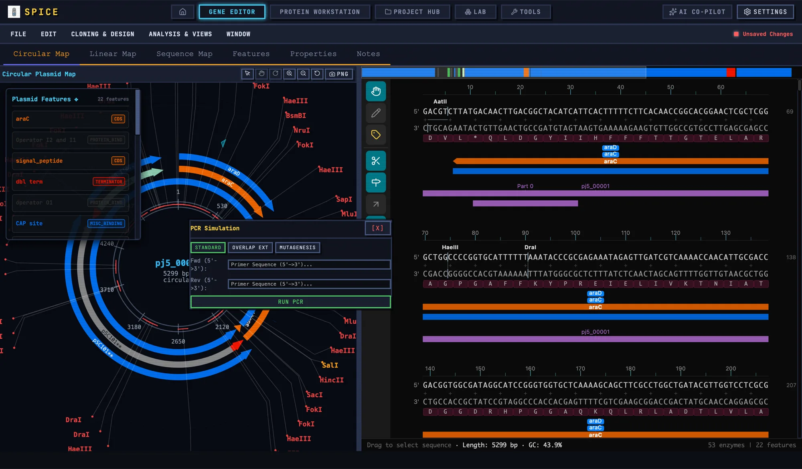

# PCR Simulator

The PCR Simulator runs three sequence-level routines on the open Gene Editor document: standard amplification from two primers, overlap-extension assembly of the current sequence, and site-directed point mutagenesis. Each routine produces a sequence that can replace the document, and the standard and overlap products can also be sent to the Virtual Gel as a single band.

**Menu:** **Cloning & Design → PCR Simulator** · **Type:** floating panel

## What it does

In **Standard** mode both primers are read 5'→3' and the reverse primer is reverse-complemented internally. The forward primer is located by an exact search for its first 15 bases (or the whole primer when shorter), falling back to its first 10; the reverse site is found the same way, searched only after the forward site. The product runs from the forward primer's start to the end of the reverse site. The template is treated as circular unless the Linear Map tab is active; on a circular template the product wraps past the origin when that end passes the end of the stored sequence. The result reports product length, GC over the whole product, and the Tm of the first 20 bases of the product, not of the full amplicon. Warnings are raised below 50 bp and above 5000 bp. Running requires both primer fields; a missing binding site produces an empty product reported as a failed simulation.

**Overlap Ext** splits the current sequence at its midpoint and runs overlap extension with a fixed 20 bp overlap. The routine joins the fragments only when the last 20 bases of the product equal the first 20 bases of the next fragment, directly or as reverse complements, in which case the shared bases are counted once. Otherwise it appends the fragment in full and records an overlap-mismatch warning. Because the two halves are consecutive slices of one sequence, real 20 bp homology is unusual: expect the warning and a product identical to the input, even though the run is still reported as completed.

**Mutagenesis** replaces one base. The position is used directly as a zero-based index into the current sequence, and the base field is uppercased and written in place of that base. The routine then designs 25-base forward and reverse primers centred on the edit, but this panel does not display them. There is no range or alphabet check before the call, and the routine's own warnings are not shown in this mode. **Apply Mutation** writes the returned sequence to the document and adds an edit-history entry.

For Standard and Overlap Ext, **Apply Product** replaces the entire document sequence and records a history entry, while **Send to Electrophoresis** adds a lane named `PCR Prod N` with one band at the product length and opens the Virtual Gel panel.

## How to use

1. Open **Cloning & Design → PCR Simulator**.
2. Choose **Standard**, **Overlap Ext**, or **Mutagenesis** from the three mode buttons.
3. In Standard mode, paste the forward primer into **Fwd (5'->3')** and the reverse primer into **Rev (5'->3')** as they would be synthesised.
4. Click **Run PCR** and read the product length, Tm, GC, and any warnings.
5. Click **Apply Product** to replace the document, or **Send to Electrophoresis** to add the product to the gel.
6. In Overlap Ext mode, click **Run OE-PCR**, then apply the product if the reported length is what you expect.
7. In Mutagenesis mode, set **Position** and **Base**, click **Site-directed mutagenesis**, then click **Apply Mutation**.
8. Drag the panel by its header, or close it with **[X]**.

## Inputs and results

| Field | Meaning |
|---|---|
| Standard / Overlap Ext / Mutagenesis | Mode buttons; the active mode is highlighted and shows its own controls. |
| Fwd (5'->3') | Forward primer for Standard mode, written 5'→3'; must match the top strand. |
| Rev (5'->3') | Reverse primer for Standard mode, written 5'→3'; reverse-complemented internally. |
| Run PCR | Runs standard amplification; both primer fields must be non-empty. |
| Run OE-PCR | Runs overlap extension on two halves of the current sequence with a 20 bp overlap. |
| Position | Zero-based index of the base to replace in Mutagenesis mode. |
| Base | Replacement text, uppercased before use. |
| Site-directed mutagenesis | Produces the mutated sequence and its 25-base primer pair. |
| Product Length | Amplicon length in bp for Standard and Overlap Ext. |
| Tm | Melting temperature of the first 20 bases of the product, in °C to one decimal place. |
| GC% | GC content of the whole product, to one decimal place. |
| Warnings | Semicolon-separated routine messages, shown in amber. |
| Apply Product | Replaces the document sequence with the Standard or Overlap Ext product. |
| Send to Electrophoresis | Adds one gel lane with a band at the product length and opens the Virtual Gel. |
| Apply Mutation | Replaces the document sequence with the Mutagenesis product. |

## Limits and caveats

Primer matching is prefix-only and exact. Only the first 15 bases (or 10) are searched, so mismatches later in the primer are tolerated, and a primer containing bases other than A, C, G, or T is silently shortened. The first occurrence of the forward primer wins, and the reverse site must lie after it in the stored sequence order; a reverse site that falls before the forward site is not found even on a circular map, so origin-crossing products work only in the direction that passes the end of the stored sequence.

There is no annealing-temperature, polymerase, extension-time, or yield modelling, and the displayed Tm is calculated on the first 20 bases of the product rather than the amplicon. A failed run reports a generic failure: the per-primer reason is discarded before the result is shown.

Overlap Ext does not add homology arms; it only tests the fixed midpoint split and concatenates when the overlap does not match. Mutagenesis performs no validation: multi-character or non-DNA input is accepted, an out-of-range position can still return a sequence with **Apply Mutation** enabled, and its warnings are not displayed. Applying any product replaces the whole sequence string; feature coordinates and selections are not recalculated, and the change is recorded in the edit history rather than offered as a reversible preview.

## Related

- [Gene Editor](../../gene-editor.md)
- [PCR Primer Table](primer-table.md)
