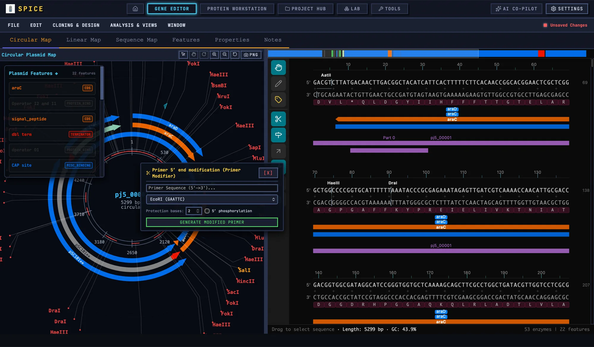

# Primer Modifier

Primer Modifier assembles a 5'-tailed primer by putting a selected restriction site and a short protection sequence in front of a primer sequence you type in. It reports the modified primer and its length, and writes a line to the Activity Log; it does not insert anything into the open sequence.

**Menu:** **Cloning & Design → Primer Modifier** · **Type:** floating panel

## What it does

The panel takes three ingredients: the primer sequence you enter, a restriction enzyme chosen from the active enzyme database, and a protection count. It builds the modified primer as an optional phosphate marker `/`, then the protection bases, then the enzyme recognition sequence, then your primer sequence, in that 5'-to-3' order. For the default EcoRI choice the middle part is `GAATTC`.

The protection bases are not user-defined. The panel slices them from the fixed string `GCA`, taking as many bases as the protection count asks for. A count of 0 adds nothing, 1 adds `G`, 2 adds `GC`, and 3 adds `GCA`; higher counts still add only `GCA`. Ticking **5' phosphorylation** prefixes a `/` to the displayed primer and adds a red `[5'-Phosphate]` badge to the result.

Every run produces a result box with the length after modification, the enzyme recognition sequence, the protection bases actually used, and the assembled primer. The same details are written to the Activity Log and a success toast reports the total length. The result is display-only: there is no button or click action that copies it, and it is never applied to the Gene Editor sequence.

## How to use

1. Open **Cloning & Design → Primer Modifier**; the panel floats over the Circular Map view and can be dragged by its header.
2. Enter your primer in **Primer Sequence (5'->3')**, without adding the tail yourself.
3. Choose the restriction enzyme from the dropdown. Options are shown as `Name (recognition sequence)`.
4. Set **Protection bases** between 0 and 6; two bases are used by default.
5. Tick **5' phosphorylation** if the primer should carry a 5' phosphate.
6. Click **Generate modified primer**.
7. Read the modified primer in the result box, then copy it manually into your ordering system if you need it elsewhere. Press **[X]** to close the panel.

## Inputs and results

| Field | Meaning |
|---|---|
| Primer Sequence (5'->3') | The primer body placed at the 3' side of the assembled tail. Any text is accepted as entered; it is not validated or upper-cased. |
| Enzyme dropdown | The selected enzyme and its recognition sequence, taken from the active enzyme database. Default is EcoRI (`GAATTC`). |
| Protection bases | Number of bases taken from the fixed `GCA` string and placed immediately 5' of the restriction site. |
| 5' phosphorylation | Adds a leading `/` marker to the displayed primer and a phosphate badge to the result. |
| Generate modified primer | Rebuilds the result, appends an Activity Log entry, and shows a success toast. |
| Length after modification | Length in nucleotides of the assembled primer, excluding the `/` phosphate marker. |
| Cut site | Despite the label, this row shows the enzyme recognition sequence itself, not a cut offset. |
| Protection bases (result) | The actual prefix bases used, for example `GC` at the default count of 2. |
| Modified primer | The complete assembled string, including the phosphate marker when selected. |

## Limits and caveats

The primer body is concatenated literally. Lower-case bases, ambiguous IUPAC codes, and non-DNA characters are kept unchanged, and the panel does not trim spaces or check that the primer is a sensible oligonucleotide. It also does not compute melting temperature, GC content, hairpins, dimers, or internal copies of the chosen site, so a design that is chemically unsuitable can still be reported as successful.

The enzyme list is the whole active enzyme database rather than a curated set of cloning enzymes, and the panel does not check that the site is absent from your template or compatible with the overhang you intend to create. Protection bases are limited to the three characters in the fixed `GCA` string, so values from 4 to 6 have the same effect as 3; the input range of 0 to 6 overstates what the panel can add.

Phosphorylation is a text marker only. No chemical state is recorded in the sequence, and nothing is written into the document or its annotations. Because the result is neither inserted nor copied automatically, ordering or documenting the primer is a manual step.

## Related

- [Gene Editor](../../gene-editor.md)
- [DNA End Modification](end-mod.md)
