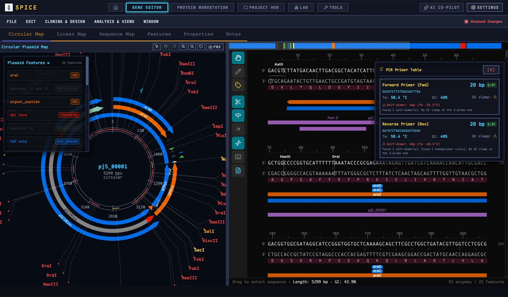

# PCR Primer Table

The PCR Primer Table reports the two 20-base primers that the Gene Editor derives from the current sequence, together with their melting temperature, GC content, and a structural quality check. It is a read-only inspector: it does not design alternative primers and never writes to the document.

**Menu:** **Cloning & Design → PCR Primer Table** · **Type:** floating panel

## What it does

The panel does not generate candidates. The Gene Editor derives the pair from the open sequence whenever it is at least 40 bases long: the forward primer is the first 20 bases of the top strand, and the reverse primer is the reverse complement of the final 20 bases, so both read 5'→3'. Each card is built from those two sequences and refreshes automatically when the sequence or the active document tab changes.

Tm uses the NEB nearest-neighbour calculation (SantaLucia 1998 parameters with the Owczarzy 2004 salt correction) at 50 mM monovalent cation and 500 nM primer concentration, rounded to one decimal place before it reaches the panel. GC is the percentage of G and C bases over the primer length. The Q score starts at 100 and subtracts fixed penalties: 20 for GC outside 30–70%, 15 for Tm outside 50–75 °C, 10 per hairpin, 8 per self-dimer, 5 per homopolymer run of four or more bases, 5 for a missing 3' G/C clamp, 5 when the longest homopolymer exceeds five bases, and 10 when the length is outside 15–35 bases. The score is floored at zero; values above 70 are shown in green, all others in amber. The length penalty cannot trigger for the derived 20-mers.

Each primer is also inspected in isolation. Hairpins are searched with stems of 4–12 bp and loops of 3–30 nt; self-dimers are complementary runs of at least 4 bp. The card shows the longest hairpin and the longest self-dimer with their own Tm values, then joins every score penalty into one semicolon-separated warning line. Cross-dimers between the two primers are not computed.

## How to use

1. Open **Cloning & Design → PCR Primer Table**.
2. Confirm that the sequence is at least 40 bases long; shorter sequences show the empty message instead of cards.
3. Read the **Forward Primer (Fwd)** card, whose sequence is the first 20 bases of the top strand.
4. Read the **Reverse Primer (Rev)** card, whose sequence is the reverse complement of the last 20 bases and is already written 5'→3'.
5. Use **Q** and the warning line to judge whether each primer is worth keeping; a green Q is above 70.
6. Edit the sequence or switch document tabs; both cards recompute without a refresh control.
7. Drag the panel by its header, or close it with **[X]**.

## Inputs and results

| Field | Meaning |
|---|---|
| Forward Primer (Fwd) | Card for the first 20 bases of the current top strand; not editable here. |
| Reverse Primer (Rev) | Card for the reverse complement of the final 20 bases, displayed 5'→3'. |
| `bp` | Primer length; derived primers are always 20 bp. |
| Q | Heuristic quality score from 0 to 100, built from the fixed penalties described above. |
| Sequence | The primer bases in monospace, written 5'→3'. |
| Tm | Melting temperature in °C to one decimal place. |
| GC | Percentage of G and C bases, rounded to a whole number for display. |
| GC clamp | Tick when the final base is G or C; warning triangle when it is A or T. |
| Hairpin | Stem length, loop length, and Tm of the longest hairpin found, when one exists. |
| Self-dimer | Length and Tm of the longest self-dimer found, when one exists. |
| Warnings | Semicolon-separated messages explaining each penalty applied to the score. |
| Empty message | `(Sequence too short to design primers)` replaces the cards below 40 bp. |

## Limits and caveats

The table is fixed to the two terminal 20-mers. It ignores the current selection and any annotated target region, so it cannot design primers for an internal amplicon. Q is a heuristic with fixed penalties, not a thermodynamic prediction, and the hairpin and self-dimer searches use exact complementarity rather than a folding model; cross-primer interactions are absent, so a pair can look clean while still forming a cross-dimer.

The Tm calculator accepts only A, C, G, and T. A terminal 20-mer containing N therefore reports 0 °C and receives the Tm penalty. There is no copy button, export, or insert action: to use a sequence, select it in the editor yourself. The panel keeps no state of its own, and closing it discards nothing because every value is derived again from the document.

## Related

- [Gene Editor](../../gene-editor.md)
- [PCR Simulator](pcr.md)
