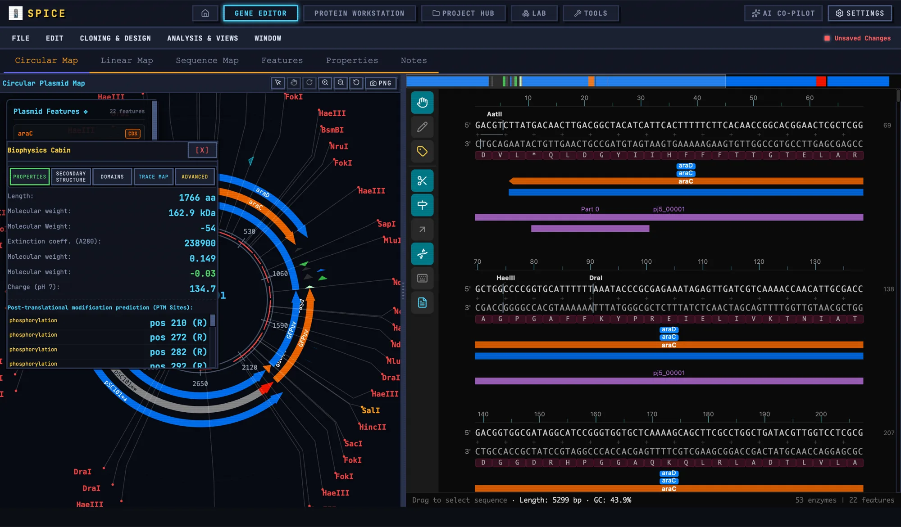

# Protein Multi-View

The Protein Multi-View opens as the **Biophysics Cabin** floating panel and derives protein-level information from the sequence currently loaded in the Gene Editor. The whole sequence is translated in the forward direction from the first base, so the panel reports one reading frame rather than an annotated CDS. Five tabs cover bulk properties, secondary-structure propensities, motif-based domain hits, a residue-to-codon trace with a back-mutation tool, and advanced peptide and charge analytics. Everything is computed locally; only the back-mutation control changes the document.

**Menu:** **Analysis & Views → Protein Multi-View** · **Type:** floating panel

## What it does

- Translates the current DNA sequence from base 1 in the forward frame using the standard genetic code. A stop codon in the final triplet is dropped; internal stops remain in the protein string.
- **Properties** reports length, molecular weight, isoelectric point, extinction coefficient at 280 nm, aromaticity, GRAVY, and net charge at pH 7, then lists predicted post-translational modification motifs with residue positions; phosphorylation motifs are the only type detected.
- **Secondary Structure** shows Chou-Fasman helix, beta-sheet and coil percentages, a GRAVY-derived intrinsic-disorder ratio, a Wilkinson-Harrison *E. coli* solubility estimate, aggregation-prone segments, and a Kyte-Doolittle hydropathy sparkline using a 9-residue window.
- **Domains** scans the protein for four motif signatures: C2H2 zinc finger, SH3-binding proline motif, Ser/Thr kinase active loop, and fluorescent-protein chromophore motif.
- **Trace Map** renders one button per residue. Selecting a residue maps it back to its DNA codon, sets the editor selection to that codon, and offers a back-mutation control with host-specific codon usage for *E. coli*, *Pichia pastoris*, or human.
- **Advanced** lists tryptic peptide masses (cleavage after K or R unless followed by P, first 20 fragments), predicted disulfide pairs, linear antigenic epitopes from a 7-residue sliding window, and local pI and charge in 30-residue windows.
- The back-mutation button replaces the selected codon in the current sequence with the preferred codon for the target amino acid and chosen host.

## How to use

1. Open **Analysis & Views → Protein Multi-View**. The panel appears at the left of the Gene Editor and moves when dragged by its header.
2. Read the **Properties** tab for the bulk values and the modification list.
3. Switch tabs with the row under the header. Each tab recalculates from the current sequence when opened.
4. In **Trace Map**, click a residue button to select its codon in the editor and reveal the back-mutation and ΔΔG controls.
5. Choose a target amino acid and optimisation host, then click **Apply back-mutation to plasmid** to write the new codon. The sequence updates immediately.
6. Close the panel with `[X]`; the document is unchanged except for any applied back-mutation.

## Inputs and results

| Field | Meaning |
|---|---|
| Current sequence | The entire Gene Editor sequence; the panel has no selection or CDS input. |
| Reading frame | Forward frame starting at base 1; no other frames are offered. |
| Length | Number of translated residues, including internal stops. |
| Molecular weight | Summed residue masses plus water, shown in Da or kDa. |
| Isoelectric point | Computed pI of the translated chain. |
| Extinction coefficient (A280) | Estimated extinction from Trp, Tyr and reduced Cys. |
| Aromaticity | Fraction of aromatic residues. |
| GRAVY | Mean Kyte-Doolittle hydropathy; positive values are flagged. |
| Charge (pH 7) | Net charge at pH 7. |
| PTM sites | Phosphorylation motifs with residue number and residue letter; first 15 shown. |
| Secondary-structure percentages | Chou-Fasman helix, sheet and coil shares. |
| Intrinsic disorder ratio | Heuristic value derived only from GRAVY, not a trained predictor. |
| *E. coli* solubility | Wilkinson-Harrison probability estimate for recombinant expression. |
| Aggregation hotspots | Sequence segments with high predicted beta-aggregation tendency. |
| Domains | Motif matches with amino acid ranges and descriptions. |
| Back-mutation | Target amino acid and host; replaces one codon in the document. |
| ΔΔG | Empirical stability change for the chosen substitution at the selected residue. |
| Trypsin PMF | Tryptic fragment ranges, sequences and monoisotopic masses. |
| Disulfide pairs | Cysteine pairs with a heuristic pairing score. |
| Antigenic epitopes | Linear epitope candidates with start, end, sequence and score. |
| Local pI and charge | Sliding 30-residue window values along the chain. |

## Limits and caveats

- The panel does not detect ORFs, CDS features, exons, or the reverse strand; a coding sequence that does not begin at base 1 will translate out of frame. Define the CDS or move the sequence before opening the panel.
- Every tab is predictive and untrained against experimental data. Chou-Fasman propensities, Kyte-Doolittle hydropathy, the GRAVY-based disorder ratio, the solubility and aggregation scores, the ΔΔG estimate, and the epitope scan are heuristics for triage, not validated structure or function predictions.
- The bulk properties are simplified: pI is derived from acidic and basic residue counts, and charge treats K, R, D and E as integral charges with a small contribution from H.
- Domain detection is limited to four regular-expression motifs and is not a Pfam or HMM search. Absence of a hit means only that those motifs are absent.
- Back-mutation assumes a single ORF beginning at base 1 and replaces the codon with the host-preferred codon for the target residue. It does not check reading frame, downstream effects, or restriction sites, and it applies without a confirmation step.
- Three property rows currently reuse the label `Molecular weight:`; in display order they are isoelectric point, aromaticity, and GRAVY.
- Long lists are truncated: 15 PTMs and 20 tryptic fragments; domain and epitope boxes scroll within a fixed height.

## Related

- [Gene Editor](../../gene-editor.md)
- [RNA Folding Structure](rna.md)
