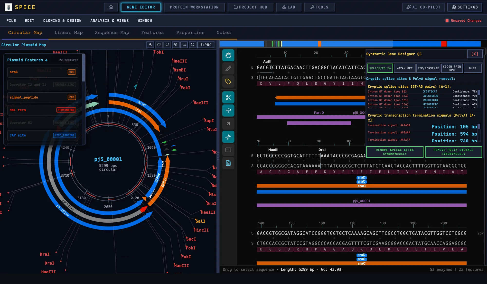

# Synthetic Gene Designer QC

The Synthetic Gene Designer QC panel runs six sequence checks on the open editor sequence and reports them across five tabs. All tabs except PTC/Nonsense can rewrite the sequence with synonymous substitutions, and the first tab offers two independent repairs. Every check reads the open sequence itself, not the current selection.

**Menu:** **Cloning & Design → Synthetic Gene Designer QC** · **Type:** floating panel

## What it does

The **Splice/PolyA** tab runs two checks. The donor check scores every GT dinucleotide in a 9 bp window against the MAG|GTRAGT consensus, awarding 10 for A/C at −3, 15 for A at −2, 20 for G at −1, 25 for the GT itself, 15 for A/G at +3, and 5 each for A, G, and T at +4 to +6; sites scoring 60 or more are listed. The acceptor check scores every AG with a 13 bp polypyrimidine tract, awarding up to 50 for the C/T fraction, 30 for AG, 10 for C/T before AG, and 10 for G after AG; sites scoring 65 or more are listed. The polyA check searches for exact occurrences of twelve hexamers: AATAAA, ATTAAA, TATAAA, AGTAAA, AAGAAA, AATACA, CATAAA, GATAAA, AATATA, AATGAA, ACTAAA, and AATAGA.

**Kozak Opt** evaluates translation initiation. The start site is the first CDS feature in the annotations, otherwise the first ATG, otherwise base 1. The score awards 40 for A at −3 or 30 for G, 30 for G at +4, and 6 for each of the five upstream bases matching GCCACC positions −6 to −1. A score of 80 or more is Strong, 50 or more Adequate, and anything lower Weak. Recommendations name the missing bases. Optimisation rewrites the six upstream bases to GCCACC and, when a synonymous codon beginning with G exists, silently recodes the codon after ATG. The button is disabled when the context is already Strong.

**PTC/Nonsense** checks every complete codon except the last for TAA, TAG, or TGA. Each hit reports its codon, base position, amino-acid position, and an NMD flag set when more than 50 nt remain after the stop.

**Codon Pair CPB** reports the mean score of in-frame adjacent codon pairs. The lookup table holds eleven entries (for example GCC_GAA 0.25, GAA_GCC 0.22, AAA_AAA 0.18, and negative values such as CGC_CGA −1.45 and ATT_ATA −0.65). Any other pair containing CG scores −0.15 and every remaining pair scores 0.02. Values at or above 0.1 are green, values from 0 to 0.1 are cyan, and negative values are red. Optimisation is available below 0.18 and greedily swaps negative-scoring pairs for the best synonymous pair.

**DUST** lists low-complexity regions: homopolymers of eight or more identical bases, 12 bp windows stepped by three whose Shannon entropy is below 1.2 bits, and windows matching a repeating two-base unit, which are labelled dinucleotide repeats. Regions within 3 bp of each other are merged. Masking converts the bases in those regions to lowercase.

## How to use

1. Open the gene or construct in the [Gene Editor](../../gene-editor.md).
2. Open **Cloning & Design → Synthetic Gene Designer QC**.
3. Choose a tab; its results are computed from the current sequence as soon as the tab renders.
4. Review the rows for position, context, and score or entropy.
5. Click **Remove splice sites synonymously**, **Remove polyA signals synonymously**, **One-click optimize mutations...**, **One-click synonymous codon pair optimization**, or **One-click low-complexity masking** where the tab offers one. The open sequence changes immediately, the change is written to the Activity Log, and a toast confirms the action.
6. Re-read the tab, which recomputes from the edited sequence, and then check the other tabs: a substitution made for one check can create or remove a site for another.
7. Close the panel with **[X]**.

## Inputs and results

| Field | Meaning |
|---|---|
| Open sequence | The full editor sequence; all six checks use it as their only input. |
| CDS feature | The first annotation whose type is `CDS`; its start sets the Kozak start site when present. |
| Intron GT donor / AG acceptor | Site type, 1-based position, the 9 bp donor or 17 bp acceptor context, and a confidence score from 0 to 100. |
| Termination signal | PolyA hexamer and its 1-based position. |
| Context around start codon | Six bases upstream, the start codon (green when ATG), and three bases downstream; out-of-range bases are padded with N. |
| Kozak initiation strength rating | Strong, Adequate, or Weak plus the numeric score out of 100. |
| Recommendations | The specific consensus positions that are missing; an empty list means no improvement was suggested. |
| Premature stop codon (PTC) | Codon, 1-based base position, and amino-acid position. |
| NMD risk | "Very high risk" when more than 50 nt follow the stop, otherwise "No significant decay risk". |
| CPB index | Mean codon pair score to four decimal places, with a short explanatory note. |
| DUST region | Type (homopolymer, dinucleotide repeat, or low entropy), 1-based start–end range, sequence, and Shannon entropy in bits. |
| Repair buttons | Synonymously remove splice sites or polyA signals, optimise Kozak, optimise codon pairs, or mask low-complexity regions; each is disabled when its tab has nothing to act on. |

## Limits and caveats

Every function uppercases the sequence and deletes every character that is not A, T, C, or G before working. A repair action therefore writes back the stripped, uppercase sequence: existing lowercase masking, ambiguity codes, and any non-A, T, C, G characters are lost.

The silent-mutation routines assume frame 0, meaning the first base of the open sequence is codon position 1. If the CDS starts at an offset, the substitutions are not silent for that CDS. The splice and polyA repair routines also have no fallback for an amino acid whose synonymous codons all preserve the motif; they stop and log that not all sites could be removed.

Splice scores are motif scores from short windows, not a splice predictor, and the 60 and 65 thresholds are fixed. Kozak reads only nine bases around the chosen start and ignores the rest of the transcript leader. Optimisation logs an out-of-range message and returns the sequence unchanged when fewer than 6 bp precede or 6 bp follow the ATG. The PTC check treats the final complete codon as the natural stop, so a CDS whose stop codon has been trimmed away reports no PTC.

The CPB lookup is small and every unlisted pair defaults to +0.02, so scores cluster near zero and the colour cut-offs are coarse. Optimisation is a single left-to-right pass and can lower the score of the pair that follows an improved one. DUST masking only changes case; detection re-uppercases first, so re-running the tab reports the same regions. Repairs are immediate edits with no preview, so keep a copy of the design if you want to compare before and after.

## Related

- [Gene Editor](../../gene-editor.md)
- [Silent Mutagenesis](silent-mut.md)
- [NGS & Genomics Engine](ngs.md)
