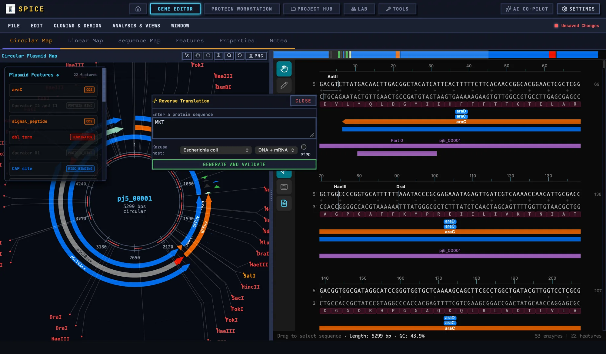

# Reverse Translate

Reverse Translate converts a one-letter protein sequence into a coding DNA sequence, back-translates the result, and reports whether the translated protein matches the input. It can display cDNA and mRNA, copy either to the clipboard, and show the codon chosen for each residue. The panel does not insert anything into the open document.

**Menu:** **Cloning & Design → Reverse Translate** · **Type:** floating panel

## What it does

The protein input is converted to upper case, and every character except an upper-case letter or `*` is removed before translation. Each residue is replaced by one fixed, built-in preferred codon. The generated DNA uses T; the mRNA view is the same sequence with every T replaced by U. If **stop** is ticked, a single `TAA` is appended after the last residue. The panel then translates the whole generated DNA back into protein and marks validation as **PASS** when every requested residue matches the translation and every codon is a recognised triplet, or **FAIL** otherwise.

The panel header reads **Reverse Translation**; the menu entry is **Reverse Translate**. Results appear in a green-bordered box with the validation status, the number of codons, and the selected sequence views. Two copy buttons are always offered, one for cDNA and one for mRNA, regardless of which views are displayed. A codon trace can be expanded to show the residue, codon, and one-based DNA span for each position. Non-fatal problems such as an invalid stop codon or a failed validation are listed as warnings.

Nothing is written to the Gene Editor: there is no apply or insert control, so the sequence must be copied out and pasted into the document or another tool.

## How to use

1. Open **Cloning & Design → Reverse Translate**; the panel floats over the editor and can be dragged by its header.
2. Type or paste the protein sequence in **Enter a protein sequence**, using one-letter amino-acid codes.
3. Choose the **Kazusa host** entry. The options are *Escherichia coli*, *Saccharomyces cerevisiae*, and *Homo sapiens*.
4. Choose the output view: **DNA + mRNA**, **cDNA**, or **mRNA**. This only controls which lines are shown.
5. Tick **stop** if the construct should end with a stop codon.
6. Click **Generate and validate**.
7. Check **Validation** and read the codon count and any warning text.
8. Copy **cDNA** or **mRNA** with the buttons, or expand **Codon trace** to inspect individual codons.
9. Adjust the input and run again to replace the previous result; close the panel with **CLOSE** when finished.

An empty protein input is refused with an error message and no result is produced.

## Inputs and results

| Field | Meaning |
|---|---|
| Enter a protein sequence | One-letter amino-acid sequence; letters and `*` are kept, other characters are ignored. |
| Kazusa host | Host label for the codon request: *Escherichia coli*, *Saccharomyces cerevisiae*, or *Homo sapiens*. |
| Output view | Chooses which of the cDNA and mRNA lines are displayed; both are always generated. |
| stop | Appends `TAA` after the last residue when ticked. |
| Generate and validate | Produces the DNA, back-translates it, and fills the result box. |
| Validation | **PASS** when the translated DNA matches every requested residue and all codons are recognised; otherwise **FAIL**. |
| Codon count | Number of codons in the trace, equal to the number of protein positions before any appended stop. |
| cDNA | The coding DNA sequence, written with T. |
| mRNA | The same sequence with U in place of T. |
| Copy cDNA / Copy mRNA | Writes the corresponding sequence to the clipboard and shows a confirmation message. |
| Codon trace | Expandable list of residue, codon, and one-based DNA start and end for each position. |
| Warnings | Remarks such as invalid characters, an invalid stop codon, or a failed validation. |

## Limits and caveats

The generator uses one fixed codon per amino acid and performs no codon-usage optimisation. Although the panel offers a host selector, the current build passes no host-specific usage weights into the generator with GC optimisation off, so all three host options produce the same codons for a given input. Treat the host label as metadata rather than a guarantee of host-adapted sequence.

There is no GC targeting, no avoidance of repeats, hairpins, or restriction sites, and no check of the start codon; methionine always uses the built-in codon, normally `ATG`. The **stop** checkbox always adds `TAA`, so a protein sequence that already ends in `*` and also has **stop** ticked receives an extra stop codon. Validation compares only the requested residues, not any appended stop, so a stop-related problem is visible only in the sequence and warnings.

Characters outside the accepted set are silently discarded, which can make the output shorter than the visible input; check the codon count. The panel does not write to the Gene Editor and creates no history entry. Copying requires clipboard access, and the confirmation message does not verify that the destination application accepted the paste.

## Related

- [Gene Editor](../../gene-editor.md)
- [Silent Mutagenesis](silent-mut.md)
