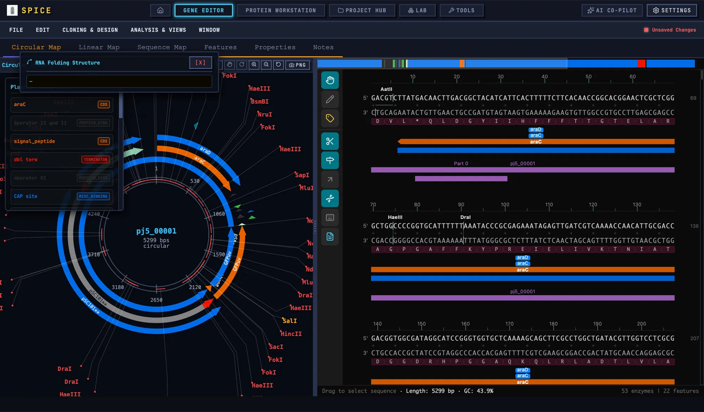

# RNA Folding Structure

The RNA Folding Structure panel runs a draft secondary-structure prediction on the sequence currently loaded in the Gene Editor. It treats the whole sequence as one input, decides whether it is RNA or DNA from its base composition, folds overlapping 120-nucleotide windows with a maximum-base-pairing algorithm, and prints the resulting dot-bracket string together with an approximate free energy and length. The panel is read-only: it never edits the sequence or sends data off the machine.

**Menu:** **Analysis & Views → RNA Folding Structure** · **Type:** floating panel

## What it does

- Checks the current sequence for RNA character: a sequence containing `U` and no `T` is folded as RNA, and anything else as single-stranded DNA.
- Runs a Nussinov dynamic program that maximises the number of base pairs with a minimum hairpin loop of 3 nucleotides. RNA folding allows A–U, G–C and G–U wobble pairs; DNA folding allows A–T and G–C pairs.
- Scans in 120-nucleotide windows that advance by 60 nucleotides, ignores windows shorter than 20 nucleotides, and keeps a window when it has at least one pair or an estimated free energy at or below −10 kcal/mol.
- Calls the Rust command `find_rna_structures_rust` in the desktop build and falls back to the TypeScript implementation in a browser preview.
- Displays the dot-bracket string for the result, the approximate ΔG, and the folded length. The result box wraps long strings.
- Recomputes whenever the sequence changes while the panel is open; closing and reopening the panel starts a fresh prediction.

The prediction is a draft. It counts possible pairs rather than modelling stacking energies, so it is not a substitute for a thermodynamic folding package or for experimental probing.

## How to use

1. Open **Analysis & Views → RNA Folding Structure**. The panel floats over the map and can be dragged by its header.
2. Wait for **Computing structure…** to clear. The prediction starts automatically; there is no run button.
3. Read the dot-bracket line: `(` and `)` mark paired bases and `.` marks unpaired bases.
4. Read the ΔG line when present; a more negative value indicates a more favourable predicted fold under the panel's rough energy model.
5. Close the panel with `[X]`. To run again, edit the sequence or reopen the panel.

## Inputs and results

| Field | Meaning |
|---|---|
| Current sequence | The entire Gene Editor sequence; the current selection is ignored. |
| Molecule type | RNA when the sequence contains `U` and no `T`; otherwise single-stranded DNA. |
| Window / step | 120 nt folded per window, advancing 60 nt, so adjacent windows overlap by half. |
| Free-energy filter | Windows are retained at or below −10 kcal/mol, or whenever at least one pair is found. |
| Dot-bracket string | Secondary-structure notation for the returned window, with `.` for unpaired bases. |
| ΔG | Approximate free energy in kcal/mol; a crude pair-count estimate, not a nearest-neighbour calculation. |
| Length | Number of nucleotides in the folded result. |

## Limits and caveats

- The algorithm is a draft: Nussinov maximum pairing ignores stacking thermodynamics, temperature, salt and ligand conditions, and the reported ΔG is a rough scoring heuristic rather than a physical energy.
- Pseudoknots are excluded by the dynamic program, and base pairs spanning a window boundary are not considered. Long transcripts are therefore represented only as local folds.
- DNA input folds the top strand as single-stranded DNA; the panel does not transcribe the sequence to RNA or fold the reverse complement.
- In the current build the fold result carries a per-window list (`structures`, `longestHairpin`, `overallMfe`), while the panel reads top-level `structure`, `dotBracket` and `mfe` fields. Those fields are absent, so the body shows `—` and the energy and length lines do not appear; the screenshot reflects this state.
- The panel does not draw an arc diagram, export the dot-bracket string, or apply anything to the sequence. A helper that converts a dot-bracket string to SVG paths exists in the module but is not used by this panel.

## Related

- [Gene Editor](../../gene-editor.md)
- [Protein Multi-View](protein-view.md)
