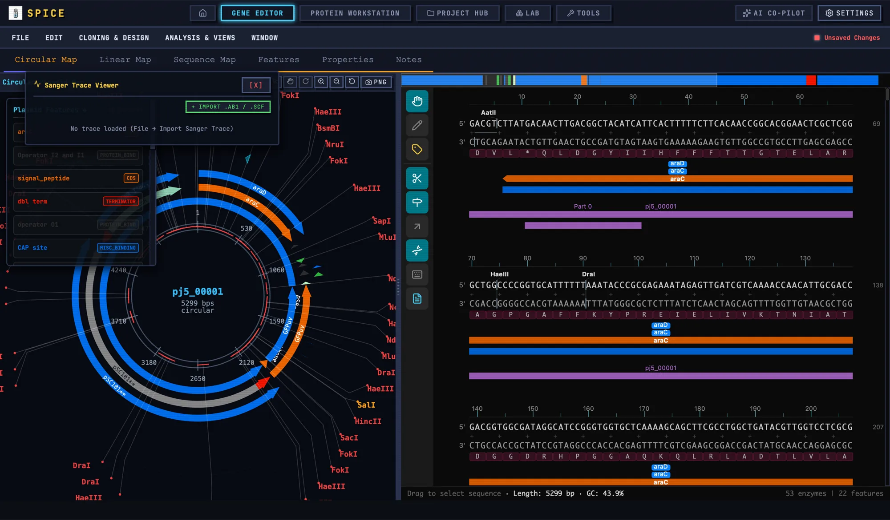

# Sanger Trace Viewer

Sanger Trace Viewer imports ABI and SCF sequencing files, draws their four dye channels with the called bases and Phred quality bars, and compares each imported read with the sequence currently open in the Gene Editor. Every read is held in the panel for the session, so several traces can be stacked for inspection without leaving the editor.

**Menu:** **Analysis & Views → Sanger Trace Viewer** · **Type:** floating panel

## What it does

- Reads `.ab1`, `.abif`, and `.scf` files, taking the four channel intensities, the stored base calls, Phred scores, and peak positions from the file.
- Compares each newly imported read against the current workbench sequence and prints its identity and mismatch count above the chromatogram.
- Draws 22 bases at a time as four colour-coded curves: A green, T red, C blue, G orange.
- Places the called base under each peak, a quality bar above it, and a position tick every 10 bases.
- Colours quality bars green at Q30 or above, orange from Q20 to Q29, and red below Q20.
- Adds each import to the panel rather than replacing the previous one; closing and reopening the panel keeps the session's traces.

## How to use

1. Open **Analysis & Views → Sanger Trace Viewer**. The panel opens with the message `No trace loaded (File → Import Sanger Trace)`.
2. Click **+ Import .ab1 / .scf**, or use **File → Import Sanger Trace (.ab1/.scf)**. The file extension chooses the parser.
3. Read the line above the trace: `Identity vs reference: N% · Mismatches: N`.
4. Move along the read with the left and right chevrons, which shift the window by 15 bases. Consecutive windows therefore overlap by seven bases.
5. Use the zoom-out and zoom-in buttons to scale peak height from 0.25× to 5× in steps of 0.25. Horizontal scale is fixed.
6. Import further files to append more traces. Each trace gets its own comparison line and chromatogram.
7. Close the panel with `[X]`. The reads stay in the workbench state and reappear the next time the panel is opened.

## Inputs and results

| Field | Meaning |
|---|---|
| + Import .ab1 / .scf | Opens the file chooser. Accepts `.ab1`, `.abif`, and `.scf`. |
| Identity vs reference | Percentage of matching bases after the read's low-quality ends are trimmed, found by sliding the read across the reference at the best-scoring offset. |
| Mismatches | Bases that differ from the reference at that best offset. |
| Position header | Current window and read length, for example `(1 - 22 / 731 bp)`. |
| Channel curves | Baseline-corrected fluorescence for A, T, C, and G, scaled to the tallest peak in the visible window. |
| Base letters | The base call stored in the file, coloured by the same channel palette. |
| Quality bars | Phred score of each base, drawn as a bar 0 to 16 pixels high. |
| Zoom buttons | Vertical amplitude scaling only; the horizontal window stays at 22 bases. |
| Chevrons | Step 15 bases backwards or forwards through the read. |

## Limits and caveats

- The viewer does not perform base calling. It displays the base calls stored in the file (the ABIF `PBAS1` tag, or the base section of an SCF file).
- The AB1 reader is minimal. It expects `DATA1` to `DATA4`, `PBAS1`, `PCON1`, and `PLOC1` and does not interpret dye-set names, mobility corrections, or the full ABIF directory specification. Files lacking those tags can produce empty curves or an empty base string.
- The SCF path does not read stored quality scores or peak positions: it assigns Q30 to every base and spaces peak indices evenly across the sample count. SCF quality bars are therefore placeholders, not measurements.
- A file whose signature is neither `ABIF` nor `.scf` is silently replaced by a 50 bp synthetic placeholder trace instead of reporting an error.
- The reference comparison is ungapped. Trimmed base calls are slid across the reference and the best matching offset is chosen, so an insertion or deletion appears as a run of mismatches, and a read longer than the reference yields 0% identity. The reverse complement is not tested.
- Low-quality ends are trimmed at Q20 for the comparison, and a warning is raised below 90% identity or below mean Q20, but the panel shows only identity and mismatch count; warnings and individual error positions are not displayed.
- The panel is read-only. There is no base editing, quality trimming control, export, or search, and traces are session state only: they are not written into `.spiceg` projects.
- Several traces can be loaded, but each has no individual close button or name label beyond `Sanger Read` or `SCF Read`.

## Related

- [Gene Editor](../../gene-editor.md)
- [Sanger Clone Validator](sanger-validator.md)
