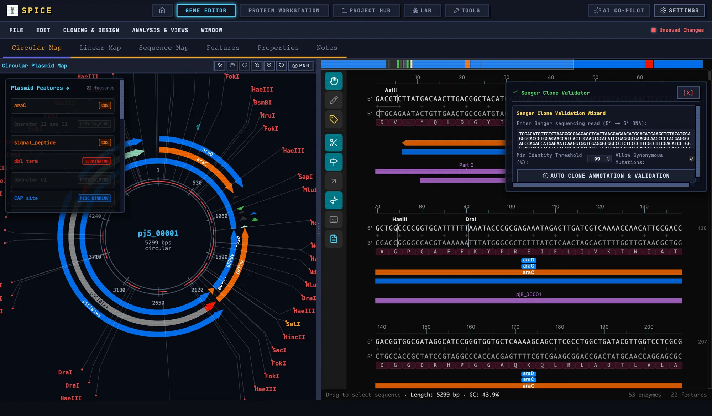

# Sanger Clone Validator

Sanger Clone Validator compares a pasted sequencing read with the sequence open in the Gene Editor, aligns the two, and reports whether the clone matches. It classifies every difference it finds, including codon-level effects inside annotated coding regions, and reduces the result to a PASS, WARNING, or FAIL verdict.

**Menu:** **Analysis & Views → Sanger Clone Validator** · **Type:** floating panel

## What it does

- Uses the current Gene Editor sequence as the reference and its `CDS` and `feature` annotations as coding regions.
- Aligns the pasted read to the reference with a semi-global Needleman-Wunsch alignment (match +2, mismatch −1, gap open −5, gap extend −1).
- Aligns the reverse complement as well and keeps whichever orientation scores a higher identity, adding a warning when the read had to be flipped.
- Calls point mismatches, insertions, and deletions, labelling an indel as a frameshift when its length is not a multiple of three.
- Maps each mismatch inside a CDS to its codon, translates the original and mutated codons, and classifies the effect as synonymous, missense, or nonsense. Differences outside a CDS are reported as intronic or intergenic; in-frame indels inside a CDS are reported as deletion or insertion.
- Produces a verdict and writes a one-line summary to the Activity Log.
- Draws a Sanger quality profile across the read when the alignment finishes.

## How to use

1. Open **Analysis & Views → Sanger Clone Validator**. The reference is taken automatically from the editor; it cannot be chosen in the panel.
2. Clear the example sequence from the text area and paste the sequencing read, 5′ to 3′, without FASTA headers or line numbers.
3. Leave **Min Identity Threshold (%)** at 99 or set the percentage below which the clone must fail.
4. Leave **Allow Synonymous Mutations** checked if non-critical variants should still pass; uncheck it to fail any variant.
5. Click **Auto Clone Annotation & Validation**.
6. Read the status badge: `PASS`, `WARNING`, or `FAIL`, with identity, coverage, and variant count.
7. Review the warning list, then the **Variant Effect Prediction (VEP)** table for position, base change, coding region, protein change, and classification.
8. Read the **Sanger Chromatogram Quality Profile** as a modelled profile, not a measurement.

## Inputs and results

| Field | Meaning |
|---|---|
| Sanger read text area | The query sequence, 5′ to 3′; must be at least 10 nt and is uppercased before alignment. |
| Min Identity Threshold (%) | Identity below this value forces FAIL. Default 99. |
| Allow Synonymous Mutations | When checked, a WARNING from non-critical variants is reported as a pass; when unchecked, that WARNING becomes FAIL. |
| Auto Clone Annotation & Validation | Runs alignment, variant calling, translation, and the verdict. |
| Status badge | `PASS`, `WARNING`, or `FAIL`, with identity percentage and coverage percentage. |
| Variant count | Number of mismatches and indels called in the aligned region. |
| Warning list | Reverse-complement realignment, low mean quality, low identity, or critical CDS mutation messages. |
| Position | Reference position of the variant, 1-based. |
| Variant | Reference base and query base, or `-` for an indel side. |
| Coding Region | CDS name containing the variant, or `Non-coding`. |
| Protein Change | Original residue, codon number, and mutated residue, for example `V95A`; `-` outside a CDS. |
| Classification | `Synonymous`, `Missense`, `Nonsense`, `Frameshift`, `Deletion`, `Insertion`, or `Intronic/Intergenic`. |
| Quality profile | Mean Q-score and Q30+ percentage, with a bar per sampled base. |

## Limits and caveats

- The reference and its features come from the live editor state. To validate against another construct, load or edit that construct first. Only feature types `cds` and `feature` are used, and every feature is treated as forward-strand (`forward: true` is hard-coded), so reverse-strand CDS translation is not applied correctly.
- The panel accepts pasted text only. It cannot open `.ab1` or `.scf` files, and it never receives real Phred scores, so the quality profile is always simulated: a bell-shaped curve with fixed sinusoidal noise and a heavy penalty at mismatches, including randomly varying values for those positions.
- The text area is pre-filled with a built-in example sequence (a blue fluorescent protein coding sequence). It must be replaced before a meaningful run, and a run on the untouched example validates that example against your plasmid.
- `Min coverage` is held at 90% internally, has no control in the panel, and is never consulted by the verdict logic. Coverage is reported as the aligned reference span divided by the whole reference length, so a short read against a plasmid usually shows low coverage without failing.
- The verdict is: any non-synonymous variant inside a CDS forces FAIL; otherwise any variant at all gives WARNING; identity below the threshold forces FAIL. Coverage never affects the outcome.
- Identity is matches divided by aligned length including gaps, so indels reduce the score even when the sequences are otherwise correct. An indel in a CDS is judged only by its length, not by its downstream frame effect.
- Unchecking **Allow Synonymous Mutations** turns any non-critical WARNING, including synonymous and intronic changes, into FAIL; the variants stay listed and are not removed from the report.
- The alignment allocates a full matrix over read length times reference length. Very long references or reads make the run slower and more memory-hungry.
- Closing the panel discards the report and resets the form, including the text area, to the built-in example. Results are not saved with the project.

## Related

- [Gene Editor](../../gene-editor.md)
- [Sanger Trace Viewer](sanger-trace.md)
