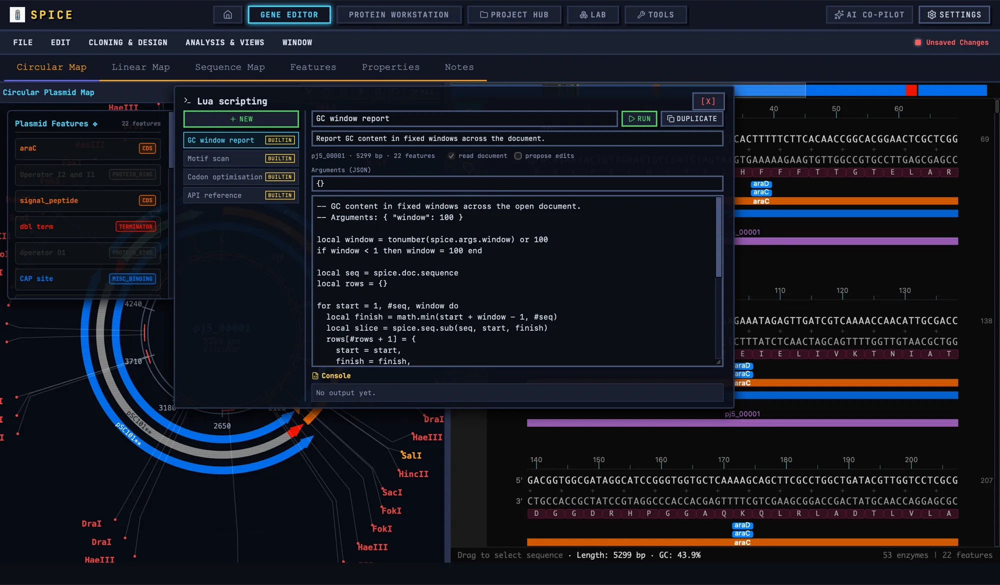

# Lua Scripts panel

The Lua Scripts panel runs Lua 5.4 scripts against the open document and shows their output beside the sequence. It lists built-in and user scripts, accepts a JSON argument object, and displays console output, the returned JSON, and any proposed document change for review. The panel never edits the document on its own: a scripted change is applied only after you click **Apply to document**.

**Menu:** **Cloning & Design → Lua Scripts** · **Type:** floating panel

## What it does

Each script runs in a dedicated Web Worker with a fresh Lua VM and reads a snapshot of the open plasmid: name, sequence, topology, and features. Scripts can log messages, return a JSON-style table, and — when granted permission — propose a new sequence or document name. Built-ins cover a GC window report, a motif scan, codon optimisation, and an API reference. The language surface and complete function reference are documented in [Lua Scripting](../../scripting.md); this page only covers the panel controls.

## How to use

1. Open **Cloning & Design → Lua Scripts**.
2. Pick a built-in script from the left list, or click **New** to start a user script.
3. A built-in is read-only. Click **Duplicate** to make an editable copy; app updates do not overwrite your copies.
4. Edit the name, description, and Lua source. Tick **propose edits** only if the script calls `spice.doc.apply`.
5. Enter the arguments as a JSON object in **Arguments (JSON)**, for example `{"window": 50}`; leave it as `{}` when the script takes none.
6. Click **Run**. Invalid arguments are reported inline and the script does not start.
7. Read the **Console** output, any error, and the returned **Result** JSON.
8. If a change is proposed, inspect the patch description, then click **Apply to document** or discard it.
9. For a user script, click **Save** to keep the edits; **Delete** requires a second click to confirm.

## Inputs and results

| Field | Meaning |
|---|---|
| Script list | Built-in scripts and user scripts stored on this machine; **Built-in** marks read-only entries. |
| Name | Script name, used in the list, toasts, and the edit history entry when a patch is applied. |
| Description | Short note shown under the name in the editor. |
| Arguments (JSON) | JSON object exposed to the script as `spice.args`; an empty box means no arguments. |
| Source | Lua source editor; read-only for built-ins. |
| read document | Always enabled; supplies `spice.doc` to the script. |
| propose edits | Adds the write permission needed by `spice.doc.apply`; off by default for new scripts. |
| Run | Validates the source and arguments, then executes the script in a worker. |
| Console | Lines from `spice.log`, `spice.warn`, and `spice.error`, plus runtime errors. |
| Result | The table returned by the script, rendered as JSON; truncated at the documented limit. |
| Proposed document change | The pending sequence and/or name, with **Apply to document** and discard controls. |

## Limits and caveats

Runs are capped at 15 seconds and 64 MiB of Lua memory; the console keeps 500 entries and returned JSON is cut off at 2,000,000 characters. `spice.doc.apply` can be called once per run, requires the **propose edits** permission, and rejects unknown fields. Applying goes through the normal edit path, so **Undo** reverts it.

Built-in scripts are recreated on launch, while user scripts live in local storage. Scripts are code: read the source before running one, including a copy you did not write, and check that the result matches what you expected before applying it.

## Related

- [Gene Editor](../../gene-editor.md)
- [Lua Scripting](../../scripting.md)
