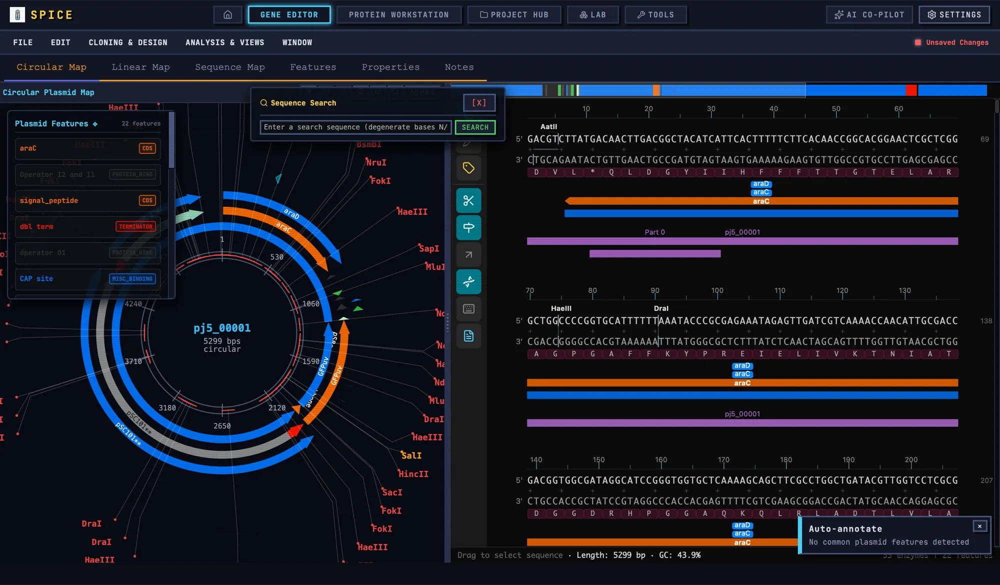

# Sequence Search

Sequence Search finds a short DNA motif in the open sequence on both strands, accepts IUPAC ambiguity codes, and lists every hit with its one-based position and the surrounding bases. Clicking a hit selects that span in the sequence view. The search only reads the document: the sequence, features, and history are left untouched.

**Menu:** **Edit → Sequence Search** · **Type:** floating panel (draggable by its header, 340 px wide, closed with **[X]**; the same panel toggles with `Ctrl+F` / `Cmd+F`)

## What it does

The panel takes a nucleotide query, converts it to upper case, and removes every character outside the IUPAC DNA set `A T G C N R W S K M Y B D H V`. The cleaned query must be at least three bases long. It is then searched against the current sequence in both orientations: the forward query and its reverse complement are matched independently, and each hit is labelled with the strand that matched.

Two matching paths are used. A query of at least six bases with no ambiguity codes is looked up through a 6-mer index built over the current sequence, which makes the common case fast; the first six bases of the query and of its reverse complement seed the candidate positions, and the full query is verified at each candidate. Shorter queries, or any query containing an ambiguity code, use a regular-expression match in which each code becomes a base class: `N` matches A, T, G, or C; `R` matches A or G; `Y` matches C or T; `S` matches G or C; `W` matches A or T; `K` matches G or T; `M` matches A or C; `B` matches C, G, or T; `D` matches A, G, or T; `H` matches A, C, or T; and `V` matches A, C, or G. Matching is otherwise exact; substitutions, insertions, and deletions are not allowed.

Each result row starts with `→` for a forward-strand hit or `←` for a reverse-strand hit, followed by `pos N`, where N is the one-based start of the match on the forward sequence. Below the position is the match context: the hit plus five bases on each side, taken from the forward sequence. The panel header reports `Found N matches`, and a search is written to the activity log as `[Search] Found "<query>": N matches`.

## How to use

1. Open the sequence you want to search, then choose **Edit → Sequence Search** or press `Ctrl+F` / `Cmd+F`.
2. Type at least three bases into the search field. Case does not matter, and ambiguity codes such as `N` or `R` are accepted.
3. Click **Search** or press `Enter`.
4. Read the hit count. A zero result leaves the list empty; a query shorter than three bases is refused with a toast and no result is produced.
5. Click a hit row to set the sequence selection to that match, then close or drag the panel as needed to inspect the highlighted region.
6. Edit the query and search again to replace the previous list. Close the panel with **[X]**; reopening it keeps the last query and results until they are replaced.

## Inputs and results

| Field | Meaning |
|---|---|
| Search sequence | Nucleotide query of at least 3 bases; case-insensitive; characters outside the IUPAC DNA set are removed before matching. |
| Search / Enter | Runs the query against the current sequence in both orientations and replaces the previous results. |
| Found N matches | Total number of hits, including both strands. |
| Hit position | `pos N`, the one-based start of the match on the forward sequence. |
| Strand arrow | `→` marks a forward-strand match; `←` marks a reverse-complement match. |
| Context | The matched bases plus five flanking bases on each side, taken from the forward sequence. |
| Click a hit | Sets the document selection to the hit span so the match is highlighted in the sequence view. |

The hit count is the number of rows in the list. Matches are not sorted by score because there is no score; they appear in the order produced by the forward pass, then the reverse-complement pass.

## Limits and caveats

There is no result limit: every match is returned, counted, and listed, and the list scrolls inside the panel when it grows. A palindromic query whose reverse complement equals the query itself is reported twice at each position, once as a forward hit and once as a reverse hit.

Ambiguity codes are interpreted only in the query. The target sequence is used as stored, so a literal `N` in the target is not matched by the query's `N` class, which expands to A, T, G, or C. Searches are linear over the stored string: on a circular map, a match that crosses the numbering origin is not found, and the panel does not wrap the sequence.

The selection span is sized from the query text as typed, not from the cleaned query, so a query containing removed characters can produce a selection longer than the actual match. The panel has no mismatch tolerance, no protein mode, no reverse-translation, and no regular-expression syntax; characters with a regex meaning are simply stripped. Searching never edits the document, creates a history entry, or marks the project dirty.

## Related

- [Gene Editor](../../gene-editor.md)
- [Auto-Annotate](auto-annotate.md)
