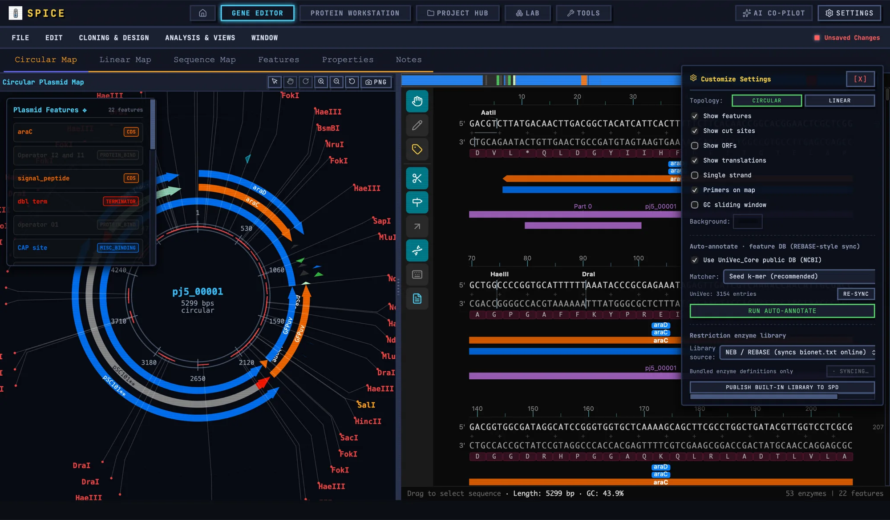

# Customize Settings

Customize Settings is a compact floating panel in the Gene Editor that gathers the map display options, the auto-annotation database controls, and the restriction-enzyme library source in one place. It changes how the open sequence is drawn and which libraries annotate it; it is separate from the application-wide [Settings workspace](../../settings.md), which handles themes, language, integrations, and updates.

**Menu:** **Window → Customize Settings** · **Type:** floating panel

## What it does

The panel is divided into three groups. The display group holds a **Topology** pair of **Circular** and **Linear** buttons, checkboxes for **Show features**, **Show cut sites**, **Show ORFs**, **Show translations**, **Single strand**, **Primers on map**, and **GC sliding window**, and a **Background** colour picker preloaded with `#070a12`. The auto-annotate group adds the **Use UniVec_Core public DB (NCBI)** checkbox, a **Matcher** choice of seed k-mer, Smith-Waterman, or exact substring, the current UniVec entry count with a **Re-sync** button, and a **Run auto-annotate** button. The enzyme group sets the **Library source** to NEB/REBASE or the SPD public catalogue, shows the active library and entry count, offers **Sync library**, and adds **Publish built-in library to SPD**.

Every control applies at once; there is no Apply or OK step. The display values are saved in the browser's `localStorage` under `spice_gene_view_config`, while the UniVec, matcher, and enzyme-source choices use their own keys. The panel is 300 px wide, limited to 540 px high with a scrolling body, can be dragged by its header, and closes with **[X]**.

## How to use

1. Open a sequence in the [Gene Editor](../../gene-editor.md).
2. Choose **Window → Customize Settings**. The panel opens at the upper right.
3. Choose **Circular** or **Linear** to change the main map view, and tick the display options you want to see on the map.
4. Pick a **Background** colour; the workbench behind the map updates immediately.
5. For annotation, choose a **Matcher**, leave the UniVec option enabled if you want the public vector library searched, press **Re-sync** to refresh that library, then press **Run auto-annotate**.
6. For enzymes, choose a **Library source** and press **Sync library** to refresh it; the status line reports the applied source, count, and time. Use **Publish built-in library to SPD** only when you intend to seed the SPD catalogue.
7. Close the panel with **[X]**. Changes remain in force and most are restored on the next launch.

## Inputs and results

| Field | Meaning |
|---|---|
| Topology | **Circular** or **Linear** switches the main map tab; it does not add, remove, or reorder bases. |
| Show features | Draws the annotated feature overlays on the map. |
| Show cut sites | Draws cut positions for the currently selected restriction enzymes. |
| Show ORFs | Draws open reading frames on the map. |
| Show translations | Shows translated sequence frames. |
| Single strand | Displays one strand instead of the default double-strand view. |
| Primers on map | Draws primers as map features. |
| GC sliding window | Opens or closes the GC panel; it does not run the analysis. |
| Background | Colour picker for the gene workbench background; default `#070a12`. |
| Use UniVec_Core public DB (NCBI) | Adds the synced UniVec vector library to the auto-annotate search set. |
| Matcher | Seed k-mer (recommended), Smith-Waterman (native Tauri only), or exact substring. |
| UniVec count and Re-sync | Number of loaded UniVec entries; **Re-sync** downloads the library again. |
| Run auto-annotate | Scans the sequence, adds new features, and records a history snapshot and log line. |
| Library source | NEB/REBASE downloads `bionet.txt`; SPD public catalogue exports its enzyme list. |
| Active status and Sync library | Shows `Active: source - count entries - time`, or `Bundled enzyme definitions only`; **Sync library** applies the chosen source. |
| Publish built-in library to SPD | Uploads the bundled cutter catalogue to SPD with live progress, skipping unsupported entries. |

## Limits and caveats

The panel is not the application-wide Settings workspace. Appearance themes, interface language, accounts, tokens, updates, and other global preferences are not here, and the colour theme selector remains in the **Window** menu rather than in this panel.

The **Topology** buttons are view state, not a sequence edit, and the choice is not part of the `.spiceg` payload. It does affect the circular flag used when exporting GenBank, EMBL, or FASTA. Reloading a document can therefore open it with a different topology from the one you last viewed.

Display preferences are stored per installation and browser profile, not in the project file, so they are not shared with collaborators. The panel's open state and the GC panel's visibility are not persisted, and the enzyme status is repopulated by the startup sync rather than restored. There is no reset-to-defaults control.

The **GC sliding window** checkbox only shows or hides that panel. The analysis runs from the GC panel's own **Recalculate** button or from the **Analysis & Views → GC Sliding Window** menu item, so ticking the box alone leaves the result area empty.

Smith-Waterman requires the native Tauri runtime. In a browser context the annotation falls back to the k-mer matcher even when Smith-Waterman is selected, and the selection only affects the next **Run auto-annotate** run. Re-running annotation skips features already present at the same name and span, so it is idempotent but never removes or corrects existing features.

Library synchronisation needs network access. A failed NEB/REBASE sync falls back to a cached copy when one exists; an empty SPD catalogue falls back to REBASE. The applied status then names the source actually used, which may not match the selected source.

Publishing to SPD requires an API token configured in the application Settings under Public Integrations. The upload is idempotent by enzyme name, runs four requests at a time, and skips entries whose cut geometry or ambiguity cannot be expressed in SPD's `cutPosition` grammar. Progress appears in the button label and the final toast reports created, already present, failed, and skipped counts.

This panel and the **Edit History Tree** share the same default upper-right position, so opening both stacks them until one is dragged. Neither panel has a keyboard shortcut.

## Related

- [Gene Editor](../../gene-editor.md)
- [Settings workspace](../../settings.md)
