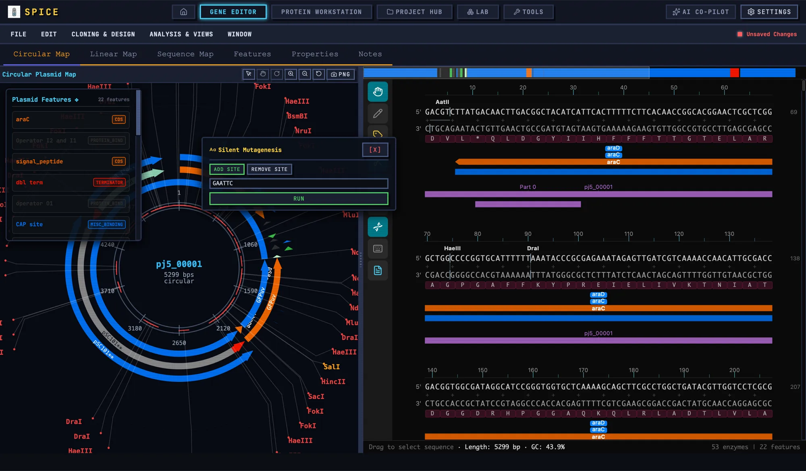

# Silent Mutagenesis

Silent Mutagenesis designs synonymous codon changes that add or remove a short DNA recognition sequence in the open Gene Editor document. It lists the base changes and the codons before and after each change, and applies them to the sequence only when you press **Apply mutations**. The sequence length and, within the assumed reading frame, the encoded protein are unchanged.

**Menu:** **Cloning & Design → Silent Mutagenesis** · **Type:** floating panel

## What it does

The panel takes the current Gene Editor sequence, converts it to upper case, and removes any characters other than A, C, G, T, and N. It treats the first base of that cleaned sequence as the start of a codon and reads in triplets from there; the reading frame is fixed and is not taken from any annotated feature.

In **Add site** mode the panel scans the sequence from the first base towards the end and tests each position where the entered recognition sequence could fit. A position qualifies only if every base of the site can be produced by changing one base of its codon to another codon for the same amino acid, and at least one base must actually change. The first qualifying position is used, the changes are applied to a working copy, and the search stops. In **Remove site** mode the panel looks for the exact recognition sequence on the forward strand. It tries to replace each base of that occurrence with a synonymous codon base, moving to later occurrences if the first cannot be changed, and stops at the first one it can disrupt.

Running the search only produces a preview: the panel shows the mutation count and one line per base change in the form `pos <n>: <codon> -> <codon>`. Positions are zero-based offsets in the cleaned sequence. **Apply mutations** then replaces the Gene Editor sequence with the modified copy and records an edit-history entry. The sequence is not written anywhere else, and no annotation coordinates change because the length is unchanged.

## How to use

1. Open **Cloning & Design → Silent Mutagenesis**; the panel floats over the editor and can be dragged by its header.
2. Choose **Add site** or **Remove site**.
3. Enter the recognition sequence to add or remove, for example `GAATTC` for an EcoRI site. Enter bases only, in the orientation you want matched.
4. Click **Run**.
5. If a design is found, read the mutation count and the codon changes in the result box.
6. Click **Apply mutations** to write the modified sequence into the Gene Editor and close the result by using the panel's **[X]** when finished.
7. If the result box reports that the site cannot be added or removed, change the site or the sequence and run again. The panel can be left open while you edit.

## Inputs and results

| Field | Meaning |
|---|---|
| Add site / Remove site | Selects whether the search introduces the sequence or disrupts an existing occurrence. |
| Recognition sequence | The literal DNA string to add or remove; matched in the orientation entered. |
| Run | Searches the current sequence and replaces any previous preview with a new one. |
| Mutation count | Number of individual base changes in the previewed design, not the number of codons. |
| Mutation lines | `pos <n>: <codon> -> <codon>` for each changed base, with the codon before and after the change. |
| Apply mutations | Replaces the Gene Editor sequence with the previewed sequence and adds a history entry. |
| Warnings | Explains why no design was found, for example that no synonymous change exists in the current reading frame. |

## Limits and caveats

The reading frame always starts at the first base of the sequence and cannot be changed in the panel. If the coding region starts later or sits on the reverse strand, a change reported as silent may not be silent in the real coding sequence, and a site that looks impossible may be possible in another frame.

The site is matched literally and only in the orientation entered. Ambiguous IUPAC codes are not expanded, and the reverse complement of the site is not searched, so a site present only on the other strand is not found for removal. For addition, the panel stops at the first workable position and does not check whether the site already exists elsewhere; running it again on the same sequence can add a second copy. For removal, only the occurrence being edited is guaranteed to be disrupted, and a single run does not remove every copy.

The panel does not consult restriction-enzyme annotations, check that the new site is unique, or test whether the change alters another overlapping site or feature. It only checks that the codon replacements are synonymous in the fixed frame. Synonymy is tested one base at a time, so a site that spans more than one base of the same codon is not re-validated as a complete codon after all of its bases are combined.

## Related

- [Gene Editor](../../gene-editor.md)
- [Reverse Translate](reverse-translate.md)
