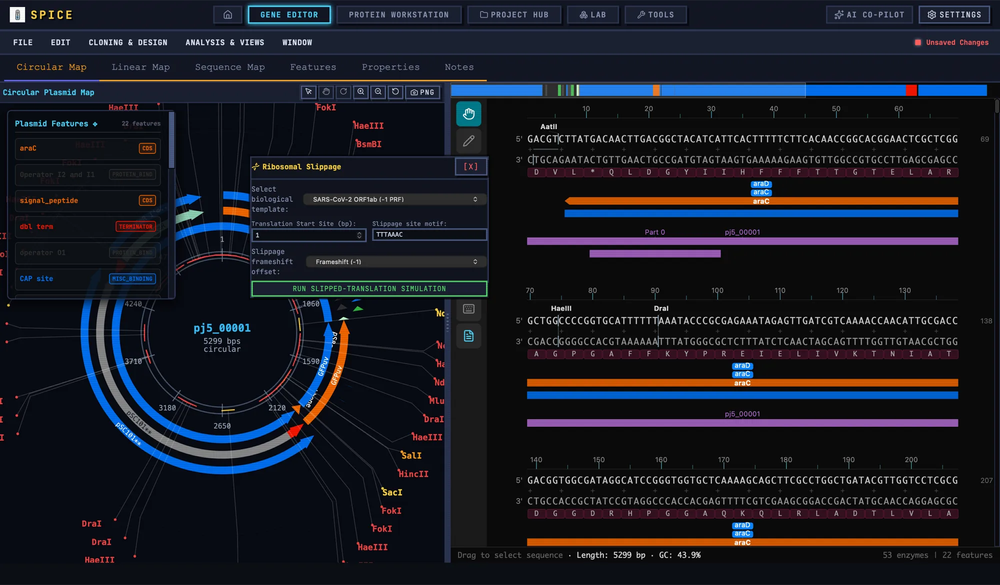

# Ribosomal Slippage

The Ribosomal Slippage panel simulates a programmed ribosomal frameshift at a chosen slippery-site motif. It translates the sequence in the original frame up to the site, applies a −1, +1, −2, or +2 base shift, and continues translation to the next stop codon. It reports the pre-slippage and post-slippage peptides, their combined length, and a text alignment of the junction. Nothing is applied to the sequence.

**Menu:** **Cloning & Design → Ribosomal Slippage** · **Type:** floating panel

## What it does

- Offers three presets that fill the start position, motif, and shift: SARS-CoV-2 ORF1ab (−1 PRF), HIV-1 Gag-Pol (−1 PRF), and *E. coli* Release Factor 2 (+1 PRF).
- Searches the forward strand for the first exact occurrence of the motif at or after the chosen start position. If there is no match there, it falls back to the first occurrence anywhere in the sequence.
- Translates from the start position in triplets up to the site. Translation ends silently at a stop codon.
- Translates the whole codons contained in the motif, counted as `floor(motif length / 3)`, and appends them to the pre-slippage peptide.
- Applies the selected shift to the base index after those codons, then translates the shifted frame to the next stop codon or the end of the sequence.
- Reports the motif sequence and its one-based position, the length of each peptide, the combined length, and an alignment sketch showing the original and shifted frames.
- **Copy results** copies a plain-text report containing the template name, site, position, combined length, and protein sequence.
- **Create feature** adds a `PRF Fusion (motif)` CDS from the slippery site to the end of the sequence, on the forward strand.

## How to use

1. Open **Cloning & Design → Ribosomal Slippage**. The panel floats over the Gene Editor and can be dragged by its header.
2. Choose a template from **Select biological template**, or fill the fields manually. Choosing a preset overwrites the start position, motif, and shift; the choice itself is not stored.
3. Set **Translation Start Site (bp)** to the one-based base where translation begins.
4. Enter the DNA motif in **Slippage site motif**; matching is case-insensitive and `U` is read as `T`.
5. Choose a value from **Slippage frameshift offset**: −1, +1, −2, or +2 bases.
6. Click **Run slipped-translation simulation**.
7. Read the site, peptide lengths, combined length, and alignment sketch.
8. Use **Copy results** for a text summary, or **Create feature** to mark the region on the map.
9. Close the panel with **[X]**. The inputs and last result remain in panel state until they are changed or the page is reloaded.

## Inputs and results

| Field | Meaning |
|---|---|
| Select biological template | Preset chooser for the three named examples; sets start to 1 and fills the motif and shift. |
| Translation Start Site (bp) | One-based base where the original-frame translation begins. |
| Slippage site motif | Exact DNA substring searched on the forward strand; case-insensitive, with `U` treated as `T`. |
| Slippage frameshift offset | Raw base shift applied after the translated site codons: −1, +1, −2, or +2. |
| Slippery site | Motif sequence found and its one-based start position. |
| Pre-slippage peptide | Amino acids translated before the shift, reported in aa. |
| Post-slippage peptide | Amino acids translated after the shift up to the first stop codon, reported in aa. |
| Full fusion protein | Combined pre-slippage and post-slippage length, reported in aa. |
| Alignment sketch | Original and shifted frames around the cut point, with the junction amino acids and the new start position. |

The English result card labels the post-slippage row **Sliding Point Location** and the combined row **Slippage point location**. Both lines show amino-acid counts, not coordinates.

## Limits and caveats

Only the forward strand is searched and translated. There is no reverse-complement option, no choice among multiple motif occurrences, and no way to enter an explicit slippery-site position even though the underlying routine accepts one.

Inputs are not validated. An empty motif matches at the start position and runs with no site codons; an out-of-range or negative start position is accepted and produces a truncated or unexpected translation; a motif that is absent from the sequence fails with a **Slippery site not found** error and no result.

A motif whose length is not a multiple of 3 has its trailing one or two bases skipped before the shift. This applies to the presets: `TTTAAAC` contributes two codons and `CTTTG` contributes one. The search also reports the motif's exact start, while translation resumes from the codon boundary at or before it, so an unaligned motif can have its translated codons begin one or two bases earlier than the reported site.

A stop codon before the site ends the pre-slippage peptide without aborting the run; site and post-slippage translation continue from that codon boundary. The output is therefore not a strict single-ORF translation, and the internal stop counter is not displayed. A stop codon in the shifted frame ends the post-slippage peptide and is omitted from the sequence.

The shift is a fixed base offset, not a frameshift probability. There is no slippery-site model, pseudoknot handling, or efficiency estimate, and the exact-substring match does not establish that a real programmed frameshift occurs. Treat the output as a sequence-design sketch.

**Create feature** starts at the slippery site rather than the translation start, runs to the end of the sequence, and is always forward-strand. It changes the feature list only; it does not alter the sequence or save the document. The copied report does not include the alignment sketch.

## Related

- [Gene Editor](../../gene-editor.md)
- [Fusion Frame Check](fusion-check.md)
