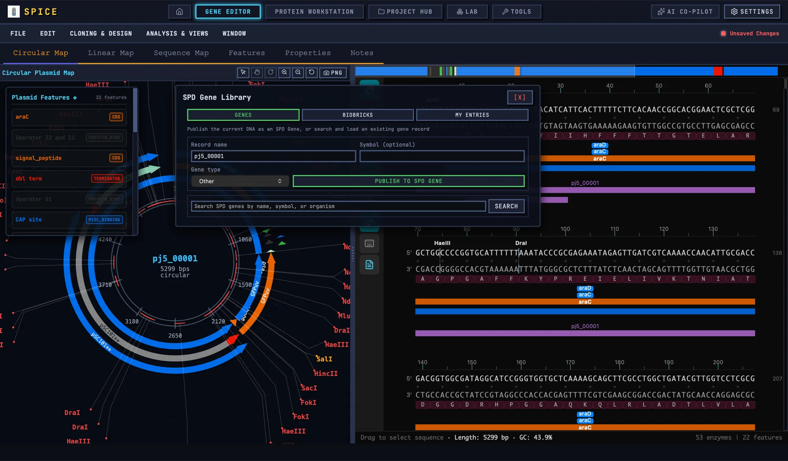

# SPD Gene Library

The SPD Gene Library connects the Gene Editor to the SPICE Protein Database (SPD) at `d-api.spicebio.top`. It publishes the sequence in the editor as a gene or BioBrick record, searches public records, and loads a record back into the canvas with its annotated regions. The panel has three tabs — Genes, BioBricks and My entries — and it does not depend on the open project: with no project configured it still reads and writes the current editor workspace.

**Menu:** **File → SPD Gene Library** · **Type:** floating panel

## What it does

- **Genes** publishes the current DNA with its feature table as an SPD gene (one gene record plus up to 500 DNA region rows), searches genes by name, symbol or organism, and loads a record and its regions into the editor.
- **BioBricks** publishes the current DNA as a reusable part, lists or searches parts with an optional part-type filter, and loads a part as a linear sequence with one full-length feature.
- **My entries** reads the personal activity feed for the configured token — submissions and batch imports merged, de-duplicated and sorted newest first — and can load its gene, BioBrick and vector rows.

Publishing genes or BioBricks and reading My entries need the Universal API Token described below. Search and load work without one and send no `Authorization` header when no token is stored.

## How to use

1. Open **Settings → Public Integrations**, paste an SPD Universal API Token and click **Verify token**. This step is only needed for publishing and My entries.
2. In the Gene Editor, open **File → SPD Gene Library**.
3. On **Genes**, check the prefilled **Record name** (taken from the editor document name), optionally add a **Symbol**, choose a **Gene type**, and click **Publish to SPD Gene**.
4. Confirm the returned gene ID. **Details** opens the inspector for that record. Its **Links** section lists the record's SPD relations — the gene's encoded protein, a sequence's fold or parent, a fold's environment and model — and any target the inspector can open is clickable; sequence records also show their **Lineage** chain. The message reports how many regions were written and any features that could not be mapped; duplicate counts appear in the activity log.
5. To retrieve a record, type a query and press Enter or click **Search**; leave the field empty and search to list genes. The result list is hydrated with one graph read, so a gene row also shows the protein it encodes after an arrow (→). Choose **Load** on a row to replace the editor sequence, name and features.
6. On **BioBricks**, the list loads when the tab is first opened. Publish from the top form, or choose a part type and search; **Load** opens the part in linear view.
7. On **My entries**, click **Refresh** to fetch the feed; **Load** is offered only for gene, BioBrick and vector rows.

## Inputs and results

| Field | Meaning |
|---|---|
| Current sequence | The editor's DNA sequence, published as `dnaSequence`; an empty sequence aborts with "The workspace has no DNA sequence". |
| Record name | Gene record name. Prefilled from the editor name and required. |
| Symbol | Optional gene symbol, sent as `symbol`. |
| Gene type | `protein_coding`, `non_coding`, `regulatory` or `other`; defaults to Other and is sent as `geneType`. |
| Feature table | Mapped to SPD region rows with 1-based inclusive coordinates; unsupported types become `other`. |
| Search query | Gene search by name, symbol or organism; an empty query lists genes. |
| BioBrick part type | Promoter, RBS, terminator, CDS, protein tag, regulatory or other; also used as the list filter. |
| My entries list | Authored submissions and imports for the token user, with entity type, status and date. |

## Limits and caveats

- A missing token is detected only by the publish actions and My entries. They stop with "Configure an API token in Settings → Public Integrations first"; search, list and load proceed and rely on public read access.
- The token is read from `localStorage` (`spice_spd_api_token`) and is stored unencrypted. Every SPD feature in the app shares it.
- Features are skipped, not clamped, when their coordinates are not integers, fall outside the sequence, are reversed, or cross the origin of a circular sequence. At most 500 regions are sent.
- If the gene is created but its region batch fails, the gene stays published and the panel reports the region error; it does not retry automatically.
- RNA-only records load as their DNA equivalent (U converted to T), and the success message notes the RNA source. A record with neither DNA nor RNA sequence is rejected.
- Gene and BioBrick searches return at most 50 rows. The encoded-protein hint on gene rows comes from one extra graph read covering the first 25 rows; if that read fails the rows still list without the hint.
- Loading a gene or BioBrick replaces the current editor content and adds one history entry. The panel never edits or deletes an existing SPD record.
- The panel does not save anything into the open project; publishing uploads the workspace sequence, and loading changes only the current editor document.

## Related

- [Gene Editor](../../gene-editor.md)
- [Project Collections](collections.md)
