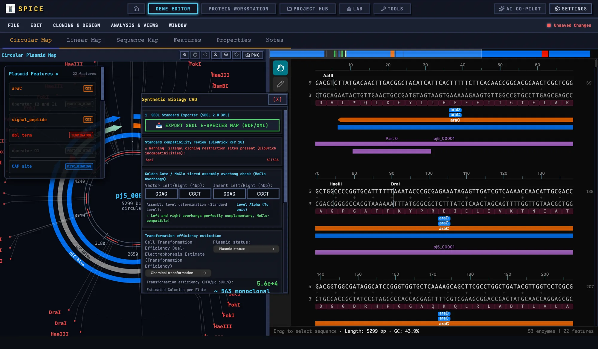

# Synthetic Biology CAD

Synthetic Biology CAD collects the standards, assembly, transformation, and registry tasks for a construct in one floating panel. It stacks seven sections: SBOL export, a BioBrick RFC 10 scan, a MoClo overhang check, a transformation-efficiency estimate, genetic-circuit inference, copy-number and biosecurity screening, and a SynBioHub part search. Everything except the registry search runs locally from the current plasmid name, sequence, and feature list.

**Menu:** **Analysis & Views → Synthetic Biology CAD** · **Type:** floating panel

## What it does

Each section reads the open document and returns a fixed result. The panel edits nothing until you use a control: **Export** downloads an SBOL file, and **Import** on a registry result appends a part to the sequence and adds a matching feature.

The standards checks are local. BioBrick scanning looks for four restriction sites in the sequence; MoClo compares the four overhangs you type. The copy-number, biosecurity, and catalogue sections use the databases installed through **Settings → Gene Editor → Database syncs**: AMRFinderPlus for exact catalogue matches, Commec for profile-HMM biorisk matches. Only the registry section contacts SynBioHub, and it has a small offline sample library.

## How to use

1. Open the panel from **Analysis & Views → Synthetic Biology CAD** with the construct you want to review.
2. Click **Export SBOL e-Species Map (RDF/XML)** to download a document named after the plasmid. A toast and log entry confirm the export.
3. Read the BioBrick section. If it reports illegal sites, the matching enzyme and sequence are listed.
4. Enter the four 4-character MoClo overhangs: vector left and right, then insert left and right. Defaults are `GGAG` and `CGCT`.
5. Choose the transformation method and plasmid state. The efficiency and colony estimate update immediately.
6. Scroll down for inferred circuit gates, replicon and copy number, biosecurity flags, and catalogue matches.
7. Search the registry by typing a part ID or keyword, optionally choosing a type filter, then pressing Enter or **Search**. Use **Import** to append a returned part.
8. Drag the header to move the panel and click `[X]` to close it.

## Inputs and results

| Field | Meaning |
|---|---|
| SBOL export | Downloads `<plasmid>_sbol2.xml`, a minimal SBOL 2.0 RDF/XML document containing the sequence and one annotation per feature. |
| BioBrick scan | Exact matches for EcoRI, XbaI, SpeI, and PstI. Compatible only when none are present. |
| Vector / insert overhangs | Four 4-character strings. Vector left is compared with insert left, and vector right with insert right. |
| Assembly level | Named from the vector overhangs: Alpha, Promoter, CDS, Terminator, or Beta. Other pairs are reported as a custom level. |
| Transformation method | Chemical transformation uses a 1e7 baseline; electroporation uses 1e9. |
| Plasmid state | Supercoiled or ligation product. A ligation product multiplies the baseline by 0.01. |
| Transformation efficiency | Rounded CFU/µg after an exponential size discount above 3 kb. |
| Estimated colonies | One hundredth of the efficiency, assuming a 10 ng load. |
| Circuit gate | INPUT for a promoter followed within 200 bp by a CDS; NOT for a `lac` promoter followed by a `tetR` CDS. |
| Replicon and copy number | First feature whose type or name resembles an origin; pUC, ColE1/pMB1, pBR322, pSC101, and p15A have fixed profiles. |
| Biosecurity level | LOW or HIGH_RISK from Commec profile matches. Each hit names the model, its category, and the matched span. A must-flag model is HIGH_RISK, and the level is N/A while the database is not installed. |
| Catalogue screening | SAFE or MATCH DETECTED from exact AMRFinderPlus matches, reporting the catalogue gene, its class, and the matched motif. The catalogue includes virulence and stress-response entries alongside resistance genes; the class column says which one a hit is. The level is SAMPLE while the bundled five-signature sample is in use, and N/A when no catalogue is loaded. |
| Registry query | SynBioHub public iGEM collection, up to 30 results. The type filter applies to a type inferred from the description. |
| Imported part | The part sequence is appended to the end of the plasmid and a feature is added from the previous sequence length to the new end. |

## Limits and caveats

- Only registry search and sequence fetch use the network. When the registry is unreachable, search falls back to four sample parts with a warning toast. Import then uses built-in sequences for those four IDs and the literal `ATGC` for any other ID, which is appended as if the fetch had succeeded.
- The SBOL output is a hand-built minimal document. It uses fixed placeholder URIs, sets every annotation to inline orientation, writes the sequence in lower case, and is not validated against SBOL rules.
- The MoClo check compares overhang strings only. It does not scan restriction sites, simulate a digest, or produce an assembly product.
- The transformation estimate is a generic closed-form model keyed to method, plasmid state, and size. It is not strain- or protocol-specific, and the pUC19 label is a unit reference rather than a prediction for that plasmid.
- Circuit inference uses names and adjacency. Every promoter followed within 200 bp by a CDS becomes an INPUT entry, and a `lac` promoter followed by a `tetR` CDS also produces a NOT entry, so both entries can appear for the same pair.
- Copy number is chosen from the first feature whose type is `ori` or whose name contains `ori` or `origin`. If none match, a default ColE1-like profile is shown rather than a warning.
- Biosecurity results are profile-HMM matches, and catalogue results are exact matches in the AMRFinderPlus catalogue. Neither is an identity search. A hit does not prove a functional element, and a miss is not clearance; neither section replaces institutional biosafety review.
- Biorisk screening needs the Commec database installed in Settings. Without it the section reports no biorisk hits rather than a clean result.
- The five bundled AMR signatures are shorter than a gene. The diagnostics panel marks them as short signatures, so confirm any hit before acting on it.
- SBOL export is refused while a blocking biosecurity match is unresolved. The Diagnostics panel names the match and its span; local editing stays available.
- Registry part type is inferred from description keywords, defaulting to CDS, so the filter and the imported feature type can misclassify a part.
- Results render `BBa_` before the part identifier, so the offline sample IDs, which already begin with `BBa_`, show the prefix twice.
- The panel is a fixed-width window with a 480 px maximum height and internal scrolling.

## Related

- [Gene Editor](../../gene-editor.md)
- [Advanced Genomics Tools](genomics.md)
