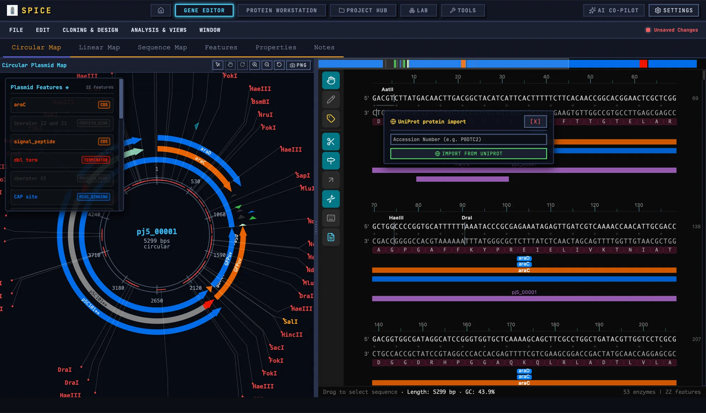

# UniProt Import

Fetches a UniProtKB entry as GFF3 and loads its amino-acid sequence and feature annotations into the Gene Editor workspace, so an annotated protein can be brought in without downloading and importing files by hand.

**Menu:** **File → Import from UniProt...** · **Type:** floating panel

## What it does

The panel requests `https://rest.uniprot.org/uniprotkb/<ACCESSION>.gff`, using the accession you type converted to upper case. It parses the GFF3 feature rows and the `##FASTA` block, replaces the current sequence and annotations with the parsed protein, switches the workspace to the Linear Map tab, records an import entry in the edit history, writes a summary to the Activity Log, and closes itself on success. The request is unauthenticated and needs a network connection.

## How to use

1. Open **File → Import from UniProt...**.
2. Type a UniProtKB accession such as `P0DTC2` and press **Enter** or click **Import from UniProt**.
3. Wait for the button to leave its **Searching in...** state. On success the panel closes and the protein appears in the workspace.
4. Check the imported name, length, and feature count in the Activity Log, then inspect the annotations on the Features tab.

## Inputs and results

| Field | Meaning |
|---|---|
| Accession Number | UniProtKB accession used as the URL path; it is trimmed and upper-cased and must name an entry, not a gene or free-text search. |
| Import from UniProt | Submits the request; the button is disabled and shows a spinning icon while the request is in flight. |
| Sequence | The amino-acid sequence assembled from the `##FASTA` block. |
| Name | Protein name taken from the FASTA header, falling back to `<ACCESSION>_protein` when the header has no usable name. |
| Features | GFF3 rows converted to annotations; `CHAIN`, `TRANSMEM`, `SIGNAL`, `ACTIVE_SITE`, `DOMAIN`, `HELIX`, and `STRAND` receive preset colours, and other feature types are retained with their own names. |

## Limits and caveats

- The field accepts an accession only. Gene names, free text, and UniProt entry names are not resolved, and a malformed path returns an HTTP error.
- The import replaces the current document without a confirmation prompt. Save or export first if you need the previous sequence.
- A non-OK HTTP status or a network failure produces an error toast titled **UniProt Import failed**, writes a failure entry to the Activity Log, and leaves the document unchanged; the panel stays open so the accession can be corrected.
- If the response has no `##FASTA` block, the parser synthesises a placeholder sequence from the highest feature coordinate. Treat such an import as annotations-only rather than as a real protein sequence.
- Every fetched feature is stored, including feature types that have no preset colour; the Features tab is the reliable place to review what arrived.
- The importer uses the public UniProt REST service with no API key and no rate-limit handling, so repeated bulk imports may be throttled by the service.
- There is no progress indicator beyond the button state, and no size limit other than what the service and the network impose.
- The import is written to the Edit History Tree as an import step named after the accession, and the panel closes only after the workspace has been updated.
- Features are renumbered sequentially as `uniprot_1`, `uniprot_2`, and so on; their original GFF identifiers are not preserved.

## Related

- [Gene Editor](../../gene-editor.md)
- [External BLAST](blast.md)
