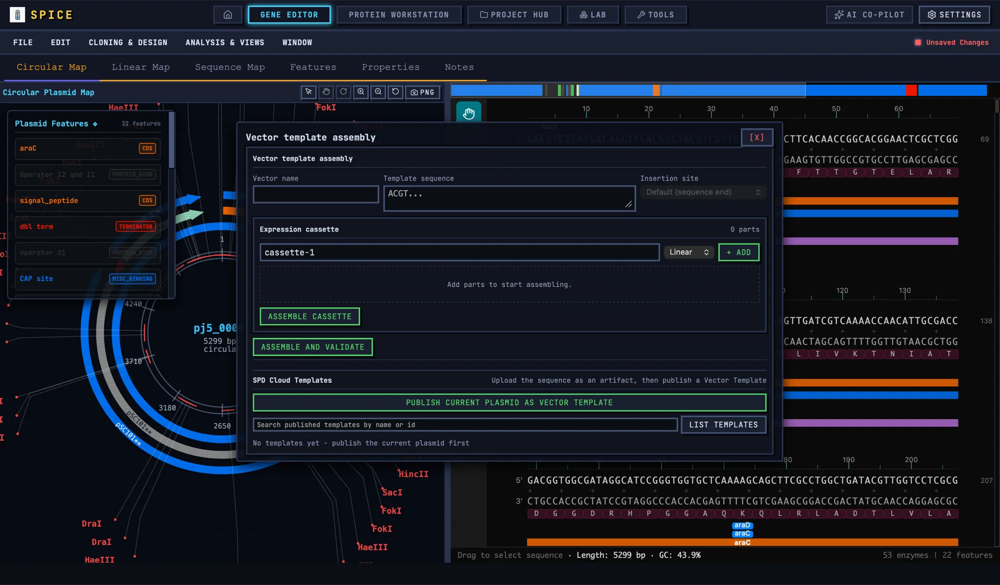

# Vector Template Assembly

Vector Template Assembly places an expression cassette into a vector backbone, reports the combined construct, and validates it against structural rules. It embeds the Expression Cassette Builder for the insert and adds an SPD section for publishing and loading shared vector templates. Local assembly and validation run offline; the SPD section uses the configured server and requires an API token.

**Menu:** **Cloning & Design → Vector template assembly** · **Type:** floating panel

## What it does

- Holds a vector template with a name, backbone sequence, topology, feature list, insertion sites, and optional validation rules.
- Embeds the cassette builder, so parts use the same roles, orientation control, and `ACGTN` rule as the standalone builder.
- On **Assemble and validate**, joins the cassette to the backbone, shifts backbone features that lie after the insertion point, adds the cassette features, and records the combined part ranges.
- Runs local validation where rules are present: required features retained, preserved features retained, forbidden restriction-site motifs absent, and CDS parts divisible by three when reading-frame checking is enabled.
- Publishes the current gene workbench plasmid as an SPD Vector Template, and lists or loads published templates.
- Applies the assembled construct to the Gene Editor, replacing the canvas sequence and features.

## How to use

1. Open **Cloning & Design → Vector template assembly**.
2. Enter the vector name. Paste the backbone DNA into **Template sequence**, or load a template from SPD (step 6), which fills the name, sequence, topology, features, and insertion sites.
3. Choose an **Insertion site** if the template defines any. The menu is disabled when it has none.
4. Build the insert in the embedded **Expression cassette** section: **+ Add**, then set name, role, orientation, and sequence for each part. The inner **Assemble cassette** button only assembles that cassette and shows its length; the outer action is what produces the vector.
5. Click **Assemble and validate**. The row reports combined length and feature count, and the validation box lists issues or `No structural or sequence issues found.`
6. To work with SPD, use **SPD Cloud Templates**: **Publish current plasmid as Vector Template**, search and **List templates**, then **Load** a row or open its **Details**.
7. Confirm the result on the Gene Editor canvas. Assembly overwrites the current sequence and annotations.

## Inputs and results

| Field | Meaning |
|---|---|
| Vector name | Template name, shown in the header and used when publishing. |
| Template sequence | Backbone DNA; uppercased, and restricted to `ACGTN` when assembling. |
| Insertion site | `Default (sequence end)` or an ID from the template's insertion sites. |
| Assemble and validate | Builds the vector, runs local validation, and applies the result. |
| Result line | Combined sequence length and projected feature count. |
| Validation box | `Validation passed` or `Needs attention`, with each issue listed. |
| Publish current plasmid as Vector Template | Uploads the live workbench sequence and features to SPD. |
| Search / List templates | Queries published templates by name or ID. |
| Load / Details | Loads a template into the workbench and panel, or opens the SPD inspector. |

## Limits and caveats

- A fresh panel has no backbone: the default template is empty, and there is no built-in vector library. The name and backbone are editable; features and insertion sites are not editable here and arrive with a loaded SPD template or from page state.
- If the template has no insertion sites, assembly returns the cassette alone and ignores the backbone sequence you typed. Use a template that defines at least one insertion site, which in this panel means an SPD-loaded template.
- Without site boundary fields, the cassette is appended at the end of the backbone sequence. A site carrying `beforeFeatureId` or `afterFeatureId` inserts at that boundary; SPD sites carry a position only, so they resolve to the end.
- `Default (sequence end)` selects the first defined insertion site when one exists rather than forcing the end of the sequence. For SPD templates that still resolves to the end.
- Local validation is driven entirely by the template's `validationRules`. The panel's own fields provide no rules, and the SPD load path copies only name, sequence, topology, features, and insertion sites, so unless a caller supplies rules the local check reports no issues.
- Local validation checks structure, not sequence quality: codon usage, GC content, repeats, and off-target effects are not evaluated.
- **Publish** ignores the panel's template fields and publishes the live gene workbench instead: its sequence, its features, and one insertion site per selected enzyme at that enzyme's first cut position. The sequence must be at least 20 nt after non-IUPAC characters are stripped.
- SPD actions require an API token configured in Settings → Public Integrations. Publishing also reports the server's own validation checks, which are separate from the local result.
- Assembly overwrites the whole workbench document. Use undo or the history tree if the current sequence was not saved.

## Related

- [Gene Editor](../../gene-editor.md)
- [Expression Cassette Builder](expression-cassette.md)
