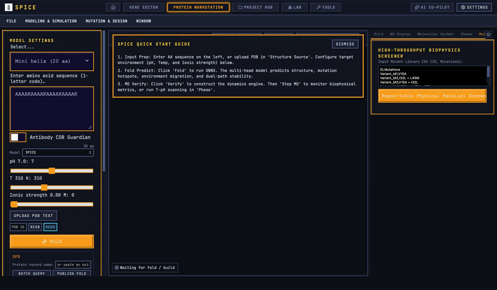

# Batch Design Screening Panel

The Batch Design Screening Panel applies a CSV library of mutations to the current sequence and scores every variant with sequence-level biophysics at the pH and temperature set in **Model Settings**. It reports a stability score, net charge, hydrophobicity, helix propensity, and disorder for each variant, and marks variants as passing or failing at a fixed score threshold. The scores are heuristic predictions and hypotheses, not measured stabilities.

**Menu:** **Window → Batch Design Screening Panel** · **Type:** right-hand work pane (not a floating window)

## What it does

The panel parses the text area as CSV and uses the current clean sequence from **Model Settings** as the template; no fold is needed. Each non-empty row must contain at least two comma-separated fields: the first field is the variant ID, and the remaining fields are joined and read as the mutation list. A mutation list may separate substitutions with commas, plus signs, semicolons, or whitespace, so `V15A + I32L` and `V15A,I32L` are equivalent. Each substitution must be a one-letter wild-type residue, a 1-based position, and a one-letter replacement (a `*` is also accepted as the replacement). The substitution is applied only when the wild-type letter matches the base sequence at that position; otherwise it is skipped without a message. Lines beginning with `#`, `ID,`, or `id,` are treated as comments or headers and ignored.

Each parsed variant is evaluated once, in CSV order, by the local biophysics evaluator. GRAVY is the mean Kyte–Doolittle hydrophobicity. Net charge is calculated with Henderson–Hasselbalch side-chain and terminal terms at the pH slider value, while the table's **Net Charge (pH7)** column is recalculated at pH 7.0. Helix percentage comes from Chou–Fasman propensities, and disorder is the fraction of residues classified as disordered by a 21-residue FoldIndex window. The stability score starts at 70 and subtracts 8 when the absolute net charge exceeds 10, 12 when GRAVY exceeds 0.5, and 5 when GRAVY is below −1.5; it adds 0.35 for each percentage point of helix content above 25, subtracts 22 times the disorder fraction, and subtracts 1.1 per degree Celsius above 42 °C. The result is clamped to 0–100 and rounded. Ionic strength is passed to the evaluator but does not affect the result.

Rows are not re-ordered: the table follows the CSV order and is therefore not a ranking. Each row moves from pending to running to a final state, with success when the score is 50 or above and failure below 50. The staged progress is display-only; all variants are scored in one synchronous pass before the rows are animated, and the button's "Rayon-Tokio" label does not indicate that a parallel or simulation-backed run occurs.

## How to use

1. Enter or load the base protein sequence in **Model Settings** and set the pH and temperature sliders.
2. Open **Window → Batch Design Screening Panel**.
3. Edit the text area, keeping the `ID,Mutations` header and one variant per line.
4. Click **Run Rayon-Tokio Physical Parallel Screening**.
5. Read each row's stability score and supporting metrics; green status indicates a score of 50 or more, red indicates a lower score.
6. Adjust the sequence or environment sliders and run again to compare a revised library; the table is replaced on each run.
7. Apply promising single substitutions in the Mutation Analysis Panel or edit the sequence directly.

## Inputs and results

| Field | Meaning |
|---|---|
| Base sequence | Template taken from the sequence box in Model Settings; screening stops with an error when it is empty. |
| Mutant Library CSV | Text area for `ID,Mutations` rows; prefilled with a five-variant sample on first use. |
| Run Rayon-Tokio Physical Parallel Screening | Parses the CSV and scores every variant with the current pH and temperature. |
| ID | Variant identifier from the first CSV field, shown unchanged. |
| Mutations | Mutation list as parsed, with quotes removed. |
| Stability Score | Composite 0–100 heuristic score; values of exactly 0 are displayed as a dash. |
| Net Charge (pH7) | Net charge at pH 7.0 in elementary charges, suffixed `e`. |
| GRAVY Hydrophobicity | Mean Kyte–Doolittle score; values above 0.5 are highlighted. |
| Helix % | Percentage of residues assigned to helix by Chou–Fasman prediction. |
| Disorder | Fraction of residues classed as disordered by a 21-residue FoldIndex calculation. |
| Status | Pending, running, pass (score 50 or above), or fail (below 50). |

## Limits and caveats

CSV parsing is permissive but silent. A malformed substitution token, a position outside the sequence, or a wild-type letter that does not match the template is skipped, so a variant can be scored with only some of its intended changes, or with none of them. A row with no applicable substitutions is still evaluated as a copy of the base sequence. Duplicate IDs are allowed, and rows with fewer than two comma-separated fields are dropped without a message. The header is recognised only after trimming, and any other preamble line is treated as a variant row and likely dropped by the two-field rule.

The stability score is a fixed-weight sequence heuristic, not a ΔΔG, melting temperature, expression yield, or binding affinity. It ignores ionic strength despite accepting it, applies the temperature penalty only above 42 °C, and uses whole-sequence averages rather than structural context. Changing the pH or temperature sliders does not update existing rows; re-run the screening to score the library under the new conditions. Passing the 50-point threshold means only that the heuristic score cleared it, and every result remains a hypothesis requiring experimental validation.

The panel does not fold structures, run molecular dynamics, dock ligands, or compare variants statistically. There is no sorting, filtering, export, or per-variant detail view, and the progress animation does not reflect real parallel execution. Because the table is replaced on every run, keep a copy of any library worth reusing outside the panel.

## Related

- [Protein Workstation](../../protein-workstation.md)
- [Mutation Analysis Panel](mutation.md)
