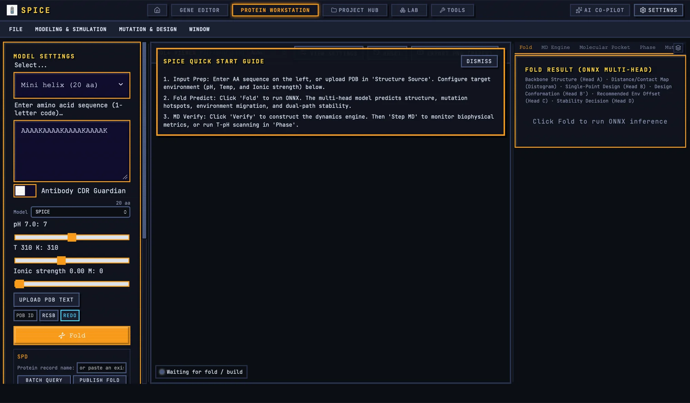

# Structure Folding Panel

The Structure Folding Panel reports the most recent fold of the current sequence: its length, model identifier, run time, expected pairwise distance matrix, contact map, and the model's two-path stability confidence. The fold itself is started from the left-hand model settings; this pane reads and exports the result. Because the SPICE model is still under development, every number here is exploratory and none of it is publication-ready.

**Menu:** **Window → Structure Folding Panel** · **Type:** right-hand work pane (not a floating window)

## What it does

A fold produces several outputs at once: a Cα backbone (Head A), a predicted distance matrix and contact map, a mutant trace and substitution profile (Head B and B'), an environmental offset (Head C), and a two-path stability decision (Head D). This pane shows the structural matrices and the Head D decision for the current result. The mutation rows, mutant trace, and offset are covered by the Mutation Analysis Panel.

The pane reports the folded length, the model file name or remote model identifier, and the latency reported by the provider. The distance heatmap is the expected Cα–Cα distance matrix from the distogram head, coloured over 3–48 Å. The contact map is the predicted contact-probability matrix, captioned at the Cα–Cα threshold of 8 Å. The two confidence bars are Head D's path A (no mutation) and path B (mutated) values, taken directly from the fold output and shown as percentages.

When the result came from the Demo provider, a **Demo data** chip marks it as synthetic. When a fold fails, an error alert replaces the result. When no fold has been run, the pane shows **Click Fold to run ONNX inference**.

## How to use

1. Enter a sequence in **Model Settings** on the left, or load an example, a PDB file, or an RCSB entry.
2. Choose a **Model** provider: the bundled local SPICE ensemble, SWISS-MODEL, or Demo.
3. Set pH, temperature, and ionic strength with the sliders. These are disabled when the selected provider does not accept environmental conditions.
4. For SWISS-MODEL, paste an API token in the field that appears below the provider selector.
5. Click **Fold** and wait for submission, polling, and fetching to finish; the current phase is shown below the button.
6. Open **Window → Structure Folding Panel** and read the result. This tab is the default on first visit.
7. Use **Export mmCIF** to save the Head A trace, or **Export complete** to save a `.spicep` package with the current sequence, environment, coordinates, and any MD history.

## Inputs and results

| Field | Meaning |
|---|---|
| Model | Provider selector in the left column: local SPICE ONNX ensemble, remote SWISS-MODEL, or Demo. |
| pH, Temperature, Ionic strength | Fold conditions sent with the request; ignored or disabled for providers that do not accept them. |
| API token | SWISS-MODEL only; stored locally in the browser profile. |
| Length | Number of residues in the fold output. |
| Model | File name of the local model, or the remote model identifier. |
| Latency | Run time reported by the provider in milliseconds; remote jobs report elapsed job time. |
| Expected distance matrix (Å) | Distogram prediction of pairwise Cα distance, coloured from 3 to 48 Å. |
| Contact map (Cα < 8 Å) | Predicted contact probability for each residue pair. |
| Path A (no mutation) | Head D confidence for the unmutated path, as a percentage bar. |
| Path B (mutated) | Head D confidence for the mutated path, as a percentage bar. |
| Export mmCIF | Writes the Head A Cα trace to `spice_fold_L<length>.cif`. |
| Export complete | Writes a `.spicep` package containing the current structure and status data. |
| Demo data | Marks a synthetic result produced by the Demo provider. |

## Limits and caveats

The model is under active development. Fold coordinates, distance and contact matrices, and both confidence bars are model predictions, not experimental measurements. The panel exposes no accuracy, validation, or error estimate, so the values cannot support a publication claim on their own. Treat them as hypotheses to be tested against experimental structures and assays.

Changing the sequence, environment sliders, or provider does not clear or recompute the displayed result; run **Fold** again before reading the pane. The result lives only in this route: navigating away discards it unless you export a `.spicep` file or the page is attached to a SPICE project document, in which case the payload is written back to that document. The sequence, environment, provider choice, token, and active tab are kept in local storage, but the fold output itself is not.

Provider differences matter. SWISS-MODEL does not accept pH, temperature, or ionic strength, so those sliders are disabled and the structure is predicted under the service's default conditions. Its distogram and contact map are calculated from the returned Cα coordinates rather than predicted, its mutant trace mirrors the reference trace, and its two bars are QMEAN divided by 100 and sequence coverage, despite the Path A and Path B labels. Demo output, and a local backend fallback to synthetic data, are not physical predictions.

## Related

- [Protein Workstation](../../protein-workstation.md)
- [Dynamics Trajectory Panel](md.md)
- [Mutation Analysis Panel](mutation.md)
