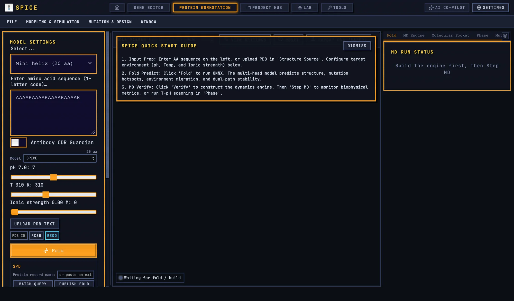

# Dynamics Trajectory Panel

The Dynamics Trajectory Panel reports the latest batch of molecular-dynamics steps from the built SPICE engine. It shows the potential-energy trace, a two-dimensional conformation landscape, the kinetic temperature, per-step cost, clamping count, and five biophysical stability metrics. The dynamics are exploratory and the numbers are not publication-ready.

**Menu:** **Window → Dynamics Trajectory Panel** · **Type:** right-hand work pane (not a floating window)

## What it does

The panel displays the result of the most recent **Step MD** call, not a continuously running simulation. Each call advances the engine by the number of steps set in **SPICE Engine settings** and returns a short energy history together with the final coordinates. The status block reports the cumulative step count, simulated time, kinetic temperature, average milliseconds per step, and the number of coordinates clamped on the last step. A kinetic temperature more than 25 K away from the temperature slider is highlighted as a warning.

The potential trajectory plots the returned `U` history in kcal/mol. The conformation landscape plots the current radius of gyration against Cα RMSD. The engine supplies the final RMSD and Rg for each batch; the pane appends ten linearly interpolated points per call so the line looks continuous, and keeps only the last 120 points. The shaded basin and cliff ellipses and their labels are fixed decorations, not computed classifications of the trajectory.

Five metric bars show potential fluctuation (m1), radius-of-gyration drift (m2), secondary-structure loss (m3), clash fraction (m4), and surface charge mismatch (m5). Each bar prints the value in exponential notation and a threshold, and turns green when the value is below that threshold: 1.0e+5, 0.15, 0.55, 0.05, and 1.0 respectively. A crash replaces the metrics with a terminal-state alert.

The layers button in the tab header pins a compact monitor below the pane, repeating the last step, temperature, potential energy, and metric values while you work in other tabs. The pin state is remembered between visits.

## How to use

1. Fold a sequence or import a PDB structure, then click **Verify** in **SPICE Engine settings**; this builds the engine and runs one step.
2. Alternatively, open this pane before a build and click **Build Full-Atom Engine**. That button builds the engine only; you still need **Step MD** afterwards.
3. Set **Steps** between 1 and 100. Optionally enable **Bias force** and set its amplitude from 0 to 1, or enable **Equilibrate** for the next build.
4. Optionally enter **ΔT** and **ΔpH** to shift the engine's target conditions for that step batch.
5. Click **Step MD** in **SPICE Engine settings** (or **Modeling → Run Full-Atom Thermal MD Simulation**).
6. Read the status block, energy trace, landscape, and metric bars.
7. Click the layers button in the tab header to pin the biophysics monitor.
8. Export via **File → Export SPICE Status (.spicep)** to keep the step history, landscape points, and metrics; an attached project document also receives the payload automatically.

## Inputs and results

| Field | Meaning |
|---|---|
| Steps | Number of MD steps requested per **Step MD** call; 1 to 100, default 20. |
| Bias force | Enables a random 16-component force action on each step. |
| Force amplitude | Scale of that random action, 0 to 1 in steps of 0.05. |
| Equilibrate | Build option that runs the engine's equilibration stage on the next build, not on each step. |
| ΔT, ΔpH | Per-call shift applied inside the engine before stepping. |
| Build Full-Atom Engine | Builds the engine from the current fold coordinates; shown in the empty pane. |
| Step MD | Advances the engine and refreshes every field in this pane. |
| Steps | Cumulative step count reported by the engine. |
| Time | Simulated picoseconds accumulated by the engine. |
| t_kin | Kinetic temperature in kelvin, highlighted when it differs from the slider by more than 25 K. |
| per step | Average wall-clock milliseconds per requested step for this batch. |
| clamp | Coordinates clamped on the last step; shown in red when non-zero. |
| Potential trajectory U | Per-step potential energy in kcal/mol for this batch. |
| Conformation landscape | Rg against Cα RMSD, with display interpolation and a 120-point cap. |
| m1 to m5 | Potential fluctuation, Rg drift, secondary-structure loss, clash fraction, and surface charge mismatch. |
| Crashed | Terminal instability reported by the engine; metrics are withheld for that batch. |

## Limits and caveats

The SPICE model is under development. The engine is a learned coarse-grained model, the runs are short, and no result here is publication-ready. The metrics are heuristic diagnostics with fixed thresholds, not measured observables, free energies, or validated quality scores. A green bar means only that the fixed threshold was cleared.

The landscape is partly illustrative. RMSD is computed against the last fold's Cα trace when one exists; when the engine was built from an imported PDB with no fold result, placeholder RMSD and Rg values are used. The ten intermediate points per call are linear interpolation, not stored intermediate conformations, and the basin and cliff labels do not react to the data. The energy trace covers only the current batch, so earlier batches are visible only through the pinned monitor or an export.

ΔT and ΔpH change the engine's working conditions for the step call but do not update the pH and temperature sliders or the saved environment, so the t_kin warning is still compared with the pre-shift slider value. The bias action is a random kick, not a controlled pulling or steered-MD protocol. **Equilibrate** takes effect on the next build, and **Build Full-Atom Engine** does not step the engine by itself.

Results are held in memory only. Leaving the route discards them unless you export a `.spicep` file or the page is writing to a project document. The exported package carries the step count, time, potential history, landscape points, and metrics, but its global and pocket quality fields are fixed placeholders rather than computed values. The sequence, environment, active tab, and pin state are kept in local storage; the trajectory is not.

## Related

- [Protein Workstation](../../protein-workstation.md)
- [Structure Folding Panel](folding.md)
- [Environmental Phase Panel](phase.md)
